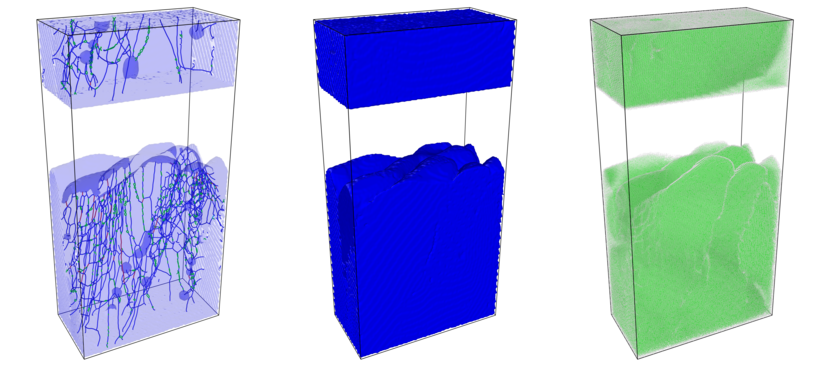

<!--
SPDX-FileCopyrightText: 2026 VTT Technical Research Centre of Finland Ltd
SPDX-License-Identifier: AGPL-3.0-or-later
-->

# OpenPFC

[![Release][releases-img]][releases-url]
[![DOI][doi-badge-img]][doi-badge-url]
[![Website][site-badge-img]][site-badge-url]
[![CI][ci-badge-img]][ci-badge-url]
[![License][license-img]][license-url]



OpenPFC is an open-source C++20 framework for partial differential equations
on structured, periodic grids. Spectral and finite-difference methods share
one MPI domain decomposition, distributed transforms use HeFFTe, and the same
models run on CPUs and on NVIDIA and AMD GPUs. Use it as a library or through
the configuration-driven applications in `apps/`. Phase-field crystal models
are where the project began.

**Everything else is on the website: <https://vtt-propertune.github.io/OpenPFC/>**

| | |
|---|---|
| What it does | [Capabilities][capabilities] · [Applications][applications] · [Performance][performance] |
| Get started | [Installing OpenPFC][install] · [15-minute start][fifteen] · [Quick start][quickstart] |
| Look things up | [Handbook][docs] · [C++ API reference][api] · [Release notes][releases-url] |
| Decide | [When not to use OpenPFC][fit] |
| Cite | [How to cite OpenPFC][cite] |

## Build and run

OpenPFC needs a consistent compiler, MPI and HeFFTe stack; the
[installation guide][install] covers workstations and the supported clusters.
Then:

```bash
cmake -DCMAKE_BUILD_TYPE=Release -S . -B build
cmake --build build -j"$(nproc)"
cd build
mpirun -n 1 ./examples/05_simulator
```

## Use the installed library

An installed OpenPFC exports `OpenPFC::openpfc`. The package resolves the MPI
C and C++ components, so a consumer enables both languages:

```cmake
cmake_minimum_required(VERSION 3.21)
project(my_sim LANGUAGES C CXX)

find_package(OpenPFC 0.5 CONFIG REQUIRED)

add_executable(my_sim main.cpp)
target_link_libraries(my_sim PRIVATE OpenPFC::openpfc)
```

## Contributing

See [CONTRIBUTING.md](CONTRIBUTING.md) for tests, CI and commit conventions.

## Citation

If OpenPFC contributes to published work, cite T. Pinomaa, J. Aho,
J. Suviranta, P. Jreidini, N. Provatas and A. Laukkanen, "OpenPFC: an
open-source framework for high performance 3D phase field crystal
simulations", *Modelling and Simulation in Materials Science and
Engineering*, 2024, doi:[10.1088/1361-651X/ad269e](https://doi.org/10.1088/1361-651X/ad269e).
BibTeX and version DOIs are on the [citation page][cite].

## License

AGPL-3.0-or-later; see [LICENSE.md](LICENSE.md).

[site]: https://vtt-propertune.github.io/OpenPFC/
[capabilities]: https://vtt-propertune.github.io/OpenPFC/capabilities/
[applications]: https://vtt-propertune.github.io/OpenPFC/applications/
[performance]: https://vtt-propertune.github.io/OpenPFC/performance/
[cite]: https://vtt-propertune.github.io/OpenPFC/cite/
[docs]: https://vtt-propertune.github.io/OpenPFC/docs/
[install]: https://vtt-propertune.github.io/OpenPFC/docs/project/install/
[fifteen]: https://vtt-propertune.github.io/OpenPFC/docs/start_here_15_minutes/
[quickstart]: https://vtt-propertune.github.io/OpenPFC/docs/quickstart/
[fit]: https://vtt-propertune.github.io/OpenPFC/docs/when_not_to_use_openpfc/
[api]: https://vtt-propertune.github.io/OpenPFC/docs/api/
[releases-img]: https://img.shields.io/github/v/release/VTT-ProperTune/OpenPFC
[releases-url]: https://github.com/VTT-ProperTune/OpenPFC/releases/latest
[doi-badge-img]: https://zenodo.org/badge/DOI/10.5281/zenodo.10799936.svg
[doi-badge-url]: https://zenodo.org/doi/10.5281/zenodo.10799935
[site-badge-img]: https://github.com/VTT-ProperTune/OpenPFC/actions/workflows/docs.yml/badge.svg
[site-badge-url]: https://github.com/VTT-ProperTune/OpenPFC/actions/workflows/docs.yml
[ci-badge-img]: https://github.com/ahojukka5/OpenPFC/actions/workflows/ci.yml/badge.svg
[ci-badge-url]: https://github.com/ahojukka5/OpenPFC/actions/workflows/ci.yml
[license-img]: https://img.shields.io/github/license/VTT-ProperTune/OpenPFC
[license-url]: https://github.com/VTT-ProperTune/OpenPFC/blob/master/LICENSE.md
