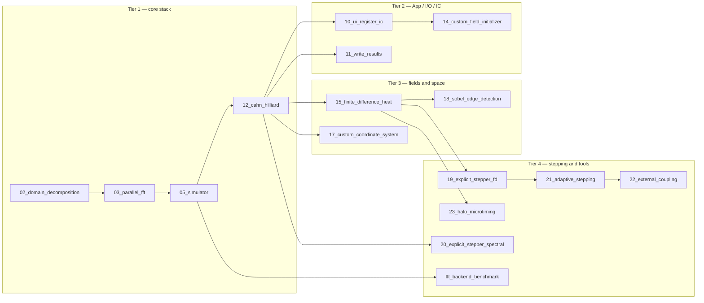

<!--
SPDX-FileCopyrightText: 2026 VTT Technical Research Centre of Finland Ltd
SPDX-License-Identifier: AGPL-3.0-or-later
-->

# Examples catalog

Executables are built when `OpenPFC_BUILD_EXAMPLES=ON` (default). Output directory is typically `<build>/examples/` (exact path depends on the CMake generator and multi-config toolchains).

Prerequisites: Most examples need MPI and a working HeFFTe-linked OpenPFC build. Run with at least `mpirun -n 1` unless the source states otherwise.

This page is for lookup and for choosing the next small executable to read. If you want a guided first run, use [`../start_here_15_minutes.md`](../start_here_15_minutes.md). If you want the examples in a teaching sequence with more context, use [`../tutorials/spectral_examples_sequence.md`](../tutorials/spectral_examples_sequence.md). The catalog below stays compact so it can answer “what is this target for?” without becoming another tutorial.

## Curriculum (suggested order)

Use the first tier on your first day, then branch by topic. The original numbered examples remain available. The [Quarto lessons](https://vtt-propertune.github.io/OpenPFC/learn/) now provide a thematic mathematical sequence; the heat implementations for targets 19 and 20 live under `examples/heat/`.

| Tier | Executables | Focus |
|------|-------------|-------|
| **1 — Core stack** | `02_domain_decomposition`, `03_parallel_fft`, `05_simulator`, `12_cahn_hilliard` | `Domain`, distributed FFT, simulation driver, conserved nonlinear model |
| **2 — Wiring** | `10_ui_register_ic`, `11_write_results`, `14_custom_field_initializer`, `diffusion_model_with_custom_initial_condition` | Registration, writers, custom initial conditions |
| **3 — Fields and space** | `15_finite_difference_heat`, `17_custom_coordinate_system`, `18_sobel_edge_detection` | Halos, coordinate interpretation, stencil-like field operations |
| **4 — Stepping and tools** | `19_explicit_stepper_fd`, `20_explicit_stepper_spectral`, `21_adaptive_stepping`, `22_external_coupling`, `23_halo_microtiming`, `24_adaptive_etd`, `fft_backend_benchmark`, `profiling_timer_report` | Explicit/adaptive steppers, external coupling, halo microtiming, ETD step doubling, backend comparison, profiling |

Narrative companion: [`getting_started/01-basics/README.md`](../getting_started/01-basics/README.md). Ordered source examples: [`api_examples_walkthrough.md`](api_examples_walkthrough.md).

## Full catalog

| Executable | Source | What it demonstrates |
|------------|--------|----------------------|
| `fft_backend_benchmark` | `fourier/backend-buffers/model.cpp` | Host/device FFT buffers, complete round-trip fields and collective participation |
| `02_domain_decomposition` | `geometry/decomposition/model.cpp` | `Domain`, `Decomposition`, MPI |
| `03_parallel_fft` | `fourier/round-trip/model.cpp` | Distributed FFT (HeFFTe) |
| `04_diffusion_model` | `heat/implicit-euler/model.cpp` | Backward-Euler spectral heat with a complete-field oracle |
| `05_simulator` | `heat/driver-hooks/model.cpp` | Native time-loop hooks and the actual final clock interval |
| `06_multi_index` | `geometry/index-boxes/model.cpp` | `Box3i` iteration and `to_linear` |
| `07_array` | `geometry/field-storage/model.cpp` | Array helpers |
| `08_discrete_fields` | `geometry/coordinate-fields/model.cpp` | `pfc::data::Field` with domain geometry |
| `09_parallel_fft_high_level` | `fourier/field-layout/model.cpp` | Higher-level FFT usage |
| `10_ui_register_ic` | `initialization/catalog/model.cpp` | UI and field-modifier registration patterns |
| `11_write_results` | `output/vtk-series/model.cpp` | Native VTK/binary snapshot series and metadata |
| `12_cahn_hilliard` | `phase-fields/cahn-hilliard/model.cpp` | Conserved Cahn–Hilliard physics through native ETD1 |
| `fft_kspace_helpers_example` | `fourier/symbols/model.cpp` | physical wave numbers, Nyquist conventions and heat symbols |
| `mpi_worker` | `parallel/hello/model.cpp` | MPI worker pattern |
| `mpi_worker_inside_class` | `parallel/session/model.cpp` | MPI worker encapsulated in a class |
| `mpi_timers` | `diagnostics/mpi-timing/model.cpp` | MPI timing |
| `profiling_timer_report` | `diagnostics/profiling/model.cpp` | Profiling and timer reporting |
| `time` | `integration/output-clock/model.cpp` | Time-stepping utilities |
| `write_results` | `output/binary-field/model.cpp` | Results I/O variant |
| `diffusion_model_with_custom_initial_condition` | `heat/gaussian-pulse/model.cpp` | Diffusion with a custom initial condition |
| `json_read` | `configuration/session/model.cpp` | Native JSON/TOML settings loader and spectral session factory |
| `world_helpers_example` | `geometry/grid-spacing/model.cpp` | `Domain` compatibility helpers |
| `world_query_helpers_example` | `geometry/domain-queries/model.cpp` | `Domain` query helpers (volume, dimensionality, bounds) |
| `14_custom_field_initializer` | `initialization/patterns/model.cpp` | Custom field initializer |
| `15_finite_difference_heat` | `heat/separated-halos/model.cpp` | Finite-difference heat with separated halos; see [`halo_exchange.md`](../concepts/halo_exchange.md) |
| `16_strong_types_demo` | `geometry/strong-arguments/model.cpp` | Strongly typed domain inputs |
| `17_custom_coordinate_system` | `geometry/polar-patterns/model.cpp` | Polar-defined Cartesian field and smooth origin limits |
| `18_sobel_edge_detection` | `differentiation/stencils/model.cpp` | Sobel-style field operations and edge detection |
| `world_strong_types_example` | `geometry/anisotropic-grid/model.cpp` | Strong types with `Domain` compatibility helpers |
| `19_explicit_stepper_fd` | `heat/finite-differences/model.cpp` | Explicit stepping with finite-difference operators |
| `20_explicit_stepper_spectral` | `heat/fourier/model.cpp` | Explicit stepping with spectral operators |
| `21_adaptive_stepping` | `integration/adaptive-rk/model.cpp` | Adaptive Bogacki–Shampine 3(2) with `Time` attempt transactions |
| `22_external_coupling` | `coupling/host-orchestrator/model.cpp` | Mock FEM loop: `FieldHandle` export, `clip_attempt_dt`, FieldModifier-shaped source |
| `23_halo_microtiming` | `diagnostics/halo-frames/model.cpp` | Timed `HaloExchange` loop; schema-v2 JSON (`--cuda` / `--hip` / `--full`) |
| `24_adaptive_etd` | `integration/adaptive-etd/model.cpp` | ETD1 step doubling: a heat mode against `exp(-k²t)`, then `∂t ψ = ∇²ψ − ψ³` with the memoryless controller |
| `nonlinear_spectral_course` | `phase-fields/alias-free-cubic/model.cpp` | Periodic Allen–Cahn: cubic Galerkin projection with `4K < N`, ETD2, independent convolution/RK4 checks and MPI ownership output |
| `ns2d_vorticity` | `flow/vorticity/model.cpp` | Issue #21 2-D vorticity–streamfunction Navier–Stokes (CPU). See [`../../examples/ns2d_vorticity/README.md`](../../examples/ns2d_vorticity/README.md). |
| `ns2d_spatial_refine` | `flow/spatial-refinement/model.cpp` | Fixed-timestep grid refinement, common-grid Fourier restriction and a time-step control |
| `ns2d_temporal_refine` | `flow/temporal-refinement/model.cpp` | Fixed-grid IFRK4 time refinement with a finest-step reference and guarded order estimates |
| `ns2d_flux_balance` | `flow/flux-balance/model.cpp` | Analytic Fourier face integrals, modal divergence and nodal-quadrature comparisons |
| `mhd2d` | `flow/magnetohydrodynamics/model.cpp` | Issue #23 2-D incompressible visco-resistive MHD (CPU). See the retained flow README. |
| `taylor_green3d` | `flow/taylor-green-3d/model.cpp` | Issue #229 3-D periodic Taylor–Green on the Fourier velocity (CPU). See [`../../examples/taylor_green3d/README.md`](../../examples/taylor_green3d/README.md). |
| `periodic_differentiation` | `differentiation/periodic/model.cpp` | Analytic derivative, second/fourth-order FD, and Fourier convergence |
| `heat_exponential` | `heat/exponential/model.cpp` | Exact linear Fourier propagator; compare spatial and temporal error |
| `cardinal_interpolation` | `interpolation/cardinal/model.cpp` | Trefethen program 3: cardinal sinc reconstruction of three sampled signals |
| `periodic_collocation` | `differentiation/collocation/model.cpp` | Cotangent collocation matrix versus FFT derivatives of a hat and analytic profile |
| `spectral_smoothness` | `differentiation/smoothness/model.cpp` | Trefethen programs 2 and 7: regularity, aliasing and matrix/FFT convergence |
| `variable_transport` | `waves/variable-transport/model.cpp` | Trefethen program 6, Fourier/leapfrog transport, startup and exact characteristics |
| `stability_regions` | `integration/stability/model.cpp` | Trefethen program 25, public RK tableaus and multistep root-locus references |
| `polynomial_interpolation` | `polynomials/interpolation/model.cpp` | Program 9: Runge interpolation on equally spaced and Chebyshev nodes |
| `polynomial_nodal_polynomials` | `polynomials/nodal-polynomials/model.cpp` | Program 10: nodal products and complex-plane magnitude contours |
| `polynomial_differentiation` | `polynomials/differentiation/model.cpp` | Programs 11 and 18: Chebyshev matrix versus public LocalFFT coefficients |
| `polynomial_regularity` | `polynomials/regularity/model.cpp` | Program 12: four regularity classes on Chebyshev grids |
| `polynomial_integration` | `polynomials/integration/model.cpp` | Program 30: antiderivative boundary problem with native GMRES |
| `polynomial_boundary_values` | `polynomials/boundary-values/model.cpp` | Programs 13, 32 and 33: homogeneous, lifted and mixed boundary conditions with GMRES |
| `polynomial_nonlinear_boundary` | `polynomials/nonlinear-boundary/model.cpp` | Program 14 adapted to native Newton–GMRES, checked by an analytic solution and scalar root |
| `runtime_coupled_fields` | `coupling/runtime-fields/model.cpp` | Runtime field RK4 staging, two-field oscillator and exact recurrence |
| `coupled_fields_example` | `coupling/fixed-tuples/model.cpp` | Two requested gradient packs, full halos and tuple scatter |
| `symbolic_coupled_rhs` | `coupling/symbolic-rhs/model.cpp` | Generated pointwise algebra with exact derivative inputs and a shared source |
| `checkpoint_restart` | `output/checkpoint-restart/model.cpp` | Collective checkpoint publication, fresh-state restart and discrete trajectory equivalence |
| `first_domain` | `geometry/first-domain/model.cpp` | Give the grid a physical meaning |
| `harmonic_oscillator` | `fourier/harmonic-oscillator/model.cpp` | Find the energies of a harmonic trap |
| `mathieu_spectrum` | `fourier/mathieu/model.cpp` | A periodic potential splits eigenvalues |
| `chebyshev_eigenmodes` | `polynomials/eigenmodes/model.cpp` | A grid has its own spectrum |
| `airy_eigenproblem` | `polynomials/airy/model.cpp` | A zero weight is a constraint |
| `membrane_eigenmodes` | `polynomials/membrane/model.cpp` | An asymmetric potential reshapes a membrane mode |
| `square_poisson` | `polynomials/poisson-square/model.cpp` | Solve a square without a giant Kronecker matrix |
| `square_helmholtz` | `polynomials/helmholtz-square/model.cpp` | A wave number can make a solve delicate |
| `square_laplace` | `polynomials/laplace-square/model.cpp` | Let the boundary drive the interior |
| `gamma_contour` | `quadrature/complex-contour/model.cpp` | A contour turns an integral into a sum |
| `multigrid_poisson` | `elliptic/multigrid/model.cpp` | Use a hierarchy to correct different scales |
| `clamped_beam` | `polynomials/clamped-beam/model.cpp` | Build the clamped ends into the trial function |
| `clamped_plate` | `polynomials/clamped-plate/model.cpp` | Twenty-five clamped square-plate modes and repeated frequencies |
| `davies_pseudospectra` | `polynomials/pseudospectra/model.cpp` | Small singular values reveal spectral sensitivity |
| `orr_sommerfeld` | `polynomials/orr-sommerfeld/model.cpp` | Complex generalized Orr–Sommerfeld spectra and near-neutral growth |
| `disk_eigenmodes` | `polynomials/disk-modes/model.cpp` | Fourier/Chebyshev disk modes and Bessel frequency checks |
| `disk_poisson` | `polynomials/poisson-disk/model.cpp` | Polar Poisson, manufactured fields and regularity-limited convergence |
| `chebyshev_wave_line` | `waves/chebyshev-line/model.cpp` | A pulse meets the end of an interval |
| `chebyshev_wave_square` | `waves/chebyshev-square/model.cpp` | Let a wave spread across a square |
| `mixed_wave_tank` | `waves/mixed-tank/model.cpp` | A wave tank has two kinds of edge |
| `kdv_integrating_factor` | `waves/kdv/model.cpp` | Let dispersion evolve exactly between stages |
| `allen_cahn_fixed` | `polynomials/allen-cahn-fixed/model.cpp` | Lift the boundary before evolving the interior |
| `allen_cahn_driven` | `polynomials/allen-cahn-driven/model.cpp` | A changing wall must enter the next derivative |

## Flow prototype notes

The flow lessons retain their prototype executable names, build locations and
verification criteria. Operational and historical notes remain in the
[2-D flow README](../../examples/ns2d_vorticity/README.md) and
[3-D Taylor–Green README](../../examples/taylor_green3d/README.md).
Application admission follows the [apps policy](../../apps/README.md#what-belongs-here).

## Sources not built by default

The former `01_hello_world/world.cpp` is now the runnable `first_domain` lesson under `examples/geometry/first-domain/`.

## See also

- [`quickstart.md`](../quickstart.md) — suggested order for the first runs
- [`getting_started/01-basics/README.md`](../getting_started/01-basics/README.md) — narrative tutorial
- [`api_examples_walkthrough.md`](api_examples_walkthrough.md) — `docs/api/examples/` in reading order
- [`tutorials/README.md`](../tutorials/README.md) — VTK, HeFFTe `plan_options`, spectral sequence, and other guided workflows
- [API example source tree](https://github.com/VTT-ProperTune/OpenPFC/tree/master/docs/api/examples)
