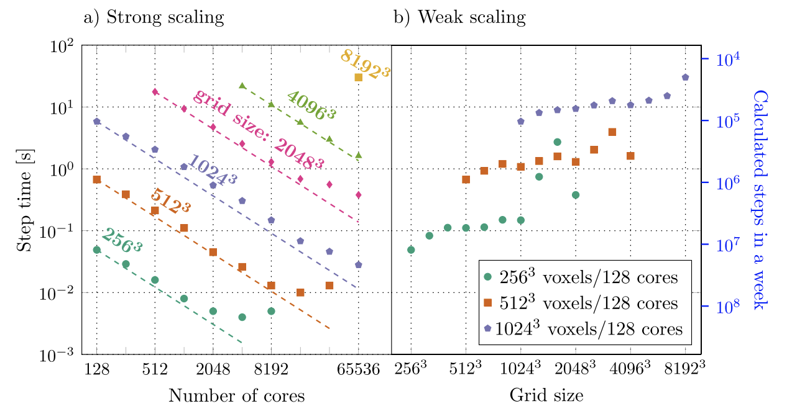

<!--
SPDX-FileCopyrightText: 2026 VTT Technical Research Centre of Finland Ltd
SPDX-License-Identifier: AGPL-3.0-or-later
-->

# Showcase

This page ties **figures** you may see in the repository or publications to **runnable** entry points. Build and run instructions: [`quickstart.md`](../quickstart.md), [`applications.md`](applications.md), [`examples_catalog.md`](../reference/examples_catalog.md).

## Tungsten solidification (3D)

*Representative large-scale solidification and defect structure (from project materials; parameters may differ from your run).*

| Property | Description |
|---|---|
| **Typical app** | [`apps/tungsten`](../../apps/tungsten/README.md) — JSON/TOML configs under [`apps/tungsten/inputs_json/`](../../apps/tungsten/inputs_json/README.md) |
| **Concepts** | 3D PFC, boundary conditions, MPI + spectral FFT stack |
| **Further reading** | [`app_pipeline.md`](app_pipeline.md), [`io_results.md`](io_results.md), root [`README.md`](../../README.md) (science overview) |

## Scalability (strong / weak scaling)

*Illustrative scaling results; your hardware and problem size will differ.*

| Property | Description |
|---|---|
| **Context** | HPC campaigns on large grids (e.g. LUMI); see [`performance_profiling.md`](../hpc/performance_profiling.md), [`lumi_slurm/README.md`](../lumi_slurm/README.md) |
| **Typical app** | Same [`apps/tungsten`](../../apps/tungsten/README.md) family with performance-oriented inputs (e.g. `tungsten_performance.json` — large domain; use for scaling studies, not first debug) |

## Cahn–Hilliard–style dynamics

| Property | Description |
|---|---|
| **Materials app** | [`apps/cahn_hilliard`](../../apps/cahn_hilliard/README.md) — Fe–Cr-like spinodal, JSON, VTK of `c` |
| **Teaching example** | `examples/12_cahn_hilliard` (see [`examples_catalog.md`](../reference/examples_catalog.md)) |
| **VTK / ParaView** | Walkthrough: [`tutorials/vtk_paraview_workflow.md`](../tutorials/vtk_paraview_workflow.md) |
| **Concepts** | Fourth-order spectral ETD; $k^4$ is a multiply |

## Surface diffusion (nanoscale smoothing)

| Property | Description |
|---|---|
| **Runnable** | [`apps/surface_diffusion`](../../apps/surface_diffusion/README.md) — `smoothing.json` |
| **VTK** | height `h` under `results/surface_diffusion/`; mode-amplitude recipe in the app README |
| **Concepts** | Linear Mullins $k^4$; $h_k(t)=h_k(0)\exp(-B\vert k\vert ^4 t)$ |

## Kawahara (capillary–gravity waves)

| Property | Description |
|---|---|
| **Runnable** | [`apps/kawahara`](../../apps/kawahara/README.md) — `pulse.json` |
| **VTK** | height `u` under `results/kawahara/` |
| **Concepts** | Odd-order dispersion $\omega=\beta k^3+\gamma k^5$; $k^4$ here rotates, it does not damp |

## EHD film (flexible plate)

| Property | Description |
|---|---|
| **Runnable** | [`apps/ehd_film`](../../apps/ehd_film/README.md) — `relaxation.json` |
| **VTK** | gap `h` under `results/ehd_film/` |
| **Concepts** | Sixth-order bending lubrication; $\lambda=-M_0 B k^6$ |

## Gradient elasticity (size-dependent defects)

| Property | Description |
|---|---|
| **Runnable** | [`apps/gradient_elasticity`](../../apps/gradient_elasticity/README.md) — `inclusion.json` / `gaussian.json` |
| **VTK** | inclusion `g` and displacement `ux`,`uy` under `results/gradient_elasticity/` |
| **Concepts** | Helmholtz–Navier $(1-\ell^2\nabla^2)L_{\mathrm{navier}}\mathbf{u}=\mathbf{f}$; $\ell$ regularizes high $k$ |

## Thin-film dewetting / coating

| Property | Description |
|---|---|
| **Runnable** | [`apps/thin_film`](../../apps/thin_film/README.md) — `dewetting.json` / `leveling.json` |
| **VTK** | film height `h` under `results/thin_film/` |
| **Concepts** | Fourth-order capillary ETD; $\lambda(k)=M_0 k^2(\Pi'(h_0)-\gamma k^2)$ |

## Weibel / Vlasov–Maxwell (LUMI-G)

| Property | Description |
|---|---|
| **Runnable** | `vlasov_run --case=weibel --device=hip --reduced-dir=DIR` — [`apps/vlasov_maxwell`](../../apps/vlasov_maxwell/README.md) |
| **Recipe** | [`showcase_weibel.sbatch`](../../apps/vlasov_maxwell/slurm/showcase_weibel.sbatch) (8 GCDs) |
| **ParaView** | File → Open `reduced/weibel_f_xvx.xdmf` (and `Bz` / `Ey` / `Jy`) |
| **Concepts** | 1D2V Weibel; paired linear $\gamma$ arm; reduced movie frames |

Heavy frames live on `/scratch/project_462001519/juaho/openpfc-showcase/`.

## Alloy dendrite (2-D, LUMI-G)

| Property | Description |
|---|---|
| **Runnable** | `alloy_dendrite_hip_growth` — [`apps/alloy_dendrite_elastic`](../../apps/alloy_dendrite_elastic/README.md) |
| **Recipe** | [`showcase_dendrite2d.sbatch`](../../apps/alloy_dendrite_elastic/slurm/showcase_dendrite2d.sbatch) (8 GCDs) |
| **ParaView** | File → Open `fields_off/off.xdmf` and `fields_on/on.xdmf` |
| **Concepts** | isothermal free growth; device Green; Al-4.5wt%Cu; $\lambda_{\mathrm{el}}=0$ vs $\lambda$ |

Frames live on `/scratch/project_462001519/juaho/openpfc-showcase/`.

## Alloy dendrite (3-D, LUMI-G)

| Property | Description |
|---|---|
| **Runnable** | `alloy_dendrite_hip_growth --nz=N` with $N>1$ |
| **Recipe** | [`showcase_dendrite3d.sbatch`](../../apps/alloy_dendrite_elastic/slurm/showcase_dendrite3d.sbatch) (8 GCDs) |
| **ParaView** | File → Open `fields/dendrite3d.xdmf` |
| **Concepts** | spherical seed; isothermal; elasticity off until `HIP_MEM` bytes/cell; voxels + slices; 2048³ later |

## Quick 2D PNG snapshots (Allen–Cahn)

The **Allen–Cahn** demo can write **grayscale PNG** snapshots (optional final, or initial + final). No JSON `App` — CLI arguments only.

| Property | Description |
|---|---|
| **Runnable** | [`apps/allen_cahn`](../../apps/allen_cahn/README.md) — e.g. `mpirun -n 4 ./apps/allen_cahn/allen_cahn 128 128 500 … initial.png final.png` |
| **Concepts** | 2D explicit interface, FD + halos; PNG via [`io_results.md`](io_results.md) |

End-to-step commands and expected files: [`tutorials/end_to_end_visualization.md`](../tutorials/end_to_end_visualization.md).

## See also

- [`science_tungsten_quicklook.md`](../science/tungsten_quicklook.md) — what tungsten runs represent  
- [`science_cahn_hilliard_vs_allen_cahn.md`](../science/cahn_hilliard_vs_allen_cahn.md) — CH example vs Allen–Cahn app  
- [`learning_paths.md`](../learning_paths.md) — ordered tracks by role
- [`class_tour.md`](../reference/class_tour.md) — how types in the figures map to headers and examples
