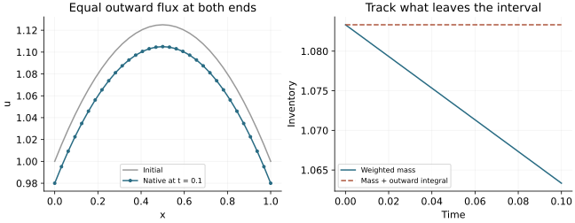

<!-- SPDX-FileCopyrightText: 2026 VTT Technical Research Centre of Finland Ltd -->
<!-- SPDX-License-Identifier: AGPL-3.0-or-later -->

::: {.article-body}
::: {.article-title}
[Boundaries / Give a flux its direction and units]{.lesson-kicker}

# Count what leaves the boundary

[A small diffusion problem. Two equivalent boundary inputs. One closed budget.]{.lesson-deck}
:::

Periodic Fourier grids identify opposite sides. Here the interval has two
physical ends. Consider constant-coefficient diffusion on $0\le x\le1$:

$$
u_t=D u_{xx},\qquad D>0.
$$

The diffusive flux vector is $-D u_x$. Its **outward** scalar component is
different at the two ends because their normals point in opposite directions:

$$
J_L=D u_x(0,t),\qquad J_R=-D u_x(1,t).
$$

Integrating the equation therefore gives

$$
\frac{d}{dt}\int_0^1u\,dx=-(J_L+J_R).
$$

Positive outward flux removes inventory. Equal positive values at the two
ends do not cancel.

## Choose a solution you can differentiate

Let $A$ be a constant and take

$$
u(x,t)=1+A x(1-x)-2DA t.
$$

Its second derivative is $-2A$ and its time derivative is $-2DA$, so it solves
the diffusion equation exactly. At both ends, the outward normal derivative
is $-A$, and the physical outward flux is $DA$. Those quantities have different
units and opposite signs when $A>0$.

The model accepts either representation explicitly:

```{.cpp include="model.cpp" snippet="boundary" dedent=4}
```

`FaceCondition::flux` converts an outward normal derivative $q$ to $-Dq$;
it uses a constitutive flux directly. Supplying $DA$ as a derivative would
ask for a different boundary condition.

## Let the operator own its boundary closure

`DiffusionAxis` supplies the nonperiodic finite-difference closure and a
positive diagonal quadrature norm $H$. Summation-by-parts operators retain
a discrete integration-by-parts identity; @mattsson2012 gives the variable-
coefficient construction underlying this family.

For spacing $h$, the first four norm weights are

$$
h\,(17,59,43,49)/48,
$$

mirrored at the right end, with weight $h$ in the interior. The operator
requires at least 17 nodes so its boundary closures do not overlap. Our
inventory is

$$
M_h=\sum_i H_{ii}u_i.
$$

Using an unweighted sum, or replacing these weights with a trapezoidal rule,
would measure a different discrete inventory. The operator reads state and
material through global-axis callbacks. This one-dimensional example owns
every node on one MPI rank; the axis itself performs no communication.

## Advance the state and account for the accepted flux

```{.cpp include="model.cpp" snippet="advance" dedent=4}
```

Every right-hand-side evaluation reads the old state, and only then swaps
in the new vector. `FluxLedger::stage` receives flux, face measure and time
weight. Each endpoint of this one-dimensional interval has measure one.
The two stages account for the two faces of a single Euler step, not two
Runge–Kutta stages.

The ledger commits an accepted step's outward integral. Its public `reject`
operation discards a trial integral; an adaptive caller would also restore
its trial state. This lesson uses fixed accepted steps and does not claim
an adaptive rollback mechanism.

The model chooses $\Delta t\le0.02h^2/D$ and adjusts it to reach the requested
final time exactly. This is a conservative choice for this small explicit
demo, not a general stability bound for other operators or integrators.

## Check both the shape and the inventory

The norm integrates this quadratic exactly, giving

$$
\begin{aligned}
M_h(0)&=1+A/6,\\
M_h(t)&=1+A/6-2DA t,\\
\mathcal J(t)&=2DA t.
\end{aligned}
$$

Consequently $M_h(t)+\mathcal J(t)=M_h(0)$. The quadratic spatial derivative
and its constant time tendency are reproduced up to floating point effects.
This example tests boundary signs, closure and accounting; it is not an
observed-order study for general smooth solutions.

{#fig-outward-budget .lightbox fig-alt="Initial and final native parabolas share a vertical scale. A second panel shows decreasing weighted mass and constant mass plus integrated outward flux."}

The figure reads native C++ CSV output. The checker compares **every node**
with the analytic quadratic and **every budget row** with the closed-form
inventory, including equivalent flux/derivative inputs and an inflow case.
A correct scalar budget alone would not establish a correct field.

## Run, change a sign and predict the result

From the repository root, with a compatible installed CPU SDK:

```sh
openpfc run examples/boundaries/outward-flux/model.cpp examples/boundaries/outward-flux/input.json
```

The CLI prints the saved attempt directory; its `results/` contains the
outputs. The supplied parameters are in [input.json](input.json). To keep experiments
separate, compile once and run from your own result directory:

```sh
mkdir -p results/outward-flux
openpfc compile examples/boundaries/outward-flux/model.cpp -o results/outward-flux/model
cp examples/boundaries/outward-flux/input.json results/outward-flux/input.json
cd results/outward-flux
./model input.json
```

The [complete model](model.cpp) needs no private helper header. It writes
`results/field.csv`, `results/budget.csv` and `results/run.json` below the
working directory. Its CMake target is `outward_diffusion_flux`.

Set `boundary` to `derivative`: the solution should stay the same because
the input represents the same physical condition. Then use negative
`amplitude` and predict the sign of both outward fluxes and the inventory
change. Vary `diffusivity`, keeping its value positive, and distinguish the
change in physical decay from the smaller explicit timestep.

## References

::: {#refs}
:::

:::
