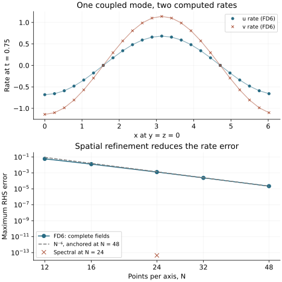

<!-- SPDX-FileCopyrightText: 2026 VTT Technical Research Centre of Finland Ltd -->
<!-- SPDX-License-Identifier: AGPL-3.0-or-later -->

::: {.article-body}
::: {.article-title}
[Coupled fields / Ask each field for what you need]{.lesson-kicker}

# Two equations, two derivative requests, one sweep

[Keep the equations visible. Change how the derivatives are evaluated.]{.lesson-deck}
:::

The [runtime oscillator](../runtime-fields/index.qmd) couples two fields
without spatial derivatives. Now give each field a different derivative
request. On the periodic cube $[0,2\pi)^3$, consider the numerical test model

$$
\begin{gathered}
\begin{aligned}
u_t &= v+a u_{xy},\\
v_t &= b\Delta u+c v_{xz}+d u_{yz},
\end{aligned}\\[4pt]
(a,b,c,d)=\left(\frac3{10},\frac1{25},-\frac15,\frac2{15}\right).
\end{gathered}
$$ {#eq-coupled-law}

Here $\Delta u=u_{xx}+u_{yy}+u_{zz}$. These coefficients give us an exact
answer with every mixed term active.
Write $\phi=x+2y+3z$ and set $u=A(t)\cos\phi$, $v=B(t)\cos\phi$.
Then $u_{xy}=-2u$, $u_{yz}=-6u$, $v_{xz}=-3v$ and $\Delta u=-14u$.
The PDE reduces on this particular mode to

$$
\begin{gathered}
\frac{d}{dt}\begin{pmatrix}A\\B\end{pmatrix}
= M\begin{pmatrix}A\\B\end{pmatrix},\\[4pt]
M=\begin{pmatrix}-0.6&1\\-1.36&0.6\end{pmatrix},\qquad M^2=-I.
\end{gathered}
$$ {#eq-mode-matrix}

With $(A(0),B(0))=(1,0.6)$, this means
$A=\cos t$ and $B=-\sin t+0.6\cos t$. Consequently the exact rates are
$u_t=-\sin t\cos\phi$ and $v_t=(-\cos t-0.6\sin t)\cos\phi$.
We evaluate a snapshot of those fields, rather than integrating them here.
This separates spatial derivative errors from time-stepping errors.
Oscillation of this one mode establishes no stability claim for arbitrary
initial data or other Fourier modes of @eq-coupled-law.

## Let the C++ types describe the requests

```{.cpp include="../equations.hpp" snippet="derivatives"}
```

`u` requests five derivatives; `v` requests its value and one derivative.
Native evaluators recognize these member names. They supply physical
spatial derivatives, including the grid-spacing factors. The model applies
its coefficients once:

```{.cpp include="../equations.hpp" snippet="equations"}
```

The returned aggregate opts into host tuple scatter:

```{.cpp include="../equations.hpp" snippet="increments"}
```

The order of the references in `as_tuple()` must match the output pointers.
The types are ordinary model-owned C++ aggregates; neither a registry nor
a string lookup is needed to describe the pointwise equations.

## Prepare the right neighbours, then compose

```{.cpp include="model.cpp" snippet="differences" dedent=6}
```

The sixth-order formulas need three halo layers. Mixed derivatives read
off-axis neighbours, so the exchanges explicitly use `Full` connectivity.
A face-only exchange would leave some required edge data stale. Separate
exchange bases give the two fields distinct communication tags.
This example uses one MPI process and periodic self-neighbours; it is a
small way to exercise real halo preparation, rather than inventing a
second boundary-fill implementation.

```{.cpp include="model.cpp" snippet="scatter" dedent=2}
```

`create_composite` assembles `Local{u,v}` at each owned point.
`for_each_interior` prepares the evaluator before the sweep, calls the
model, and scatters its two increments. With padded FD fields, output
pointers begin at the owned origin: evaluator indices are relative to that
origin. The allocated output vectors still include the storage halo.
Only owned rates are written to the CSV.

The same equation and output contract also accepts spectral gradients:

```{.cpp include="model.cpp" snippet="spectral" dedent=6}
```

The transform plan is shared; each field evaluator prepares its own
requested derivative arrays. This branch requires a HeFFTe-enabled CPU SDK.
Its resolved Fourier mode has derivative error near floating-point roundoff.

{#fig-coupled .lightbox fig-alt="Two panels show coupled u and v rates against their exact values, then a logarithmic refinement curve approaching sixth order."}

## Run, compare, and break a contract deliberately

Keep [the shared equations header](../equations.hpp) one directory above
[model.cpp](model.cpp). From this chapter's directory run

```sh
openpfc run model.cpp input.json --source-root .. --launcher=none
openpfc run model.cpp spectral.json --source-root .. --launcher=none
```

The [FD input](input.json) chooses `n`, `time`, and `method`. The
[spectral input](spectral.json) changes only the method. Both write all
$n^3$ owned rows to `results/rates.csv`: indices, coordinates, the two
fields, computed rates and exact rates. The CLI prints each attempt's
output directory.

Double `n` from 24 to 48 at the same time. The leading FD rate error should
fall by about $2^6=64$. Change `time` to exercise a different combination of
the two fields. The independent checker derives seven-point weights from
exact polynomial moments and compares every rate with the resulting
Fourier symbol, as well as checking the continuous answer.

For a staging experiment, read [verify.hpp](verify.hpp) and [verify.cpp](verify.cpp). The preserved regression
poisons input ghosts, changes the stage fields, checks an independent
midpoint-mode recurrence, and checks that scatter leaves output ghosts
untouched. A warmed-loop observer counts successful C++ `new` requests;
it makes no claim about MPI pools or all system allocations. The optional
HIP regression checks actual device evaluation and scatter with uploaded
host-filled halos. This CPU tutorial does not execute a device stepper.
The existing multi-field stepper limitations remain documented in
[#355](https://github.com/ahojukka5/OpenPFC/issues/355); this lesson does not
hide them inside a new integration wrapper.

:::
