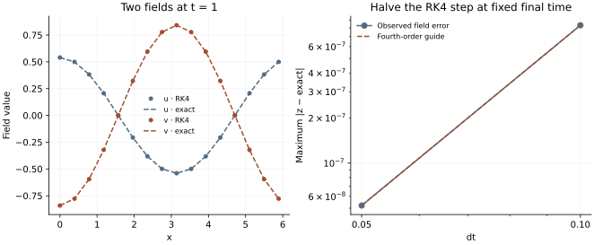

<!-- SPDX-FileCopyrightText: 2026 VTT Technical Research Centre of Finland Ltd -->
<!-- SPDX-License-Identifier: AGPL-3.0-or-later -->

::: {.article-body}
::: {.article-title}
[OpenPFC / Build a simulation]{.lesson-kicker}

# Two fields, one Runge–Kutta stage

[Bind a runtime field group to RK4 and verify that both variables see the same intermediate state.]{.lesson-deck}
:::

A harmonic oscillator is small enough to understand and demanding enough
to expose a staging mistake. At each grid point solve

$$
\begin{gathered}
u_t=v, \\
v_t=-u, \\
u(x,0)=\cos x, \\
v(x,0)=0.
\end{gathered}
$$ {#eq-oscillator}

The exact fields are $u=\cos t\cos x$ and $v=-\sin t\cos x$. There are no
spatial derivatives or halo exchanges in this experiment. Its question is
whether a multi-field integrator evaluates all variables at the actual
Runge–Kutta stage, rather than reading an old accepted field by accident.

## Bind the fields and describe the equations

```{.cpp include="model.cpp" snippet="fields" dedent=4}
```

The runtime interface borrows the two fields. During an RHS callback it
publishes the intermediate values into those bound fields, lets the callback
read them, then restores their accepted storage. The callback fills compact
owned-cell rates, in x-fastest order. The final candidate is separate until
`commit` publishes it. Field object addresses and geometry stay fixed for
the lifetime of the stepper.

The communicator makes construction, attempts and commits collective.
All ranks use the same method and time interval, but their owned boxes can
differ. A model with spatial derivatives would prepare the stage's halos
or transforms inside the callback; it could not reuse derivatives of the
previous accepted state.

{#fig-oscillator}

## Inspect a discrete answer as well as the continuous one

```sh
openpfc run model.cpp input.json --launcher=none
```

The input selects `steps` and `dt`; the grid is fixed at $16\times4\times4$.
Use two ranks with the usual CLI MPI options. Every final owned value is
written to `results/oscillator_rank_<rank>.csv` with its global index.

For a particularly sharp independent check, combine the variables as
$z=u+iv$. Then $z'=-iz$. Classical RK4 advances it by

$$R(-ih)=\sum_{j=0}^4\frac{(-ih)^j}{j!}.$$

The tests compare every sample with $R(-ih)^m\cos x$ and also with the
continuous solution. At fixed final time, halving $h$ should reduce the
leading global error by about sixteen. Keeping the old field inside an
RHS callback would fail this test despite producing plausible curves.
See the public
[runtime field RK contract](https://github.com/VTT-ProperTune/OpenPFC/blob/master/include/openpfc/kernel/simulation/steppers/runtime_field_rk.hpp)
for padding, rollback and collective admission details.

The complete [C++ model](model.cpp) and [starting input](input.json)
are available with this lesson.

:::
