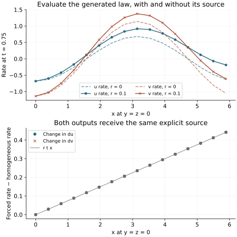

<!-- SPDX-FileCopyrightText: 2026 VTT Technical Research Centre of Finland Ltd -->
<!-- SPDX-License-Identifier: AGPL-3.0-or-later -->

::: {.article-body}
::: {.article-title}
[Model development / Algebra before execution]{.lesson-kicker}

# Write the expression once, inspect the generated C++

[A small symbolic expression can become ordinary C++ with an ordinary numerical test.]{.lesson-deck}
:::

The [coupled-gradient lesson](../fixed-tuples/index.qmd) keeps two pointwise
equations in a short `rhs` function. A symbolic description is another
useful way to author that same local law, especially when terms recur.
It should leave the resulting computation easy to inspect.

Keep the earlier coefficients and add an explicit source $s(t,x,y,z)$ to both rates:

$$
\begin{aligned}
f_u &= v+a u_{xy}+s,\\
f_v &= b\Delta u+c v_{xz}\\
    &\quad +d u_{yz}+s,\\
s&=r\,t(x+y+z).
\end{aligned}
$$ {#eq-generated-law}

Here $\Delta u=u_{xx}+u_{yy}+u_{zz}$ and $r$ is `source_rate`. Setting $r=0$ recovers the previous law.
A nonzero value defines a different, forced problem. In this chapter we
evaluate the law on prescribed exact fields; we do not claim those fields
solve the forced PDE. The linear source is sampled at the displayed grid
points and is not a periodic function across the cube's seam. It is never
Fourier-differentiated here.

## Make the shared work explicit

SymPy's common-subexpression elimination identifies algebra shared by
several output expressions [@sympycse]. Our fixed generator asks for
canonical ordering and names its temporary `cse0`. The committed output is
small enough to read completely:

```{.cpp include="generated_rhs.hpp"}
```

The one temporary contains $r\,t(x+y+z)$, reused by both outputs.
`Local`, `Parameters`, `Position` and `Increments` remain model-owned types.
The generated function receives derivative values; it does not compute
derivatives, allocate fields, exchange halos or choose a timestep.
No symbolic library is needed when compiling or running this header.

The [dependency manifest](dependency_manifest.json) records the requested
field members, parameters, position coordinates, arithmetic operation
counts and header SHA-256. A smaller symbolic operation count describes
this expression. It does not measure runtime, register use or GPU speed.

## Wrap the expression in the existing model contract

```{.cpp include="model.cpp" snippet="generated_model"}
```

`Located` combines the derivative aggregate with physical coordinates.
The wrapper supplies those arguments to the generated function and
returns the same host tuple increments as the previous lesson. It keeps
the framework's `rhs(time, local)` contract intact.

For this experiment, a small analytic evaluator supplies exact derivatives
of $u=\cos t\cos\phi$ and $v=(-\sin t+0.6\cos t)\cos\phi$, where
$\phi=x+2y+3z$. It has no preparation work, because it reads no neighbouring
samples. This deliberately isolates generated algebra from discretization
error; the previous chapter supplies actual FD and spectral evaluators.
The native owned-cell sweep still performs the model call and tuple scatter:

```{.cpp include="model.cpp" snippet="evaluate" dedent=4}
```

An independent check is immediate:

$$
\begin{aligned}
f_u&=-\sin t\cos\phi+s,\\
f_v&=(-\cos t-0.6\sin t)\\
   &\quad\cdot\cos\phi+s.
\end{aligned}
$$ {#eq-generated-check}

{#fig-symbolic .lightbox fig-alt="Two panels compare generated rates with and without forcing, then show that both output differences equal the prescribed linear source."}

## Compile the C++, then try the generator

Keep [equations.hpp](../equations.hpp) one directory above the chapter,
and [generated_rhs.hpp](generated_rhs.hpp) beside [model.cpp](model.cpp).
From the chapter directory run

```sh
openpfc run model.cpp input.json --source-root .. --launcher=none
openpfc run model.cpp homogeneous.json --source-root .. --launcher=none
```

The [starting input](input.json) uses $r=0.1$; the
[homogeneous input](homogeneous.json) uses zero. Every owned point appears
in the attempt's `results/rates.csv`. Subtract the homogeneous output from
the forced output: both rate differences must equal $s$ at every point.
At `time=0` the source vanishes even when `source_rate` is nonzero.

Generation is a separate, optional Python step. Download [generate.py](generate.py)
and [requirements.txt](requirements.txt) to the chapter directory. From
the checkout root, for example:

```sh
python3 -m venv results/symbolic-env
results/symbolic-env/bin/pip install -r examples/coupling/symbolic-rhs/requirements.txt
results/symbolic-env/bin/python examples/coupling/symbolic-rhs/generate.py --check
results/symbolic-env/bin/python examples/coupling/symbolic-rhs/generate.py --output-dir results/generated-rhs
```

The requirements pin SymPy 1.14.0 and mpmath 1.3.0. The generator accepts
only the two bounded expressions in its own source; it is not a parser
for arbitrary C++ or a general PDE compiler. Repeating generation with
different Python hash seeds gives byte-identical artifacts. `--check`
fails if the committed header or manifest differs. Edit the expression
and regenerate deliberately rather than editing the generated header.

The preserved C++ regressions exercise the host tuple protocol and compare
273 arbitrary input cases against an independent 80-digit decimal oracle.
Pinned-environment generation checks reconstruct the CSE expressions and
perturb each derivative input to check its sensitivity. Optional HIP tests
use the existing fixed-arity device increment pack; they do not call
host `std::tie` methods inside a device kernel.

A generated Hessian term such as $b u_{xx}$ is not a conservative
discretization of $\partial_x(b(x)u_x)$. Spatially varying fluxes need the
appropriate flux and divergence operators. Symbolic simplification does
not decide a discretization or establish a physical model.

## References

::: {#refs}
:::

:::
