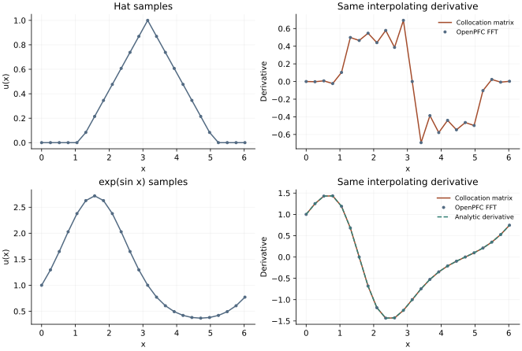

<!-- SPDX-FileCopyrightText: 2026 VTT Technical Research Centre of Finland Ltd -->
<!-- SPDX-License-Identifier: AGPL-3.0-or-later -->

::: {.article-body}
::: {.article-title}
[Differentiation / Matrix or transform]{.lesson-kicker}

# One derivative, two algorithms

[If a derivative rings near a corner, changing a matrix multiply into an FFT will not remove the corner.]{.lesson-deck}
:::

Programs 4 and 5 of @trefethen2000 make a valuable comparison: calculate
the same periodic spectral derivative with a dense matrix and with an
FFT. The approximation is the trigonometric interpolant; the algorithms
are two ways to differentiate it. We repeat both of the book's profiles,
a hat and $e^{\sin x}$, with independent C++ code.

## Differentiate the interpolating basis

For an even number $N$ of points $x_j=2\pi j/N$, the first-derivative
matrix is

$$
D_{ij}=\begin{cases}
0,&i=j,\\
\tfrac12(-1)^{i-j}\cot\!\left(\tfrac{x_i-x_j}{2}\right),&i\ne j.
\end{cases}
$$ {#eq-cotangent}

The zero diagonal and alternating off-diagonal terms encode a global
periodic interpolant. They are not a high-order local stencil. The
example-local implementation in `../profiles.hpp` is small enough to read:

```{.cpp include="../profiles.hpp" snippet="matrix"}
```

The matrix action takes $O(N^2)$ operations for all rows. The FFT route
transforms the same samples, multiplies Fourier coefficients by $ik$,
and transforms back in $O(N\log N)$ work. For real-valued data, the
even-grid Nyquist first derivative is zero in both representations.

## Compare actual values

```{.cpp include="model.cpp" snippet="compare" dedent=4}
```

OpenPFC owns the sampled field, MPI decomposition, transforms, and spectral
evaluator. The cotangent formula is a mathematical reference local to this
example, not a newly advertised public dense-matrix API.

{#fig-collocation}

The hat is $u(x)=\max(0,1-|x-\pi|/2)$. Its derivative is discontinuous at
the peak and support edges. At those corners the classical derivative is
undefined. The CSV marks such points with `differentiable=0`; it does not
pretend that an arbitrary chosen slope is an exact derivative there.

For $e^{\sin x}$ the independent exact derivative is
$\cos x\,e^{\sin x}$. At the default $N=24$, the approximation is already
very accurate. Matching algorithms alone would not establish that fact;
the analytic reference does.

## Run both experiments

```sh
openpfc run model.cpp input.json --source-root .. --launcher=none
```

The input sets `n`. The shared-header source root preserves
`../profiles.hpp`. Each attempt writes `results/derivative_rank_<rank>.csv`
for both profiles, with actual sample, matrix derivative, Fourier
derivative, and exact reference where defined.

Double `n`. The analytic error should shrink toward roundoff, while the
hat derivative retains oscillation near corners. Compare the curves at
fixed physical distance from a corner and then within a few grid cells
of it: those are different limits. Use two MPI ranks and verify the
same global samples rather than assuming every rank owns the x-axis slice.

The ordinary checks compare matrix and FFT values, require the analytic
derivative to agree within $10^{-10}$, and validate the complete set of
recorded samples. They do not claim uniform convergence at nondifferentiable
points. Continue with [what smoothness buys you](../smoothness/index.qmd).

The complete [C++ model](model.cpp) and [starting input](input.json)
are available with this lesson. It also uses the shared [profiles.hpp](../profiles.hpp);
keep its relative location when saving the files.

## References
::: {#refs}
:::
:::
