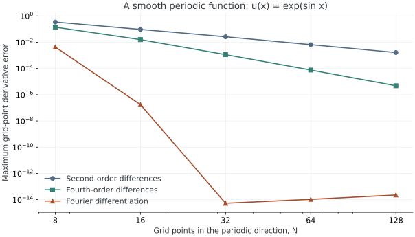

<!-- SPDX-FileCopyrightText: 2026 VTT Technical Research Centre of Finland Ltd -->
<!-- SPDX-License-Identifier: AGPL-3.0-or-later -->

::: {.article-body}

::: {.article-title}

[Lesson 01 / Differentiation]{.lesson-kicker}

# How accurately can we differentiate?

[A local stencil and a global trigonometric interpolant look at the same samples. How much can each one learn?]{.lesson-deck}

:::

Suppose all we know about a function is its value at equally spaced points.
We can estimate a derivative from nearby values, or fit a periodic wave
through every sample and differentiate that wave. Both are approximations.
For a smooth periodic function, their errors behave very differently.

This experiment revisits the question in programs 1 and 5 of
@trefethen2000, using OpenPFC's finite-difference and Fourier evaluators.
The C++ implementation and explanation are independent; we reproduce the
smooth-function comparison, rather than every experiment in those programs.

## A derivative we already know

On the periodic interval $[0,2\pi)$, let

$$
\begin{gathered}
u(x)=e^{\sin x}, \\
u'(x)=\cos x\,e^{\sin x}.
\end{gathered}
$$ {#eq-derivative}

Use $N$ points $x_j=jh$, with $h=2\pi/N$. The point $2\pi$ is the same
periodic point as zero, so it is not stored twice. Our error is measured
at the grid points:

$$
E_N=\max_j\left| (D_Nu)_j-u'(x_j)\right|.
$$ {#eq-error}

The exact expression in @eq-derivative supplies an independent reference.
No PDE or time integrator can obscure the spatial approximation here.

## Nearby values or Fourier modes?

The centred second- and fourth-order formulas are

$$
\begin{gathered}
(D_2u)_j=\frac{u_{j+1}-u_{j-1}}{2h}, \\
(D_4u)_j=\frac{-u_{j+2}+8u_{j+1}-8u_{j-1}+u_{j-2}}{12h}.
\end{gathered}
$$ {#eq-stencils}

Taylor expansion cancels the lower-order error terms. For sufficiently
smooth $u$, the remaining errors scale like $h^2$ and $h^4$.
Doubling $N$ should therefore reduce the errors by approximately four
and sixteen once the leading term dominates.

Fourier differentiation instead constructs the trigonometric interpolant
$u_N(x)=\sum_k\widehat u_k e^{ikx}$ and uses

$$
u_N'(x)=\sum_k ik\widehat u_k e^{ikx}.
$$ {#eq-fourier}

OpenPFC evaluates @eq-fourier with FFTs. For this analytic periodic function,
the approximation error falls much faster than either fixed stencil's
algebraic rate, until floating-point roundoff becomes visible. Spectral
accuracy depends on smoothness and periodic compatibility; it is not a
promise for arbitrary sampled data [@trefethen2000, programs 1 and 5].

{#fig-convergence}

## Express the calculation in C++

Our requested derivative is just `struct Derivative { double x{}; };`.
The evaluator calculates only that derivative. The same error calculation
works with both derivative evaluators:

```{.cpp include="model.cpp" snippet="differentiate"}
```

`u.apply` receives physical coordinates, including the global offset of
each MPI subdomain. The final reduction computes the maximum over all
ranks. The small $N\times8\times8$ box repeats the same function in the
transverse directions; it lets us use the usual three-dimensional stack
without changing this one-dimensional mathematical problem.

Here is the complete comparison loop:

```{.cpp include="model.cpp" snippet="compare" dedent=4}
```

The finite-difference field has two layers of padding, enough for the
fourth-order stencil. `halo.exchange()` fills those ghost cells before
either FD evaluator reads them. `SpectralCPUStack` uses distributed FFTs.
Neither changes the exact reference or the definition of error.

## Run it, then change it

From this lesson's directory, after installing the SDK:

```sh
openpfc run model.cpp input.json --launcher=none
```

The printed attempt directory contains `results/convergence.csv`, with
columns `n,fd2,fd4,fourier`. Its values supply @fig-convergence; the plotting
command is in the [examples authoring guide](https://github.com/ahojukka5/OpenPFC/blob/master/examples/AUTHORING.md).
The source is [model.cpp](model.cpp) and the editable input is
[input.json](input.json).

To extend the fourth-order comparison to the original program 1 resolutions,
8, 16, ..., 4096, use the supplied preset:

```sh
openpfc run model.cpp trefethen-p1.json --launcher=none
```

The second-order and FFT columns are additional comparisons. The larger
grid does not change the mathematical interval; its spacing remains $2\pi/N$.

Try `sizes: [16, 32, 64, 128, 256]` in the JSON file, retaining JSON's quotes
around `"sizes"`. Predict the last two error ratios before looking at them.
The FD ratios should approach four and sixteen. The Fourier errors should
stop improving once roundoff dominates; do not fit a convergence rate to
that plateau.

Then change `value` to $\sin(3x)$ and `exact_derivative` to
$3\cos(3x)$. Fourier differentiation should reach near roundoff when the
mode is resolved, $N>6$. At $N=6$ the sampled function is zero: those samples
cannot recover its nonzero derivative. This is aliasing, not a failed FFT.

## What the check establishes

The ordinary example checks launch the real executable on one and two
ranks, compare the FD error ratios, and check the Fourier error against
the analytic derivative. They establish these small smooth periodic cases.
They do not validate nonperiodic data, nonsmooth derivatives, or arbitrary
MPI process counts. The Nyquist first-derivative multiplier is zero in
OpenPFC's real-valued Fourier convention.

Continue with [heat flow from neighbouring values](../../heat/finite-differences/index.qmd).

The complete [C++ model](model.cpp) and [starting input](input.json)
are available with this lesson.
Download the [program 1 resolution preset](trefethen-p1.json) for the book comparison.

## References

::: {#refs}
:::

:::
