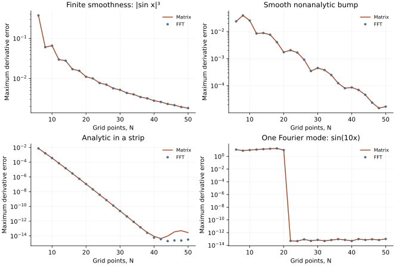

<!-- SPDX-FileCopyrightText: 2026 VTT Technical Research Centre of Finland Ltd -->
<!-- SPDX-License-Identifier: AGPL-3.0-or-later -->

::: {.article-body}
::: {.article-title}
[Differentiation / Regularity]{.lesson-kicker}

# What smoothness buys you

[A method called spectral does not give every function the same convergence curve.]{.lesson-deck}
:::

The [first differentiation lesson](../periodic/index.qmd) used the analytic
function $e^{\sin x}$. Its rapidly decreasing error is compelling, but it
is only one regularity class. Program 7 of @trefethen2000 asks the more
revealing question: what changes when the function changes?

## Four functions with known derivatives

On $[0,2\pi)$ compare:

| Function | Exact first derivative | Distinguishing property |
|:--|:--|:--|
| $|\sin x|^3$ | $3\sin x\cos x\,|\sin x|$ | Only finite smoothness at zeros |
| $\exp[-1/\sin^2(x/2)]$ | $u\sin x/[2\sin^4(x/2)]$ | Smooth, but not analytic at the periodic join |
| $1/[1+\sin^2(x/2)]$ | $-\sin(x/2)\cos(x/2)u^2$ | Analytic in a strip around the real axis |
| $\sin(10x)$ | $10\cos(10x)$ | A single band-limited mode |

: The bump and its derivative have limiting value zero at the periodic join; the implementation uses those limits explicitly. {#tbl-profiles}

We measure the maximum derivative error on the grid, using both the
cotangent matrix and OpenPFC's Fourier evaluator. Neither numerical
derivative supplies the analytic reference in @tbl-profiles.

## Why the curves differ

Fourier differentiation multiplies each coefficient by its wavenumber.
The error therefore depends on how quickly the coefficients decay.
Finite smoothness gives algebraic decay. A smooth nonanalytic bump can
converge faster than every fixed algebraic order without having one fixed
exponential rate. Analyticity in a complex strip gives exponential decay
until roundoff dominates [@trefethen2000, program 7].

For the last function there is no unresolved tail once the grid can
represent mode ten without aliasing. The requirement is $N>20$.
At $N=20$ the samples of $\sin(10x)$ vanish, while its derivative does not.
That is a useful counterexample to treating a finite grid as the function.

{#fig-smoothness}

## Make the comparison explicit

```{.cpp include="model.cpp" snippet="regularity" dedent=4}
```

The field geometry and derivative request stay fixed within each
resolution. Only the profile changes. The global maximum reduction
ensures the error includes subdomain edges and every rank's values.

## Reproduce two book experiments

For program 7, use the supplied resolutions 6, 8, ..., 50:

```sh
openpfc run model.cpp input.json --source-root .. --launcher=none
```

For program 2's matrix convergence experiment on $e^{\sin x}$, use:

```sh
openpfc run model.cpp trefethen-p2.json --source-root .. --launcher=none
```

That input selects the analytic profile at every even resolution from two
through 100. We add the FFT comparison to the book's matrix experiment;
we do not substitute one for the other. Both commands write
`results/smoothness.csv` in distinct preserved attempt directories.

First predict the errors at $N=20$ and $N=22$ for the band-limited case.
Then increase the analytic profile's resolution beyond the roundoff
plateau. Explain why fitting a convergence order there would be misleading.
Finally, use two MPI ranks and compare the maximum errors, allowing for
small floating-point differences.

## Independent verification

The checks reconstruct the derivative using a direct complex DFT in
standard-library Python. That calculation uses neither OpenPFC nor the
cotangent matrix. It compares the reported matrix and FFT errors at
$N=6,20,22,50$ against independently differentiated sampled profiles.
Invalid profile names must fail before entering the evaluator.

The experiment concerns grid-point errors for these functions. It is not
a proof of a convergence rate for every smooth function, an arbitrary
complex strip, or floating-point arithmetic at unlimited resolution.

The complete [C++ model](model.cpp) and [starting input](input.json)
are available with this lesson. It also uses the shared [profiles.hpp](../profiles.hpp);
keep its relative location when saving the files.
The [program 2 resolution preset](trefethen-p2.json) is also available.

## References
::: {#refs}
:::
:::
