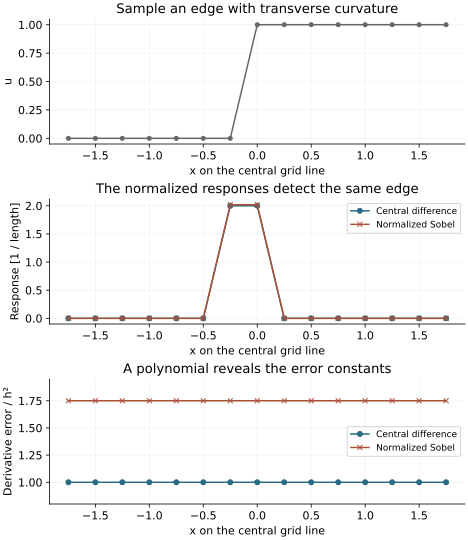

<!-- SPDX-FileCopyrightText: 2026 VTT Technical Research Centre of Finland Ltd -->
<!-- SPDX-License-Identifier: AGPL-3.0-or-later -->

::: {.article-body}
::: {.article-title}
[Finite differences / Give the weights a meaning]{.lesson-kicker}

# A stencil has moments, units and a boundary contract

[Two implementations can agree perfectly and still apply the wrong normalization. Test what the weights mean.]{.lesson-deck}
:::

The centered first difference uses weights
$d=(-1,0,1)/(2h)$. Their sum is zero, so constants disappear; their first
spatial moment is one, so the derivative of $u=x$ is one.

The three-dimensional Sobel-x kernel combines a difference along x with
smoothing in y and z. The raw integer coefficients
$(-1,0,1)\otimes(1,2,1)\otimes(1,2,1)$ need a factor $1/(32h)$:
the difference contributes $2h$, and each smoothing vector sums to four.
The old example's raw kernel was therefore **32**, not 16, times its
unit-spacing central-difference response on a transversely constant field.

## Normalize each factor

Use the physical derivative weights and unit-sum smoothing weights:

```{.cpp include="model.cpp" snippet="weights" dedent=4}
```

The dense box stores the same tensor product as the separable call. It is
indexed `[z][y][x]`. The last direction is contiguous in the backing brick.

## Apply three public kernels

```{.cpp include="model.cpp" snippet="kernels" dedent=10}
```

`central` differentiates only along x. `separable` differentiates along x
and smooths in the two transverse directions. `dense` applies the same
27-point tensor weights directly. Equality of the last two checks their
implementation parity; it does not by itself prove the intended derivative.

Each kernel takes a pointer, a center offset and explicit strides. A
single `offset` lambda describes the sample brick; all three calls use
that same layout.

## Ask a polynomial for the truncation error

Choose

$$
\begin{gathered}
u=x^3+xy^2+\tfrac12xz^2,\\
u_x=3x^2+y^2+\tfrac12z^2.
\end{gathered}
$$

The central difference differentiates $x^3$ as $3x^2+h^2$. A normalized
$(1,2,1)$ average maps $y^2$ to $y^2+h^2/2$. Applying those two identities
in the tensor product gives

$$
\begin{gathered}
D_xu=u_x+h^2,\\
S_xu=u_x+\tfrac74h^2.
\end{gathered}
$$

Both formulas are second order. The smoothing changes the error constant;
it is not a universal improvement in derivative accuracy.

{#fig-stencils .lightbox fig-alt="A unit step and localized stencil responses, followed by constant polynomial derivative errors divided by h squared: one for central differences and seven quarters for normalized Sobel."}

## Decide where a stencil is defined

The output contains all $(N-2)^3$ interior nodes. The one-cell outer layer
is excluded because a radius-one kernel would load outside the array.
Excluding it is **not** a physical boundary condition.

For distributed data, the one-axis kernel needs its corresponding halo.
The tensor stencil also reaches edge and corner neighbors: a face-only
halo exchange is insufficient. Use a corner-filled policy such as host
`HaloConnectivity::Full` before applying these multi-axis kernels. The
[separate-halo heat example](../../heat/separated-halos/index.qmd) has a
face-neighbor Laplacian and a different support requirement.

## Change the sampled field

```sh
openpfc run model.cpp input.json --launcher=none
```

The [model](model.cpp) and [input](input.json) need no companion header.
The default is a step across x, multiplied by a smooth quadratic amplitude
in y and z. Set `profile` to `affine` to calibrate the normalization, or
`polynomial` to check the exact $h^2$ error above. The bundled
[polynomial input](polynomial.json) selects that case directly.

`spacing` is physical distance between samples. This is a bounded sampled
brick, with width $(N-1)h$ and both endpoint samples retained; it does not
assume FFT periodicity. To refine the same physical interval, halve
`spacing` and replace $N$ by $2N-1$.

Each attempt writes the complete interior to `results/responses.csv`.
The checker invokes the actual binary for all three profiles and two
polynomial resolutions. It checks every interior response against the
affine and polynomial moment identities, including the spacing factor,
sign, transverse curvature, unique grid coverage and invalid inputs.
Run this demonstrator on a single CPU process.
:::
