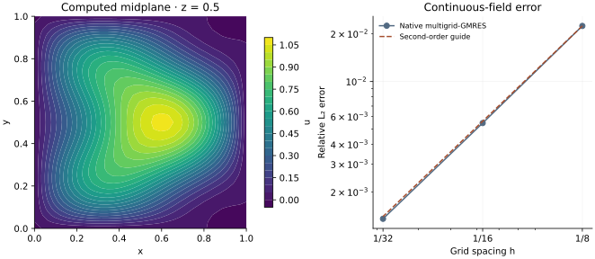

<!-- SPDX-FileCopyrightText: 2026 VTT Technical Research Centre of Finland Ltd -->
<!-- SPDX-License-Identifier: AGPL-3.0-or-later -->

::: {.article-body}
::: {.article-title}
[OpenPFC / Operators and their solutions]{.lesson-kicker}

# Use a hierarchy to correct different scales

[Solve a manufactured three-dimensional Dirichlet Poisson problem with native geometric multigrid preconditioning.]{.lesson-deck}
:::

A local relaxation quickly damps some error patterns and slowly damps
others. A multigrid hierarchy transfers the remaining error to a coarser
representation. This chapter introduces OpenPFC's serial geometric
`Multigrid` as a preconditioner for a finite-difference Poisson solve.
It is independent of the example-owned dense Chebyshev eigensolver.

## Manufacture two spatial scales

On $[0,1]^3$ prescribe zero boundary values and choose

$$u=\sin(\pi x)\sin(\pi y)\sin(\pi z)
+.2\sin(2\pi x)\sin(3\pi y)\sin(\pi z).$$

For $-\Delta u=f$, the two terms in f are multiplied by $3\pi^2$ and
$14\pi^2$, respectively. These continuous formulas are independent of
the discrete operator and give a refinement test.

## Keep the physical scaling consistent

The native `poisson_auxiliary` includes the cell-volume factor. Its interior
seven-point stencil is $h(6u_i-\sum_{j\sim i}u_j)$, equal to $h^3(-\Delta_hu)$.
The right-hand side must therefore be $h^3f$, not f. Boundary rows and loads
are projected consistently onto the homogeneous Dirichlet subspace.

```{.cpp include="model.cpp" snippet="vcycle" dedent=6}
```

Construct the hierarchy once, then reuse its V-cycle inside the native
GMRES solve. The default hierarchy uses damped Jacobi smoothing and
rediscretized coarse operators. The bounded coarsest problem is solved
directly. This serial vector interface is a clear first lesson; it does
not claim the distributed or device behavior of other multigrid classes.

{#fig-multigrid}

## Check solver accuracy and discretization separately

```sh
openpfc run model.cpp input.json --launcher=none
```

The sizes 9,17,33 include both endpoints and support nested coarsening.
`results/convergence.csv` records relative continuous-field error and solver
residuals; each complete field has its own CSV. The independent finite-grid
oracle uses the sine-mode eigenvalues

$$\mu_h=\frac4{h^2}\sum_{d=1}^3\sin^2(m_d\pi h/2).$$

Each component's discrete amplitude is its continuum eigenvalue divided
by this discrete eigenvalue. The checks verify that complete discrete
answer and the expected second-order convergence toward the continuous one.
They do not turn iteration counts on this two-mode load into a general
performance claim. Consult the public
[multigrid contract](https://github.com/VTT-ProperTune/OpenPFC/blob/master/include/openpfc/solvers/multigrid.hpp)
for coarse-operator and nullspace conventions.

The complete [C++ model](model.cpp) and [starting input](input.json)
are available with this lesson.
:::
