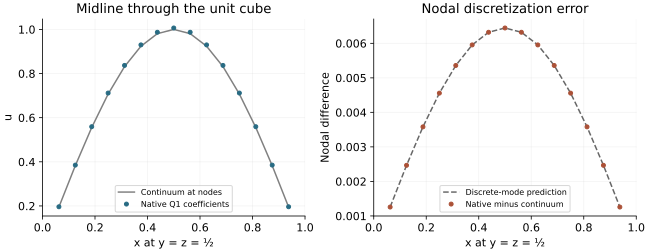

<!-- SPDX-FileCopyrightText: 2026 VTT Technical Research Centre of Finland Ltd -->
<!-- SPDX-License-Identifier: AGPL-3.0-or-later -->

::: {.article-body}
::: {.article-title}
[Finite elements / Integrate the load, then solve the discrete equation]{.lesson-kicker}

# Solve a weak equation on free nodes

[A tensor-product basis. A matrix-free action. Two different errors to measure.]{.lesson-deck}
:::

On the unit cube, consider

$$
-D\nabla^2u+cu=f,\qquad u|_{\partial\Omega}=0,
$$

with constant $D>0$ and $c\ge0$. Choose the continuum solution

$$
s(x,y,z)=\sin(\pi x)\sin(\pi y)\sin(\pi z),
$$

so $f=(3D\pi^2+c)s$. Finite elements approximate the weak equation: for
each test function $v$ vanishing on the boundary,

$$
D\int_\Omega\nabla u_h\cdot\nabla v
+c\int_\Omega u_hv=\int_\Omega fv.
$$

Here $u_h$ uses continuous trilinear, or Q1, basis functions on a uniform
hexahedral mesh. @brenner2008 gives the finite-element background. The
installed OpenPFC hierarchy supplies the Q1 action and multigrid cycle;
the example does not implement a second assembler.

## Store only the free coefficients

With $n+1$ elements per axis and $h=1/(n+1)$, the free nodes have coordinates
$h,2h,\ldots,nh$. The physical boundary coefficients are zero and eliminated.
The field domain therefore contains $n^3$ free coefficients, beginning at
physical origin $(h,h,h)$:

```{.cpp include="model.cpp" snippet="layout" dedent=4}
```

The declared axes are nonperiodic. `FieldOperations` supplies owned-node
algebra and collective norms for a single field with one halo cell. The
hierarchy owns the communication needed by its actions and transfers.

This bounded example uses $n=15$ or $31$, with one or two MPI ranks. Both
have the supported form $2^k-1$. They coarsen to seven free nodes per axis:
$15\to7$ or $31\to15\to7$. Only the bounded $7^3=343$-unknown coarse solve
is replicated; the fine operator acts on distributed owned nodes.

## Integrate the forcing against the basis

The right-hand side is a basis integral, rather than a pointwise sample of
$f$. For the one-dimensional hat function $\phi_i$,

$$
\int_0^1\sin(\pi x)\phi_i(x)\,dx
=\beta\sin(\pi x_i),
$$

where

$$
\beta=\frac{2(1-\cos(\pi h))}{h\pi^2}.
$$

Tensor-product separation gives the three-dimensional load:

```{.cpp include="model.cpp" snippet="load" dedent=4}
```

The factor $\beta^3$ carries the integrated basis measure. Omitting it, or
silently replacing it with a pointwise forcing, changes the discrete
equation and its expected coefficients.

## Compose the installed multigrid and CG interfaces

```{.cpp include="model.cpp" snippet="solve" dedent=4}
```

The operator and preconditioner remain separate callables. The first
applies the Q1 stiffness plus consistent reaction mass. The second applies
one zero-initialized V-cycle. Symmetric smoothing and transpose-related
transfers make this fixed preconditioner suitable for CG on the positive
Dirichlet system. The example leaves those hierarchy controls unchanged.

A converged linear solve establishes a small algebraic residual for the
discrete equation. It does not make the finite-element coefficients equal
to the exact continuum solution at the nodes.

## Derive an independent discrete answer

The one-dimensional nodal sine is an eigenvector of the assembled Q1
stiffness and consistent mass matrices. With $\theta=\pi h$, their eigenvalues are

$$
\kappa=\frac{2(1-\cos\theta)}h,
\qquad m=\frac h3(2+\cos\theta).
$$

The three-dimensional discrete action on that tensor-product sine has
eigenvalue

$$
\Lambda_h=3D\kappa m^2+cm^3.
$$

Consequently the exact finite-element **nodal coefficients** are

$$
u_{h,ijk}=\alpha_h s(x_i,y_j,z_k),
$$

with

$$
\alpha_h=\frac{(3D\pi^2+c)\beta^3}{\Lambda_h}.
$$

This oracle follows the tensor-product basis and analytic integrals. It
does not manufacture a right-hand side by applying the same library
operator to a chosen solution.

{#fig-q1-nodes .lightbox fig-alt="Native nodal solution points follow a sine through the cube midline. Their difference from the continuum matches the separate discrete-amplitude prediction."}

The figure reads native C++ coefficients. The checker visits every free node
from every rank and compares it with $\alpha_h s$. It separately measures
the nodal difference from $s$. Neither the plotted midline nor the scalar
solver residual replaces that complete-field check.

For the Poisson case $D=1,c=0$, the small supplied grids give

| Free nodes per axis | $h$ | $|\alpha_h-1|$ |
|---:|---:|---:|
| $15$ | $1/16$ | $6.44\times10^{-3}$ |
| $31$ | $1/32$ | $1.61\times10^{-3}$ |

Halving the spacing reduces this nodal difference by about four, consistent
with its $O(h^2)$ expansion. This is a nodal error for the selected smooth
mode; it is not an integrated error norm of the interpolated finite-element
function or a convergence result for arbitrary geometries.

## Run the weak problem and refine its grid

From the repository root, with a compatible installed CPU SDK:

```sh
openpfc run examples/finite-elements/q1-multigrid/model.cpp examples/finite-elements/q1-multigrid/input.json
```

The CLI prints its saved attempt directory. Inspect `results/run.json` and
`results/field_rank_*.csv` below that directory. Add
`--ranks 2 --launcher=mpirun` to the source-run command for the supported
two-rank decomposition; invoke the CLI once outside the launcher.

The [complete model](model.cpp) and [input](input.json) need no private
helper headers. Its CMake target is `q1_multigrid`.

Change `n` from 15 to 31 and compare the predicted nodal discretization
error separately from the residual. Then set `reaction` to 1 and update
both the forcing and discrete-eigenvalue prediction through the supplied
parameters. Tightening the CG tolerance further should not remove the
finite-element error relative to the continuum.

## References

::: {#refs}
:::

:::
