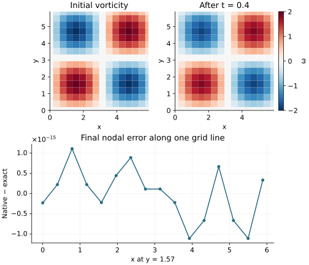

<!-- SPDX-FileCopyrightText: 2026 VTT Technical Research Centre of Finland Ltd -->
<!-- SPDX-License-Identifier: AGPL-3.0-or-later -->

::: {.article-body}
::: {.article-title}
[Flow / Begin with a vortex you can check]{.lesson-kicker}

# Recover velocity from one scalar field

[One evolving vorticity field. A Poisson solve supplies its velocity.]{.lesson-deck}
:::

A two-dimensional incompressible flow can be described by the scalar
vorticity $\omega$. The retained OpenPFC prototype advances

$$
\omega_t+\mathbf u\cdot\nabla\omega=\nu\nabla^2\omega,
$$

and recovers a streamfunction and velocity through

$$
\begin{aligned}
\nabla^2\psi&=-\omega,\\
\mathbf u&=(\psi_y,-\psi_x).
\end{aligned}
$$

The velocity is divergence free because the two mixed derivatives cancel.
On a periodic grid, Fourier differentiation and a diagonal Poisson solve
make this relationship explicit; @trefethen2000 supplies the spectral
background. This chapter teaches the existing solver rather than
introducing a second flow implementation.

## Compose the field, transform and equation

```{.cpp include="model.cpp" snippet="solver" dedent=2}
```

`SpectralCPUStack` owns the field and distributed FFT plan. The example's
`VorticityStreamCPU` composes Poisson recovery, derivatives and the
integrating-factor step. Its slab is $N\times N\times1$, so $k_z=0$;
the physical example remains two dimensional.

For a nonzero mode,

$$
\widehat\psi_{\mathbf k}=\widehat\omega_{\mathbf k}/|\mathbf k|^2.
$$

The streamfunction's zero mode is set to zero, fixing an arbitrary
additive constant. This does **not** set mean vorticity to zero. The
solver retains that mode and gives the nonlinear tendency zero DC.
All supplied periodic initial conditions have zero mean vorticity, as a
curl of a periodic velocity must.
Odd derivative symbols suppress the Nyquist component consistently.

## Look inside the nonlinear evaluation

```{.cpp include="../ns2d/vorticity_stream.hpp" snippet="advection" dedent=2}
```

First recover velocity from vorticity. Then compute both vorticity
derivatives and form $-(u\omega_x+v\omega_y)$ at owned nodes. Transform
that product back and project it onto the retained Fourier band.

The two-thirds mask applies to the state and every integrating-factor
RK4 stage **before** products, as well as to the resulting tendency.
Masking only the product would allow discarded input modes to alias into
the retained band. This is a quadratic product, unlike the
[cubic projection lesson](../../phase-fields/alias-free-cubic/index.qmd).

## Start with a vanishing advection term

Use the periodic square $[0,2\pi)^2$ and the exact Taylor–Green field

$$
\omega(x,y,t)=2\sin x\sin y\,e^{-2\nu t}.
$$

```{.cpp include="../ns2d/cases.hpp" snippet="exact_omega"}
```

Here $\nabla^2\omega=-2\omega$, while
$\mathbf u\cdot\nabla\omega=0$: the two product terms cancel. The
integrating factor therefore advances this mode exactly up to floating
point error. With spatial averages over the square, kinetic energy and
half the mean squared vorticity are

$$
\begin{aligned}
E(t)&=\tfrac14 e^{-4\nu t},\\
Z(t)&=\tfrac12 e^{-4\nu t}.
\end{aligned}
$$

{#fig-vorticity-mode .lightbox fig-alt="Two color maps show the initial and decayed vortex on a common scale; a line plot shows the small final difference from analytic decay."}

The plots read the C++ binary snapshots. Both maps use the same color
scale, and the final curve compares actual nodal output with the exact
mode. Output checks inspect every point in both snapshots, rather than
just the displayed line. The CSV diagnostics use six significant digits;
that printed precision is distinct from the binary field's precision.

This checks normalization, derivative signs, Poisson recovery and viscous
decay. It does not establish nonlinear fourth-order time accuracy, because
this particular advection term vanishes. A two-mode case is needed for
that separate question.

## Compile the shared example and verify it

From the repository root, with a compatible installed spectral CPU SDK:

```sh
mkdir -p results
openpfc compile examples/flow/vorticity/model.cpp --source-root examples/flow -o results/vorticity
results/vorticity --verify --N 16 --steps 8 --dt 0.05 --nu 0.1 --outdir results/flow/vorticity
```

The source compiler captures quoted dependencies below the declared
`flow` root. The [model](model.cpp) shares
[cases.hpp](../ns2d/cases.hpp),
[vorticity_stream.hpp](../ns2d/vorticity_stream.hpp) and
[spectral.hpp](../ns2d/spectral.hpp). Keep that relative layout when
using downloaded files; the checkout already supplies it.

`--verify` compares the final field with the exact vortex using the
retained $10^{-9}$ maximum-error criterion. The run writes diagnostics,
metadata and field snapshots beneath the selected result directory.
The CMake executable name remains `ns2d_vorticity`, with its existing
verification tests and build location.

Change `--nu` or the final time and predict the energy decay before
running. Then try `--case two_mode` without `--verify` to activate
nonlinear transfer. Keep that experiment separate from the exact-vortex
check: a plausible flow picture alone does not establish correctness.
The double-shear case uses a unit square, not this $2\pi$ square; its
length and viscosity conventions must be preserved when experimenting.

## References

::: {#refs}
:::

:::
