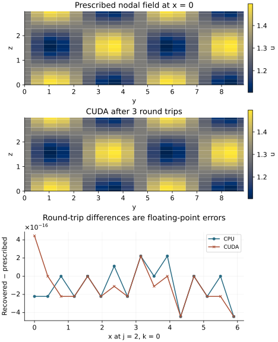

<!-- SPDX-FileCopyrightText: 2026 VTT Technical Research Centre of Finland Ltd -->
<!-- SPDX-License-Identifier: AGPL-3.0-or-later -->

::: {.article-body}
::: {.article-title}
[Fourier methods / Match the plan and its buffers]{.lesson-kicker}

# An FFT reads the memory you give it

[Change the backend. Keep the field, ownership and normalization contracts.]{.lesson-deck}
:::

The [first FFT lesson](../round-trip/index.qmd) checks what a transform
means. Here the question is where its arrays live. A host `std::vector`
and a device allocation can have the same number of doubles, but an FFT
must receive the kind of memory its backend expects.

Use the periodic box $[0,L_x)\times[0,L_y)\times[0,L_z)$ and sample $u(x,y,z)$:

$$
\begin{aligned}
u&=1+0.3\cos(2\pi x/L_x)\\
 &\quad+0.2\sin(4\pi y/L_y)\cos(2\pi z/L_z).
\end{aligned}
$$

```{.cpp include="model.cpp" snippet="signal"}
```

Coordinates come from the owned global grid, rather than a rank-local
flat index. Changing the MPI decomposition therefore changes ownership,
not the function being transformed. No endpoint is duplicated: spacing
is $L_d/N_d$ along each axis.

## Start with a host plan and host arrays

```{.cpp include="model.cpp" snippet="cpu" dedent=4}
```

Both vector lengths come from the plan. The real inbox and complex outbox
can differ in size and decomposition. The forward transform is unscaled;
the inverse includes division by the total global number of real cells,
$M=N_xN_yN_z$. One forward/backward pair therefore returns $u$, and repeated
pairs should keep returning $u$ up to roundoff. A missing inverse scale
would amplify the field by $M$ on every pass.

All MPI ranks must construct the plan and execute every transform in the
same sequence. A distributed FFT can exchange data even while its result
is needed only on rank zero. The original timing demonstrator guarded
plan construction and execution with `rank == 0`; this lesson removes that
collective-participation error. Rank zero only writes the global summary.

## Give a device plan device buffers

```{.cpp include="model.cpp" snippet="buffers"}
```

`DataBuffer<Tag,T>` owns backend-specific storage. For the device tags in
this function, `copy_from_host` uploads the local real input, and `to_host`
downloads the final values and coefficients. The transforms remain on the
device between those transfers. Host indexing such as `real[i]` is not a
substitute for a device kernel.

The CUDA branch chooses its native factory and checks execution completion:

```{.cpp include="model.cpp" snippet="cuda" dedent=4}
```

The HIP branch has the same structure, using `HIPTag`, `create_hip` and
`hipDeviceSynchronize`. The code binds each rank to a visible local device
before constructing its GPU plan. On a cluster, visibility and allocation
come from the scheduler; device zero means the first device visible to
that rank. Backend selection never silently falls back to CPU.

The synchronization check completes queued work before observing it on the
host. These are correctness boundaries, not a timing protocol. This
example makes no speedup or hardware recommendation from a small run.
The stable executable name `fft_backend_benchmark` is retained for existing
build users, but its current purpose is the numerical backend experiment.

## Know the answer before comparing backends

Write the normalized Fourier coefficient as $c_{ijk}=\widehat u_{ijk}/M$.
Euler's identity gives all the nonzero coefficients:

| Mode | Normalized coefficient |
|---|---:|
| $(0,0,0)$ | $1$ |
| $(\pm1,0,0)$ | $0.15$ |
| $(0,2,\pm1)$ | $-0.05i$ |
| $(0,-2,\pm1)$ | $+0.05i$ |

The real-to-complex plan stores only $0\leq i\leq\lfloor N_x/2\rfloor$.
Negative indices on the other axes are represented by their residues, such
as $N_y-2$. The missing negative-$i$ partners are reconstructed by complex
conjugacy. Consequently

$$
\begin{aligned}
\langle u\rangle&=1,\\
\langle u^2\rangle&=1+2(0.15)^2\\
&\quad+4(0.05)^2=1.055.
\end{aligned}
$$

Parseval's identity gives the same mean square from the compressed
spectrum, weighting its interior-$i$ coefficients twice. The $i=0$ plane
and an even grid's $i=N_x/2$ plane each have weight one. Testing all
coefficients, including the expected zeros, exposes normalization or
layout errors that a plausible-looking field alone might hide.

{#fig-backend-buffers .lightbox fig-alt="Three panels show the original periodic nodal pattern, its CUDA round-trip reconstruction, and tiny CPU/CUDA errors along a grid line."}

These plots read the C++ CSV files. The first two panels use the same color
scale and the actual $x=0$ nodes. The errors in the last panel measure
returning the prescribed input, rather than a PDE's spatial truncation
error. The independent checks also inspect the complete fields and spectra
outside these displayed cross-sections.

## Run the same experiment in different memory

With a compatible installed spectral CPU SDK:

```sh
openpfc run model.cpp input.json --launcher=none
openpfc run model.cpp input.json --ranks=2 --launcher=mpirun
```

The [C++ model](model.cpp) and [CPU input](input.json) use a small rectangular
grid and three round trips. The printed attempt contains
`results/field_rank_<rank>.csv`, `modes_rank_<rank>.csv` and `summary.json`.
Both distributed layouts carry global indices. The summary reports the
actual field error, mean and mean square.

The source-model CLI currently qualifies CPU execution. For the GPU route,
build from the checkout using the supported script and run its executable
inside a suitable allocation:

```sh
./scripts/build.sh --machine=tohtori --with-cuda --build-dir=builds/cuda
builds/cuda/examples/fft_backend_benchmark examples/fourier/backend-buffers/cuda.json
```

Run GPU commands inside a suitable allocation. On LUMI use
`./scripts/build.sh --machine=lumi --with-rocm --wait`, then the executable
from the configured flash build with [hip.json](hip.json) on an allocated
GPU node. The [CUDA input](cuda.json) and HIP input change only `backend`;
they require their matching spectral backend in the build. See the
[installation guide](https://vtt-propertune.github.io/OpenPFC/docs/project/install/)
for the compiler, MPI, HeFFTe and accelerator stack.

Change `shape` to an odd grid or increase `cycles`. The physical field and
known coefficients stay fixed; the accumulated roundoff need not match
bit for bit between FFT libraries or decompositions. Compare the complete
outputs and the analytic coefficients, rather than accepting parity
between two potentially incorrect implementations. The native checker
uses those independent coefficients and verifies every real and spectral
owner exactly once.

For a model change, replace the amplitudes $0.3$ and $0.2$ by $a$ and $b$.
Predict $\langle u^2\rangle=1+a^2/2+b^2/4$ before running. The checker is
for the prescribed experiment: when you change the signal, rederive its
coefficient table and moment checks as well.

:::
