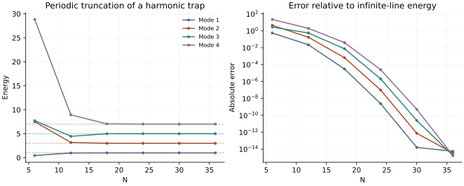

<!-- SPDX-FileCopyrightText: 2026 VTT Technical Research Centre of Finland Ltd -->
<!-- SPDX-License-Identifier: AGPL-3.0-or-later -->

::: {.article-body}
::: {.article-title}
[OpenPFC / Operators and their solutions]{.lesson-kicker}

# Find the energies of a harmonic trap

[Build a Fourier Hamiltonian with the native local FFT and watch its lowest energies converge to odd integers.]{.lesson-deck}
:::

An eigenvalue problem asks which shapes an operator preserves up to a
scalar. Program 8 of @trefethen2000 considers the harmonic oscillator

$$-u''+x^2u=\lambda u,\qquad x\in\mathbb R.$$

Its exact square-integrable energies are $1,3,5,7,\ldots$. We repeat the
book's periodic truncation to $[-8,8]$ and its resolutions 6,12,...,36.
There are two approximations to distinguish: truncating the infinite line
and resolving the resulting finite interval.

## Assemble an operator by applying it to basis vectors

The native local FFT transforms one coordinate basis vector at a time.
Multiplying its Fourier coefficients by $k^2$ applies $-\partial_{xx}$;
the normalized inverse gives one matrix column. This deliberately small
$O(N^2\log N)$ construction makes the operator explicit for an example-owned
symmetric eigensolver. A large calculation would apply it without assembling
all the columns.

```{.cpp include="../matrix.hpp" snippet="laplacian"}
```

The even-grid Nyquist second derivative is retained. Squaring a real-grid
first derivative that suppresses its Nyquist mode would give a different
second derivative. The physical wave number is $2\pi k/16$, not simply $k$.

```{.cpp include="model.cpp" snippet="oscillator" dedent=4}
```

The field supplies physical coordinates for the potential. Its first sample
is $-8+h$, matching the book's cyclic shift of a periodic grid; $-8$ and $8$
are periodic images. The potential and the low-energy modes are not periodic
functions on the whole real line. The finite-domain calculation is an
approximation, justified for modes that are tiny near the chosen endpoints.

{#fig-energies}

## Refine one approximation at a time

```sh
openpfc run model.cpp input.json --source-root .. --launcher=none
```

`results/energies.csv` records all four energies at each input resolution.
Zero floating-point differences appear at the $10^{-16}$ display floor
of the logarithmic error plot; the CSV retains the computed energies.
The native FFT and field are public OpenPFC interfaces; the small dense
Jacobi diagonalization in `matrix.hpp` belongs to this experiment. No public
eigensolver API is implied. The check compares the FFT-built operator with
an independent direct DFT and verifies convergence toward the odd integers.
Increasing $N$ cannot remove an error caused by choosing an insufficiently
large physical interval. Compare next with a
periodic potential, whose spectrum changes for a
different physical reason.

The complete [C++ model](model.cpp) and [starting input](input.json)
are available with this lesson.
Keep the shared [matrix.hpp](../matrix.hpp) one directory above the model.

## References
::: {#refs}
:::
:::
