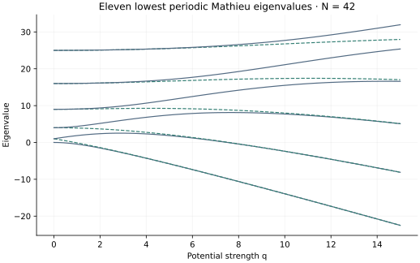

<!-- SPDX-FileCopyrightText: 2026 VTT Technical Research Centre of Finland Ltd -->
<!-- SPDX-License-Identifier: AGPL-3.0-or-later -->

::: {.article-body}
::: {.article-title}
[OpenPFC / Operators and their solutions]{.lesson-kicker}

# A periodic potential splits eigenvalues

[Track the eleven lowest periodic Mathieu eigenvalues as the strength of a cosine potential changes.]{.lesson-deck}
:::

The kinetic operator stays the same; change the potential:

$$
\begin{gathered}
-u''+2q\cos(2x)u=\lambda u, \\
u(x+2\pi)=u(x).
\end{gathered}
$$

Program 21 of @trefethen2000 uses $N=42$ and $q=0,.2,\ldots,15$.
We reproduce that sweep with the native local FFT and the example-owned
symmetric diagonalizer introduced in the harmonic-trap lesson.

## Start from a spectrum you know

At $q=0$, the periodic Laplacian has eigenvalues
$0,1,1,4,4,9,9,\ldots$. Each nonzero resolved frequency has sine and cosine
partners. The potential couples Fourier modes whose indices differ by two.
As $q$ increases, those degeneracies need not survive.

```{.cpp include="model.cpp" snippet="potential" dedent=4}
```

The sampled multiplication operator is diagonal in physical space. The
kinetic operator was obtained from actual FFT applications, including its
physical normalization. Adding their matrices lets the dense reference
solve a real symmetric eigenproblem. The diagonalization is local example
mathematics, not a newly introduced library capability.

{#fig-mathieu}

These are eigenvalues under one periodic boundary condition. They are not
a complete Bloch band-structure calculation. Sorting at every $q$ gives
ordered eigenvalues; it does not transport a particular eigenvector
continuously through crossings or near-degeneracies.

## Change a physical parameter separately from resolution

```sh
openpfc run model.cpp input.json --source-root .. --launcher=none
```

`input.json` selects `n`, `q_max` and the number of intervals in the sweep.
`results/mathieu.csv` contains eleven modes at every sampled $q$. Increase
`n` while keeping the q sweep fixed before interpreting tiny separations.
The checks recover the exact zero-potential multiplicities and compare a
nonzero-q ground state with an independent Fourier-basis calculation.
At coarse resolution, multiplication also aliases unresolved modes; the
[smoothness lesson](../../differentiation/smoothness/index.qmd) explains why
more digits in a solver output do not ensure more resolved physics.

The complete [C++ model](model.cpp) and [starting input](input.json)
are available with this lesson.
Keep the shared [matrix.hpp](../matrix.hpp) one directory above the model.

## References
::: {#refs}
:::
:::
