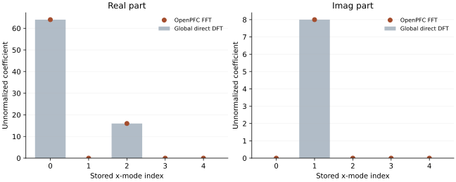

<!-- SPDX-FileCopyrightText: 2026 VTT Technical Research Centre of Finland Ltd -->
<!-- SPDX-License-Identifier: AGPL-3.0-or-later -->

::: {.article-body}
::: {.article-title}
[Fourier / A trustworthy transform]{.lesson-kicker}

# Trust an FFT by checking its coefficients

[A correct total norm can conceal incorrect phases. Compare the complex answers themselves.]{.lesson-deck}
:::

An FFT is an efficient algorithm for a specified discrete Fourier
transform. On a small grid we can afford the defining sum and check the
algorithm against it. This refactors example 03: the independent DFT now
uses the complete global signal and global mode indices, rather than
treating each MPI rank's local values as an independent periodic signal.

## Choose a signal whose phases matter

Use $N_x=8$, $N_y=4$, $N_z=2$ and

$$
\begin{gathered}
u(x,y,z)=1+\tfrac12\cos(2x)-\tfrac14\sin x, \\
x_j=2\pi j/8.
\end{gathered}
$$ {#eq-signal}

The transverse directions repeat the same signal. For the unnormalized
forward convention, the only nonzero coefficients in the stored x-half
spectrum are $\widehat u_{000}=64$, $\widehat u_{100}=8i$, and
$\widehat u_{200}=16$. The imaginary coefficient checks the sine's sign.
The Fourier viewpoint is the same one used for differentiation in
@trefethen2000, program 5.

## Transform the distributed field

```{.cpp include="model.cpp" snippet="transform" dedent=4}
```

The stack chooses compatible real-space and Fourier-space ownership.
`spectrum` is sized to this rank's outbox. Its length need not match the
length of `u` or the outbox length on another rank.

Now evaluate the defining global sum for every locally owned coefficient:

```{.cpp include="model.cpp" snippet="reference" dedent=4}
```

This reference is deliberately expensive and small. It constructs the
known signal independently at every global node. An arbitrary distributed
input would require collecting or otherwise communicating those global
values before the same reference could be used.

{#fig-coefficients}

## Complete the round trip

```{.cpp include="model.cpp" snippet="inverse" dedent=4}
```

The inverse applies the normalization required to recover the original
field. Dividing again by 64 would be an error. Conversely, a round trip
alone could miss a pair of consistently wrong transforms. The coefficient
comparison and the round trip answer different questions.

## Try to break the check

```sh
openpfc run model.cpp input.json --ranks=2 --launcher=mpirun
```

The input is empty; edit the explicit signal in [model.cpp](model.cpp).
The attempt's `results/spectrum_rank_<rank>.csv` records mode indices,
computed complex values, and the independent reference. Repeat on one
rank: the ownership changes but the global coefficients should agree
within roundoff.

Change the sine sign. Predict which stored coefficient changes, then
update its independent expected value. Compare complex differences, not
only squared magnitudes: $8i$ and $-8i$ have the same magnitude.

The executable checks a $10^{-10}$ absolute maximum discrepancy; the
test additionally verifies all 40 stored mode indices and the three known
coefficients. This qualifies this small signal, not every transform size
or hardware backend.

Continue with [choosing an FFT implementation and its layout](../field-layout/index.qmd).

The complete [C++ model](model.cpp) and [starting input](input.json)
are available with this lesson.

## References
::: {#refs}
:::
:::
