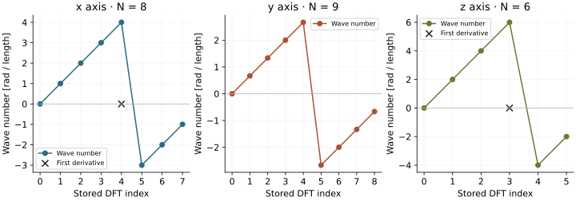

<!-- SPDX-FileCopyrightText: 2026 VTT Technical Research Centre of Finland Ltd -->
<!-- SPDX-License-Identifier: AGPL-3.0-or-later -->

::: {.article-body}
::: {.article-title}
[Fourier / Give a mode its units]{.lesson-kicker}

# An FFT index is not a wave number

[Change the length of the domain. The array indices stay put; the derivatives change.]{.lesson-deck}
:::

On a periodic interval of length $L$, the integer mode $m$ represents
$\exp(i\kappa_m x)$ with $\kappa_m=2\pi m/L$. Its first derivative has
multiplier $i\kappa_m$; its second derivative has multiplier $-\kappa_m^2$.
This is the Fourier differentiation viewpoint of @trefethen2000.

## Start with the physical box

The default grid has $8\times9\times6$ points and lengths
$(2\pi,3\pi,\pi)$. Periodic spacing is $L/N$: the endpoint is not a second
copy of the origin.

```{.cpp include="model.cpp" snippet="domain" dedent=4}
```

The three frequency scales are $1$, $2/3$ and $2$ radians per unit length.
The same integer mode therefore describes different derivatives on each axis.

## Read the stored order deliberately

For $N=8$, OpenPFC labels the full DFT indices by modes
$0,1,2,3,4,-3,-2,-1$. The even-grid Nyquist label is positive.
For $N=9$, the labels are $0,1,2,3,4,-4,-3,-2,-1$; there is no Nyquist sample.

```{.cpp include="model.cpp" snippet="components" dedent=8}
```

The odd-derivative component sets the even-grid Nyquist wave number to zero.
Indeed, $\cos(\pi j)=(-1)^j$ samples a Nyquist cosine with
$\kappa_{\mathrm{Ny}}=\pi N/L$, whose first derivative
vanishes at these nodes. Its **second** derivative does not vanish:

$$
\begin{gathered}
\left.\frac{d}{dx}\cos(\kappa_{\mathrm{Ny}}x)\right|_{x_j}=0,\\
\left.\frac{d^2}{dx^2}\cos(\kappa_{\mathrm{Ny}}x)\right|_{x_j}
=-\kappa_{\mathrm{Ny}}^2(-1)^j.
\end{gathered}
$$

Consequently, applying the nodal first derivative twice does not recover
the direct second derivative of this mode. Keep `k_component` for the
Laplacian; use `k_component_odd` for an ordinary first derivative of a real
field. More general tensor operators need their own Hermitian-symmetry
argument; this lesson does not supply one.

{#fig-waves .lightbox}

## Build an operator from its symbol

For heat flow $u_t=\Delta u$, each Fourier coefficient solves
$\widehat u_t=\lambda\widehat u$, with
$\lambda=-(\kappa_x^2+\kappa_y^2+\kappa_z^2)$. Backward Euler and exact
linear evolution use different multipliers:

$$
\begin{gathered}
g_{\mathrm{BE}}=\frac{1}{1-\Delta t\lambda},\\
g_{\mathrm{exact}}=\exp(\Delta t\lambda).
\end{gathered}
$$

```{.cpp include="model.cpp" snippet="symbols" dedent=4}
```

The zero mode has multiplier one: heat flow preserves the mean. For
nonzero modes, $0<g_{\mathrm{exact}}<g_{\mathrm{BE}}<1$. An unconditionally
stable step can still damp too slowly. The [implicit heat lesson](../../heat/implicit-euler/index.qmd)
applies the backward-Euler multiplier to an actual distributed FFT.

Here `box` is the complete x-compressed real-to-complex box. This small
program inspects symbols without allocating or executing an FFT. A
distributed solver instead passes its rank's actual outbox to the same
iterator; the callback offset then indexes that rank's spectrum.

## Change one length

```sh
openpfc run model.cpp input.json --launcher=none
```

The [model](model.cpp) and [input](input.json) need no companion header.
The run writes `results/axes.csv` and `results/symbols.csv` in its attempt
directory. Double every length and run again: each wave number halves,
and each Laplacian eigenvalue becomes one quarter of its former value.
Then change an even point count to an odd one and predict which zero in
the odd-derivative table will disappear.

The entry-point checker checks every symbol on mixed-parity, odd and
rescaled boxes against independently enumerated physical Fourier basis
functions. It also checks the compressed-box ownership, mean multiplier
and invalid inputs. The figure comes from the default native CSV table;
`examples/render_utilities.py` regenerates it.

## References

::: {#refs}
:::
:::
