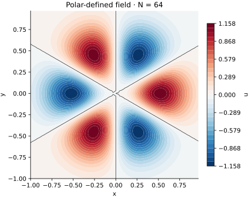

<!-- SPDX-FileCopyrightText: 2026 VTT Technical Research Centre of Finland Ltd -->
<!-- SPDX-License-Identifier: AGPL-3.0-or-later -->

::: {.article-body}
::: {.article-title}
[OpenPFC / A small callable carries the mathematics]{.lesson-kicker}

# Use polar coordinates to define a Cartesian field

[Describe a pattern in the coordinates that make its structure clear, then let OpenPFC evaluate it at owned Cartesian points.]{.lesson-deck}
:::

A Gaussian has a radial envelope. Give it an angular harmonic and it
develops a recognizable lobe pattern:

$$
u(r,\theta)=\left(\frac{r}{\sigma}\right)^m
e^{-r^2/(2\sigma^2)}\cos(m\theta).
$$ {#eq-pattern}

The default uses $m=3$ and $\sigma=0.3$. The grid samples the Cartesian
square $[-1,1)^2$, with spacing $2/N$. Each MPI rank initializes only
the points that it owns.

## Give a point another interpretation

An ordinary C++ function maps a Cartesian point to radius and angle:

```{.cpp include="model.cpp" snippet="mapping"}
```

`atan2` handles all quadrants. At the origin the angle is undefined;
the mapping records `NaN` instead of pretending there is a preferred
direction. The physical scalar field still has a well-defined limit.

## Put the continuous limit into the callable

```{.cpp include="model.cpp" snippet="pattern"}
```

For $m>0$ the factor $r^m$ makes the centre value zero. For $m=0$ the
field is the usual Gaussian, whose centre value is one. Both cases are
smooth because @eq-pattern can also be written

$$
\begin{aligned}
u(x,y)&=\operatorname{Re}
\left[\left(\frac{x+iy}{\sigma}\right)^m\right]\\
&\quad\times e^{-(x^2+y^2)/(2\sigma^2)}.
\end{aligned}
$$ {#eq-cartesian}

For example, the cubic factor at $m=3$ is $(x^3-3xy^2)/\sigma^3$.
This independent Cartesian formula supplies the numerical check without
reusing the C++ polar evaluator.

The angle jumps at its branch cut, but the integer angular harmonic
gives the same scalar field on both sides. Removing the radial factor
would also remove the continuous centre limit for nonzero $m$.

## Let the native field evaluate the expression

```{.cpp include="model.cpp" snippet="initialize" dedent=4}
```

The callable is the extension point used here. The domain, ownership
boxes and differential operators keep their Cartesian meaning. To solve
a differential equation in polar coordinates, follow the
[disk-mode](../../polynomials/disk-modes/index.qmd) and
[polar Poisson](../../polynomials/poisson-disk/index.qmd) chapters, which
derive and apply the corresponding operator.

{#fig-pattern .lightbox}

## Experiment on one process, then two

```sh
openpfc run model.cpp input.json --launcher=none
openpfc run model.cpp input.json --ranks=2 --launcher=mpirun
```

Each attempt writes `results/polar_rank_<rank>.csv`, containing global
indices, physical points, polar coordinates and the owned scalar values.
The undefined angle is the only nonfinite output, at the origin when
the grid contains it. The scalar values there are finite.

Try `harmonic: 0`, then 1 and 3, retaining JSON's quotes around the key.
Predict the number and signs of the lobes. Change `width` without changing
the grid. Then compare one and two ranks: the ownership changes, while
the same Cartesian formula determines every global point.
An odd grid such as $N=9$ omits the origin; compare its samples with an
even grid that includes it.

The checks assemble complete owned fields, reject duplicate or missing
points, verify the origin limits, and compare four parameter choices with
the complex-polynomial formula. Keep the [source](model.cpp) and
[input](input.json) together. The model accepts $N$ from 8 through 128,
integer harmonics 0 through 8 and widths 0.05 through 1.
This refactors the earlier coordinate-wrapper demonstration while retaining
its `17_custom_coordinate_system` executable name.

:::
