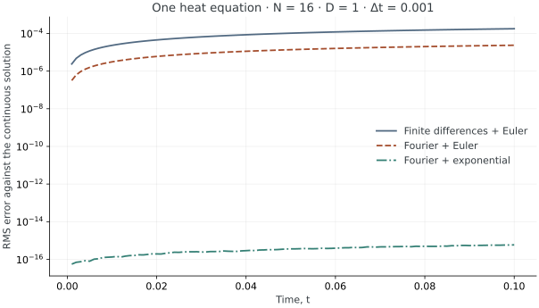

<!-- SPDX-FileCopyrightText: 2026 VTT Technical Research Centre of Finland Ltd -->
<!-- SPDX-License-Identifier: AGPL-3.0-or-later -->

::: {.article-body}

::: {.article-title}

[Lesson 02 / Heat flow]{.lesson-kicker}

# Heat flow from neighbouring values

[A warmer point gives heat to its neighbours. Can a few lines of C++ preserve that simple picture?]{.lesson-deck}

[First six experiments · 4 of 6](../../start/index.qmd){.lesson-route-label}

:::

The heat equation smooths temperature differences. A periodic box makes
the bookkeeping especially revealing: heat cannot leave through an outer
boundary, so the spatial mean must remain constant. A single cosine mode
also gives us an exact decay rate. We can check conservation and accuracy
without guessing what a plausible field should look like.

The [separated-halo lesson](../separated-halos/index.qmd) studies the
communication buffers while keeping the same physical problem.

## One problem, three methods

Let $\Omega=[0,2\pi)^3$ be periodic in every direction, with dimensionless
coordinates and temperature. For constant diffusivity $D>0$,

$$
\begin{gathered}
\partial_t u=D\Delta u, \\
u(\mathbf{x},0)=1+0.2\cos x\cos y\cos z.
\end{gathered}
$$ {#eq-heat}

Each second derivative of the cosine product is its negative, so

$$
u(\mathbf{x},t)=1+0.2e^{-3Dt}\cos x\cos y\cos z.
$$ {#eq-exact}

The spatial mean is one. The root-mean-square fluctuation about that mean
is $0.2e^{-3Dt}/\sqrt8$. Both identities follow directly from the mode;
they are stronger checks than a decreasing maximum alone.

The [Fourier](../fourier/index.qmd) and
[exponential](../exponential/index.qmd) lessons use precisely this problem.
The shared `lesson.hpp` owns input validation and diagnostics; each
`model.cpp` owns its numerical method.

## Turn curvature into a stencil

On a uniform grid with $h=2\pi/N$, approximate the Laplacian by

$$
(\Delta_hu)_{ijk}=\frac{
 u_{i+1,j,k}+u_{i-1,j,k}+u_{i,j+1,k}+u_{i,j-1,k}
 +u_{i,j,k+1}+u_{i,j,k-1}-6u_{ijk}}{h^2}.
$$ {#eq-laplacian}

Opposite fluxes cancel when summed over the periodic grid. Consequently,
forward Euler preserves the discrete mean, up to roundoff:

$$
u^{n+1}=u^n+\Delta t\,D\Delta_hu^n.
$$ {#eq-euler}

For $r=D\Delta t/h^2\le1/6$, @eq-euler is a weighted average: the centre
has weight $1-6r$, and each neighbour has weight $r$. These weights are
nonnegative and sum to one. This gives an intuitive stability condition;
the most negative stencil eigenvalue, $-12/h^2$, gives the same
forward-Euler limit. Fixed-order differences and spectral differentiation
are introduced together in @trefethen2000, chapter 1 and program 5.

## Let the code show the equation

Decompose the periodic domain, allocate a field with one layer of ghost
cells, and initialise its owned values:

```{.cpp include="model.cpp" snippet="initialize" dedent=4}
```

The `2` in the gradient factory selects second-order central differences. The derivative aggregate
asks for `xx`, `yy`, and `zz`; the model does not request or calculate
first derivatives. Now @eq-euler becomes:

```{.cpp include="model.cpp" snippet="evolve" dedent=4}
```

`halo.exchange` refreshes neighbouring values in the padded ghost cells.
`for_each_owned` evaluates the right-hand side at every owned cell before
`u` changes. `du` has the same padded layout as `u`, so the field update
uses matching storage indices.
`u += p.dt * du` is an array update through OpenPFC's
field operators. This ordering matters: overwriting one cell before
calculating its neighbour's derivative would define a different method.

## Predict the answer before running

For our cosine product, @eq-laplacian has the exact discrete eigenvalue

$$
\begin{gathered}
\lambda_h=-\frac{12}{h^2}\sin^2(h/2), \\
A_n=0.2(1+D\Delta t\lambda_h)^n.
\end{gathered}
$$ {#eq-discrete}

Thus the complete computed field should equal
$1+A_n\cos x_i\cos y_j\cos z_k$, within roundoff. Compare it with
@eq-exact to measure the combined spatial and temporal error. A small
error can reflect cancellation between these two contributions; one
fine-looking answer is not a convergence study.

{#fig-heat}

## Run and experiment

From `examples/heat/finite-differences`:

```sh
openpfc run model.cpp input.json --source-root .. --launcher=none
```

`--source-root ..` includes the shared `../lesson.hpp` in the preserved
source snapshot. The input remains [input.json](input.json), and the
implementation is [model.cpp](model.cpp).

The printed attempt directory contains `results/diagnostics.csv` and one
`results/field_rank_<rank>.csv` per rank. Diagnostics are global: `mean`
should stay near one, `rms_fluctuation` should decrease, and `rms_error`
compares every cell with @eq-exact. The field CSV records physical
coordinates, computed temperature, and the exact value.

Try halving `dt` and doubling `steps`, keeping the final time fixed. Then
double `n`, divide `dt` by four, and multiply `steps` by four. Explain why
both changes affect the error. Finally, set `dt` above $h^2/(6D)$: the
program should reject the input before advancing the field.

To compare MPI decompositions, invoke the CLI once with
`--ranks=2 --launcher=mpirun` in place of `--launcher=none`. Compare the
global diagnostics; expect small floating-point differences, not
necessarily identical CSV bytes.

## Verification and scope

The example checks compare every computed cell against @eq-discrete,
verify the reported continuum error, conservation, and decay, and reject
unstable inputs. One- and two-rank runs check the communication boundary.
These are periodic constant-coefficient teaching cases, not a model of
heat loss through a material surface.

Next: [keep the physics and change the spatial derivative](../fourier/index.qmd).

The complete [C++ model](model.cpp) and [starting input](input.json)
are available with this lesson. It also uses the shared [lesson.hpp](../lesson.hpp);
keep its relative location when saving the files.

## References

::: {#refs}
:::

::: {.lesson-navigation role="navigation" aria-label="Beginner lessons"}
[← Previous lesson](../../differentiation/periodic/index.qmd)

[Next: Fourier heat →](../fourier/index.qmd)
:::

:::
