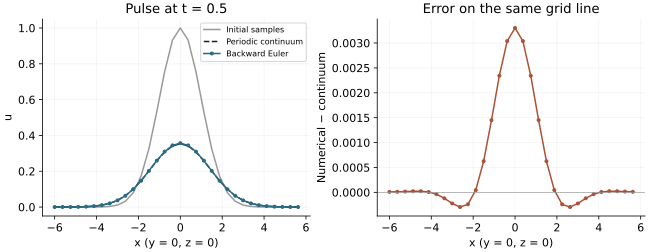

<!-- SPDX-FileCopyrightText: 2026 VTT Technical Research Centre of Finland Ltd -->
<!-- SPDX-License-Identifier: AGPL-3.0-or-later -->

::: {.article-body}
::: {.article-title}
[Heat / Follow a whole pulse]{.lesson-kicker}

# A hot spot spreads without losing heat

[The peak falls. The width grows. The integral stays put. Check all three against the field.]{.lesson-deck}
:::

For $u_t=D\Delta u$ in three-dimensional free space, an initially
unit-height Gaussian with width $\sigma$ evolves as

$$
\begin{gathered}
s^2(t)=\sigma^2+2Dt,\\
u_{\mathbb R^3}(\mathbf x,t)
=\left(\frac{\sigma}{s(t)}\right)^3
  \exp\!\left(-\frac{|\mathbf x|^2}{2s^2(t)}\right).
\end{gathered}
$$

Substitution verifies the equation. Integrating gives the constant heat
$(\sqrt{2\pi}\sigma)^3$. In a large box, this is a useful picture of the
early-time pulse. Our FFT, however, solves a **periodic** problem.

## Make the initial condition match the boundary

Periodize the one-dimensional Gaussian by summing its translated images:

$$
G_L(x,t)=\frac{\sigma}{s(t)}
\sum_{\ell\in\mathbb Z}
\exp\!\left(-\frac{(x+\ell L)^2}{2s^2(t)}\right).
$$

The three-dimensional solution is
$u(x,y,z,t)=G_L(x,t)G_L(y,t)G_L(z,t)$. Each term solves heat flow, and the
sum has matching values and derivatives at the periodic boundaries.
This avoids evolving a truncated free-space Gaussian while comparing it
with a different boundary-value problem.

```{.cpp include="model.cpp" snippet="gaussian" dedent=0}
```

The example retains images $-12$ through $12$. It requires
$s^2(t_{\mathrm{final}})\le L^2$, so omitted images are already more than
$12.5$ final widths away at the edge. The discarded tail is negligible at
double precision. The image count is an example-specific reference choice,
not an OpenPFC boundary condition.

## Give the field a callable

Use a periodic grid on $[-L/2,L/2)^3$, with spacing $L/N$.
`Field::apply` supplies physical coordinates and evaluates the callable
only at this process's owned nodes:

```{.cpp include="model.cpp" snippet="initialize" dedent=4}
```

There is no initializer registry or model inheritance to learn here.
The [initial-pattern lesson](../../initialization/patterns/index.qmd)
uses the same callable approach for several spatial patterns.

## Evolve every resolved Fourier mode

Backward Euler multiplies a mode by
$[1+\Delta tD|\boldsymbol\kappa|^2]^{-1}$ at each step. The zero mode
therefore stays unchanged. The nonzero modes decay, broadening the pulse.

```{.cpp include="model.cpp" snippet="evolve" dedent=4}
```

The [wave-number lesson](../../fourier/symbols/index.qmd) explains the physical
scales and spectral symbols; @trefethen2000 develops the Fourier
differentiation used here. The numerical loop stays separate from the
analytic reference and output.

{#fig-pulse .lightbox}

## Distinguish two approximation errors

The default run uses $N=32$, $L=12$, $\sigma=1$, $D=1$, $\Delta t=0.01$
and 50 steps. It writes each rank's **complete owned field**, with initial,
numerical and continuum values, plus global mass and error diagnostics.

```sh
openpfc run model.cpp input.json
openpfc run model.cpp input.json --ranks=2
```

Keep the [model](model.cpp) and [input](input.json) together; neither needs
a companion header. Results are under `results/` in the CLI attempt
directory. Run from one process so that `--ranks=2` owns the MPI launch.

Try these two experiments:

1. Keep $N$ and final time fixed. Halve `dt` and double `steps`. Once the
   pulse is spatially resolved, backward Euler's error should decrease
   approximately by a factor of two.
2. Keep the time step fixed and narrow `width`. The initial peak may then
   fall between a few widely spaced samples. More time steps cannot
   recover spatial detail that was never sampled; increase $N$ as well.

The grid's conserved quantity is the **discrete** mass
$(L/N)^3\sum_j u_j$. It need not equal the analytic integral when the
initial pulse is under-resolved. An unchanged mass alone is therefore
insufficient evidence that the field is accurate.

The entry-point checker compares every owned value against independent
Fourier-series initialization and direct tensor-product DFT sums. It
checks odd/even grids, unique ownership, discrete mass conservation and
first-order time refinement on one and two MPI ranks. The displayed
reference is checked independently as well. `examples/render_utilities.py`
regenerates the figure from native field CSVs.

## References

::: {#refs}
:::
:::
