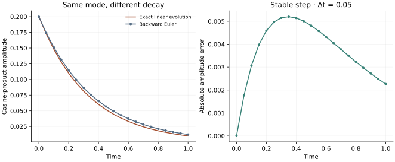

<!-- SPDX-FileCopyrightText: 2026 VTT Technical Research Centre of Finland Ltd -->
<!-- SPDX-License-Identifier: AGPL-3.0-or-later -->

::: {.article-body}
::: {.article-title}
[OpenPFC / One equation, another timestep]{.lesson-kicker}

# An implicit solve can be a division

[Fourier modes diagonalize the Laplacian. That makes an implicit heat step almost as short as an explicit one.]{.lesson-deck}
:::

Return to the [common heat problem](../finite-differences/index.qmd):

$$
\begin{aligned}
u_t&=D\Delta u,\\
u(\mathbf x,0)&=1+.2\cos x\cos y\cos z.
\end{aligned}
$$ {#eq-heat}

The original `04_diffusion_model` used a Gaussian and an approximate
value of pi in its grid. This refactoring keeps its implicit spectral
method, uses physical wave numbers from the native iterator, and joins
the same controlled mode comparison as the other heat lessons.

## Move the new Laplacian to the left

Backward Euler evaluates diffusion at the new time level:

$$
(I-D\Delta t\Delta)u^{m+1}=u^m.
$$ {#eq-implicit}

Since $\widehat{\Delta u}=-|\mathbf k|^2\hat u$, each Fourier
coefficient solves one scalar equation:

$$
\hat u^{m+1}_{\mathbf k}=
\frac{\hat u^m_{\mathbf k}}{1+D\Delta t|\mathbf k|^2}.
$$ {#eq-mode}

```{.cpp include="model.cpp" snippet="implicit" dedent=4}
```

The multiplier never exceeds one for positive $D$ and $\Delta t$.
Thus the linear heat discretization has no explicit-Euler stability
limit. It still has first-order time error. Stability regions and
spectral diagonalization are discussed in @trefethen2000.

## Predict the complete answer

For this initial cosine product, $|\mathbf k|^2=3$. After $m$ steps,
the amplitude is $.2(1+3D\Delta t)^{-m}$ rather than
$.2e^{-3Dm\Delta t}$. Backward Euler therefore decays this mode too
slowly at a fixed physical time. The zero mode stays unchanged, so
the mean remains one.

{#fig-decay}

## Use a stable step, then ask whether it is accurate

```sh
openpfc run model.cpp input.json --source-root .. --launcher=none
```

Double `dt` and halve `steps` to keep the same end time. The solution
remains linearly stable while its error grows. Compare with
[forward Euler](../fourier/index.qmd) and
[the exact linear propagator](../exponential/index.qmd).
The tests compare all physical samples with the discrete amplitude
on one and two ranks, rather than checking just the field maximum.

Keep the [model](model.cpp), [input](input.json) and
[common heat helper](../lesson.hpp) together. Complete fields and
diagnostics are written under the run's `results/` directory.

## References
::: {#refs}
:::
:::
