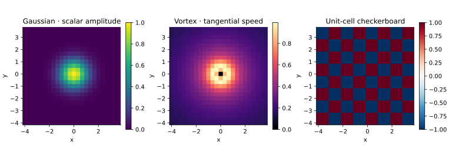

<!-- SPDX-FileCopyrightText: 2026 VTT Technical Research Centre of Finland Ltd -->
<!-- SPDX-License-Identifier: AGPL-3.0-or-later -->

::: {.article-body}
::: {.article-title}
[OpenPFC / From an equation to a field]{.lesson-kicker}

# Write an initial condition as a function

[Define the pattern in physical space. Let the field visit the samples owned by this rank.]{.lesson-deck}
:::

An initial condition is a function evaluated at grid coordinates. It need
not know how many MPI ranks hold the field or which local array offset
corresponds to a point. This refactoring of `14_custom_field_initializer`
turns its Gaussian, vortex and checkerboard demonstrations into actual
owned-field output, rather than separate printed samples of the formulas.

## Keep parameters in a small callable

The Gaussian has width $\sigma$ and unit height:

$$
g(\mathbf x)=\exp[-|\mathbf x|^2/(2\sigma^2)].
$$ {#eq-gaussian}

```{.cpp include="model.cpp" snippet="gaussian"}
```

`field.apply(Gaussian{width})` fills the field. The object carries its
width, so the function needs no global variable. The default grid is a
z=0 slice of a three-dimensional pattern; increasing `nz` samples a slab
over $0\le z<1$. Both descriptions use the same callable.

## Treat a removable singularity explicitly

A regularized vortex has tangential speed

$$
\begin{gathered}
v_\theta(r)=\frac{\Gamma}{2\pi r}(1-e^{-r^2/a^2}), \\
v_\theta(0)=0.
\end{gathered}
$$ {#eq-vortex}

```{.cpp include="model.cpp" snippet="vortex" dedent=4}
```

Near zero, $v_\theta\sim\Gamma r/(2\pi a^2)$. `expm1` evaluates
$e^z-1$ accurately when $z$ is small. The explicit centre case avoids
division by zero. This field stores a scalar tangential speed; it is
not a two-component velocity field or an evolved fluid solution.

## A discontinuity is also a legitimate initial field

```{.cpp include="model.cpp" snippet="checkerboard" dedent=4}
```

The unit cells are defined by `floor` of physical coordinates, including
negative coordinates. Rank-local indices would move the pattern when the
partition changed. Its sharp jumps also explain why Fourier derivatives
of such data need more care than derivatives of a smooth Gaussian.

{#fig-patterns}

## Fill once, inspect everywhere

```sh
openpfc run model.cpp input.json --source-root .. --launcher=none
openpfc run model.cpp input.json --source-root .. --ranks=2 --launcher=mpirun
```

Each rank writes its owned samples to `results/fields_rank_*.csv`.
The checks reconstruct the complete grid and compare every value with
the three formulas on one and two ranks. These are prescribed patterns;
the Gaussian and vortex tails are not made periodic by the grid metadata.

Change `width`, `core` or `circulation`. Then increase `n` and decide
which features are resolved. To select a pattern by name in a file,
continue with [the modifier catalog](../catalog/index.qmd).
Keep the [source](model.cpp), [input](input.json) and
[shared helper](../lesson.hpp) together.
:::
