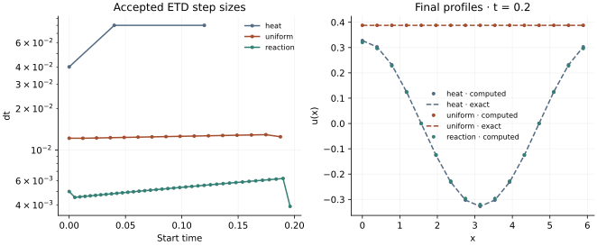

<!-- SPDX-FileCopyrightText: 2026 VTT Technical Research Centre of Finland Ltd -->
<!-- SPDX-License-Identifier: AGPL-3.0-or-later -->

::: {.article-body}
::: {.article-title}
[OpenPFC / Build a simulation]{.lesson-kicker}

# Compare one step with two half steps

[Build adaptive exponential evolution from a linear Fourier symbol, a cubic reaction and explicit rollback.]{.lesson-deck}
:::

An exponential step treats a chosen linear operator exactly, but a nonlinear
forcing still introduces time error. We refactor the adaptive ETD example
into three tests of $u_t=\Delta u-cu^3$ on a periodic domain: a pure heat
mode ($c=0$), a spatially uniform cubic decay ($c=1$), and a nonuniform
reaction–diffusion field. The same driver handles all three.

## Make the split visible

```{.cpp include="model.cpp" snippet="physics"}
```

The library supplies the physical Laplacian symbol $-\lVert k\rVert^2$;
the model returns it unchanged. The local nonlinearity is $-cu^3$.
For a Fourier mode, the ETD1 update has the form

$$
\begin{gathered}
\widehat u^*=e^{hL}\widehat u+h\varphi_1(hL)\widehat{N(u)}, \\
\varphi_1(z)=\frac{e^z-1}{z}, \\
\varphi_1(0)=1.
\end{gathered}
$$ {#eq-etd}

The native implementation evaluates the small-argument limit robustly.
The method's linear exactness does not make its nonlinear part exact.
See @cox2002 for the exponential-integration construction.

## Estimate the error and preserve the accepted state

One full step produces $u_h$; two half steps produce $u_{h/2,h/2}$.
Their difference is $O(h^2)$ for this first-order method, so the controller
uses `error_order=2`. On acceptance it keeps the two-half-step result;
it does not Richardson-extrapolate it.

```{.cpp include="model.cpp" snippet="doubling" dedent=6}
```

Unlike the isolated candidate of the embedded RK lesson, this adapter
leaves its trial field visible during an attempt. Rejecting must restore
both the real field and its Fourier state. The model records the real-field
rollback error for every rejected attempt. The library owns Fourier rollback
and rebuilds the macro-step coefficients after commit or reject.

{#fig-etd}

## Check more than a controller metric

```sh
openpfc run model.cpp input.json --source-root .. --launcher=none
```

The inputs choose even `n`, `tolerance`, initial `dt` and final `end`.
The actual MPI size determines the decomposition; use `--ranks=2
--launcher=mpirun` to exercise distributed transforms. The grid is $N\times4\times4$,
with variation in x only. All lengths and wave numbers are physical.

For the heat case, $u=.4e^{-t}\cos x$. For uniform reaction,
$u=.4/\sqrt{1+2(.4)^2t}$. The latter is not a heat eigenmode: its
Laplacian vanishes and it tests the nonlinear time approximation alone.
The nonuniform case is checked against an independent direct-DFT/RK4
reference on the same finite grid, not just another ETD run. Cubic products
are sampled on the grid; no dealiasing study is claimed here.

Each rank writes an attempt ledger and the complete final fields. Checks
also require unchanged rejected states and the documented plain-attempt
work counts: three nonlinear evaluations and nine transforms. Adaptive
error control is a time-accuracy decision, not a performance measurement.

The complete [C++ model](model.cpp) and [starting input](input.json)
are available with this lesson. It also uses the shared [lesson.hpp](../lesson.hpp);
keep its relative location when saving the files.

## References
::: {#refs}
:::

:::
