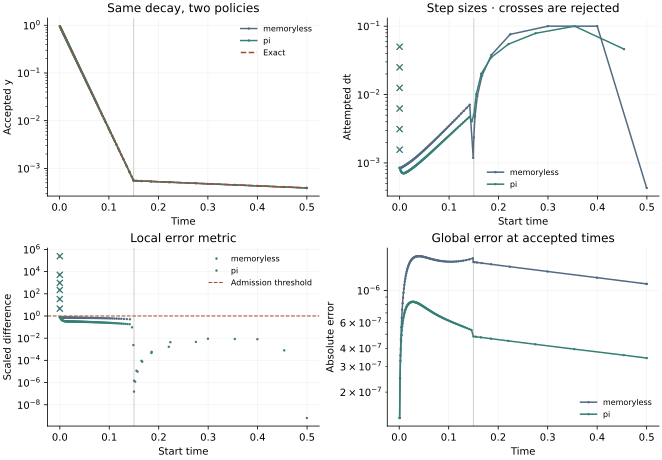

<!-- SPDX-FileCopyrightText: 2026 VTT Technical Research Centre of Finland Ltd -->
<!-- SPDX-License-Identifier: AGPL-3.0-or-later -->

::: {.article-body}
::: {.article-title}
[OpenPFC / Build a simulation]{.lesson-kicker}

# Let the error choose the next step

[Compare memoryless and PI control, keep rejected candidates separate, and land on a known change in decay rate.]{.lesson-deck}
:::

A fixed step must be small enough for the most demanding part of a run.
An adaptive method asks how much error the current step introduces. This
refactors the earlier adaptive example around the deliberately simple model
$y'=-k(t)y$, with $y(0)=1$, $k=50$ before $t_s=0.15$ and $k=1$ afterwards.
Its exact solution is

$$y(t)=\exp[-50\min(t,t_s)-\max(0,t-t_s)].$$ {#eq-decay}

## Two approximations from shared stages

The native Bogacki–Shampine factory supplies a third-order result and an
embedded second-order result. Their difference is $O(h^3)$. The controller
scales it component by component:

$$r=\max_i\frac{|e_i|}{\mathrm{atol}+\mathrm{rtol}\max(|y_i|,|y_i^*|)}.$$ {#eq-scaled-error}

All MPI ranks agree on the maximum. A step is admitted when the metric is
finite and at most one. The memoryless next-step factor is proportional to
$r^{-1/3}$. The native PI controller also uses the previous accepted metric;
its exact gains and safety convention are documented in the public
[controller header](https://github.com/VTT-ProperTune/OpenPFC/blob/master/include/openpfc/kernel/simulation/adaptive_controller.hpp).
A local error tolerance is not a guarantee on the final global error.
The control-theory viewpoint is developed by @soderlind2002; the concrete
gain and safety convention used here follows the OpenPFC contract above.

## A candidate is not an accepted state

```{.cpp include="model.cpp" snippet="adaptive" dedent=6}
```

The stepper keeps its candidate separate from `y`. Only an admitted attempt
copies that candidate into the accepted vector. `controller.apply` then
commits or rejects the clock and stores the next proposed step size.
Rejected attempts do not move accepted time or change `y`.

The rate switch is known in advance, so the driver clips a step to land on
it. The rate stays fixed throughout that attempted interval, including its
endpoint stage. The next interval uses the other rate. This avoids asking a
smooth Runge–Kutta error model to infer an unresolved discontinuity.

{#fig-adaptive}

## Make a controlled comparison

```sh
openpfc run model.cpp input.json --source-root .. --launcher=none
```

Both controllers run at the same `tolerance`, used for both `atol` and
`rtol`. The other inputs set the first proposed `dt`, `transition` and
final `end`. Each rank writes `results/attempts_rank_<rank>.csv`, including
rejections, accepted time, the accepted value, the exact solution and RHS
counts. The scalar state is replicated across ranks here; the reduction
illustrates collective decisions without claiming distributed ODE storage.

Tighten the tolerance from $10^{-4}$ to $10^{-7}$. Compare final error and
work; do not infer that one controller is always better from one trajectory.
Short intervals can also result from clipping to the rate switch or final
time. A small last step is not, by itself, evidence of a new physical transient.
The checks require exact rejection rollback, event alignment, consistent
rank decisions, a more accurate tighter run, and four RHS calls per attempt.
The current stepper does not reuse an FSAL stage.

The complete [C++ model](model.cpp) and [starting input](input.json)
are available with this lesson. It also uses the shared [lesson.hpp](../lesson.hpp);
keep its relative location when saving the files.

## References
::: {#refs}
:::

:::
