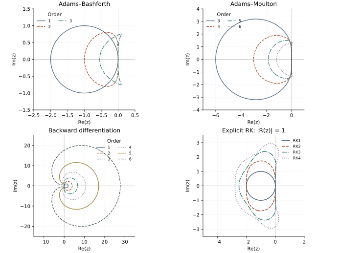

<!-- SPDX-FileCopyrightText: 2026 VTT Technical Research Centre of Finland Ltd -->
<!-- SPDX-License-Identifier: AGPL-3.0-or-later -->

::: {.article-body}
::: {.article-title}
[Time integration / Stability geometry]{.lesson-kicker}

# Where a timestep is allowed to live

[A stable PDE mode becomes an unstable computation if its scaled eigenvalue lands in the wrong part of the complex plane.]{.lesson-deck}
:::

The heat and transport examples have different timestep restrictions.
To understand why, examine the scalar test equation $y'=\lambda y$ and
write $z=\Delta t\lambda$. A one-step method maps $y^n$ to $R(z)y^n$.
Its absolute-stability region is $|R(z)|\le1$.

Program 25 of @trefethen2000 compares the boundaries of Runge–Kutta,
Adams–Bashforth, Adams–Moulton and backward-differentiation formulas.
This example reproduces those families. The explicit RK tableaus are
actual OpenPFC objects; the multistep formulas are example-local
mathematical references, not newly supported library steppers.

## Read stability from the tableau

For an explicit RK tableau, applying its stages to $y'=\lambda y$ with
$y^n=1$ gives

$$
\begin{gathered}
Y_i=1+z\sum_{j<i}a_{ij}Y_j, \\
R(z)=1+z\sum_i b_iY_i.
\end{gathered}
$$ {#eq-stability}

The implementation follows those equations directly:

```{.cpp include="model.cpp" snippet="stability"}
```

We use Euler, the midpoint rule, Kutta RK3 and classical RK4. Their stability
polynomials are the first one, two, three and four terms beyond one in the
exponential series. That identity provides an independent check of the
tableau calculation; it is not how the program computes $R$.

## Different spectra ask different questions

Diffusion contributes negative real eigenvalues. Euler therefore requires
$-2\le\Delta t\lambda\le0$. Pure periodic advection contributes imaginary
eigenvalues. Euler amplifies every nonzero imaginary mode since
$|1+i\eta|^2=1+\eta^2$. A smaller timestep reduces that amplification but
does not create an imaginary-axis stability interval.

Higher-order RK methods have different regions. In particular, classical
RK4 includes an interval on the imaginary axis. Higher order alone is
not a license to choose a timestep without considering the operator's spectrum.

```{.cpp include="model.cpp" snippet="regions" dedent=2}
```

## A root-locus picture for multistep formulas

For a recurrence with characteristic equation $\rho(w)-z\sigma(w)=0$,
a root on the unit circle gives the root-locus map
$z=\rho(e^{i\theta})/\sigma(e^{i\theta})$.

The Adams weights are obtained by integrating Lagrange interpolation
polynomials through the method's time nodes. The program independently
checks their polynomial integration moments. Backward differentiation
uses the backward-difference derivative series:

$$
\begin{gathered}
z=\sum_{j=1}^{p}\frac{(1-w^{-1})^j}{j}, \\
|w|=1.
\end{gathered}
$$ {#eq-bdf}

```{.cpp include="model.cpp" snippet="multistep" dedent=6}
```

{#fig-regions}

For a multistep method all roots must satisfy its root condition, with
unit roots simple. A unit-root curve by itself is not permission to shade
every enclosed region as stable. BDF1, for example, is stable outside
its circle, including the negative real half-plane.

## Experiment with a method rather than a label

```sh
openpfc run model.cpp input.json --launcher=none
```

The empty input leaves the tableaus and plotting domain explicit in
[model.cpp](model.cpp). The output contains `results/rk.csv` with sampled
stability-function magnitudes, and `results/multistep.csv` with root-locus
points. Render them with the documented plotting script.

Predict the Euler and midpoint amplification at $z=-2$ and at $z=2i$.
Then change the RK2 tableau from midpoint to Heun. Their internal stages
differ, but their scalar stability polynomial should be identical. That
does not make the methods identical on a nonlinear problem.

The test compares the computed RK magnitudes against independent Taylor
polynomials and selected multistep negative/positive real intercepts.
The diagram establishes properties of these formulas on the scalar test
equation. Nonnormal operators, nonlinear dynamics and accuracy require
additional analysis.

The complete [C++ model](model.cpp) and [starting input](input.json)
are available with this lesson.

## References
::: {#refs}
:::
:::
