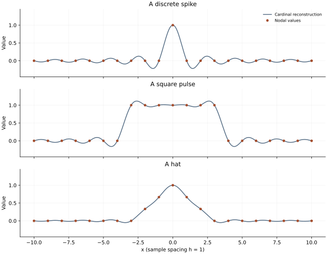

<!-- SPDX-FileCopyrightText: 2026 VTT Technical Research Centre of Finland Ltd -->
<!-- SPDX-License-Identifier: AGPL-3.0-or-later -->

::: {.article-body}
::: {.article-title}
[Interpolation / What the samples say]{.lesson-kicker}

# A curve hidden between the samples

[Passing through every sample does not determine every feature of the curve between them.]{.lesson-deck}
:::

Program 3 of @trefethen2000 reconstructs a discrete spike, a square pulse,
and a hat from equally spaced samples. Their cardinal interpolants all
pass through the supplied values. Their behaviour between those values
can be much less obvious.

## Build a cardinal basis

At spacing $h=1$, define

$$
\operatorname{sinc}(s)=\begin{cases}1,&s=0,\\
\sin(\pi s)/(\pi s),&s\ne0,
\end{cases}
\qquad p(x)=\sum_{j=-10}^{10}u_j\operatorname{sinc}(x-j).
$$ {#eq-cardinal}

At an integer node $m$, all basis functions except the $m$th vanish, so
$p(m)=u_m$. This is an interpolation property, not an error estimate for
an unknown underlying physical field. The finite sum implicitly extends
the discrete data by zero outside the stated node set.

```{.cpp include="model.cpp" snippet="sinc"}
```

OpenPFC supplies the field, coordinates and owned-cell iteration. The
sinc reconstruction is example-local mathematics; it is not presented
as a generic interpolation service in the library.

## Ask three different questions of the same basis

The spike has one nonzero sample at zero. Its interpolant is one sinc.
The square pulse has value one for $|j|\le3$ and zero elsewhere.
The hat has nodal values $\max(0,1-|j|/3)$.

```{.cpp include="model.cpp" snippet="reconstruct" dedent=2}
```

{#fig-interpolation}

The square pulse overshoots between samples even though every sample is
interpolated correctly. The continuous band-limited interpolant is not
the original discontinuous step function. Hiding the oscillation by clipping
the curve would change the reconstruction and conceal the lesson.

## Run and look between the points

```sh
openpfc run model.cpp input.json --launcher=none
```

This example runs on one process. The empty input leaves the node set and
three profiles visible in [model.cpp](model.cpp). The attempt directory's
`results/interpolation.csv` contains 401 evaluation points for each of
the three profiles.

Check values at integer x coordinates first, then near the square pulse's
edge. The test checks every nodal value, the complete spike reconstruction
against one analytic sinc, and the existence of a square-pulse overshoot.
That combination checks both interpolation and a revealing consequence
between nodes.

As an experiment, change the square pulse from seven nonzero samples to
three. Predict what happens to the central plateau and edge oscillations.
Then change the evaluation spacing without changing the input samples.
The reconstructed function should stay the same: you have changed its
display sampling, not the interpolation problem.

## The domain is not a periodic Fourier grid

The sample field has nonperiodic metadata and includes both endpoints
$-10$ and $10$. We do not wrap the sinc tails around this interval.
Periodic trigonometric interpolation is a different basis and boundary
assumption, developed in the [matrix/FFT differentiation lesson](../../differentiation/collocation/index.qmd).

The complete [C++ model](model.cpp) and [starting input](input.json)
are available with this lesson.

## References
::: {#refs}
:::
:::
