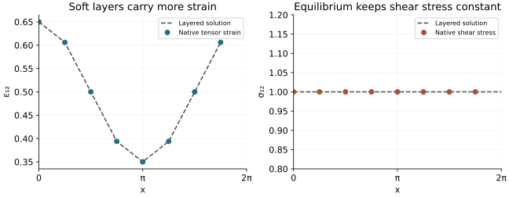

<!-- SPDX-FileCopyrightText: 2026 VTT Technical Research Centre of Finland Ltd -->
<!-- SPDX-License-Identifier: AGPL-3.0-or-later -->

::: {.article-body}
::: {.article-title}
[Materials / Recover a macroscopic law from a small cell]{.lesson-kicker}

# Let layers choose two different averages

[Six imposed strains. Six averaged stresses. A layered solution to check them.]{.lesson-deck}
:::

An elastic cell can have a simple local law and a direction-dependent
macroscopic response. On the periodic cube $[0,2\pi)^3$, let the two Lamé
coefficients vary only along $x$:

$$
\lambda(x)=\mu(x)=\frac{1}{1+a\cos x}.
$$

Choose $0\le a\le1/2$. All values are nondimensional. Each point is locally
isotropic, with
$\boldsymbol\sigma=\lambda\operatorname{tr}(\boldsymbol\varepsilon)I
+2\mu\boldsymbol\varepsilon$. The cell is graded continuously; the
stiffness weight below is not a binary phase indicator.

## Describe the material with an ordinary field

`SpectralCPUStack` supplies a domain, owned field and distributed FFT.
The homogenizer interpolates linearly between two positive stiffnesses,
so we express the prescribed $\mu(x)$ through their shared scalar weight:

```{.cpp include="model.cpp" snippet="layers" dedent=4}
```

`from_lame` receives $\lambda$ and $\mu$ directly. At $a=0$ both endpoints
coincide; assigning zero weight avoids a zero denominator and recovers a
homogeneous material.

## Ask the same cell six independent questions

For each imposed mean strain $\bar{\boldsymbol\varepsilon}$, solve

$$
\begin{aligned}
\nabla\cdot\boldsymbol\sigma&=0,\\
\boldsymbol\varepsilon
  &=\bar{\boldsymbol\varepsilon}
    +\operatorname{sym}\nabla\mathbf u^\#,\\
\langle\operatorname{sym}\nabla\mathbf u^\#\rangle&=0,
\end{aligned}
$$

where the displacement fluctuation $\mathbf u^\#$ is periodic. There is no
eigenstrain in these unit-load solves. FFT-based composite solvers use a
homogeneous reference medium's Green operator to update the heterogeneous
cell [@moulinec1998]. The example composes OpenPFC's installed implementation:

```{.cpp include="model.cpp" snippet="homogenize" dedent=4}
```

The solver's default accelerated fixed point reports relative polarization
change. The example sets its tolerance to $10^{-11}$ and rejects an
unconverged load. That stopping measure is not an independent field-error
bound; the layered solution below supplies a separate check.

## Be explicit about shear

The effective matrix acts on the **engineering** strain vector

$$
(\varepsilon_{11},\varepsilon_{22},\varepsilon_{33},
 \gamma_{23},\gamma_{13},\gamma_{12})^T,
$$

with $\gamma_{ij}=2\varepsilon_{ij}$. The library's `Sym3` fields store tensor
shear, so a unit engineering-shear load imposes mean tensor shear $1/2$.
An isotropic engineering shear diagonal is $\mu$, not $2\mu$.

To derive the response for the last load, impose $\bar\gamma_{12}=1$.
Layered equilibrium makes $\sigma_{12}=S$ constant, while
$\varepsilon_{12}=S/(2\mu(x))$. Averaging the engineering strain gives

$$
1=S\langle1/\mu\rangle,
\qquad H=\langle1/\mu\rangle^{-1}=1.
$$

Thus the exact local fields are

$$
\sigma_{12}=1,\qquad
\varepsilon_{12}(x)=\tfrac12(1+a\cos x).
$$

Softer layers take more strain under the same stress. Shear parallel to
the layers, $\gamma_{23}$, instead has constant strain and averaged stress
proportional to the arithmetic mean of $\mu$.

```{.cpp include="model.cpp" snippet="shear" dedent=4}
```

`strain(load)` retains each solved total strain. After the six loads,
`solver().stress()` belongs to the last load, engineering $12$ shear;
the code reads the matching tensor components from both.

{#fig-layered-shear .lightbox fig-alt="Native C++ shear-strain points follow the layered analytic solution. A second panel shows constant native shear stress at every plotted layer."}

The plot uses actual C++ fields on one owned grid line. Output checks visit
every node from every rank, not only this line.

## Check the entire effective tensor

Define the **grid** arithmetic mean

$$
A_N=\frac1N\sum_{i=0}^{N-1}
\frac{1}{1+a\cos(2\pi i/N)}.
$$

Normal equilibrium also makes $\sigma_{11}$ constant. Since
$\sigma_{11}=\mu(3\varepsilon_{11}+\bar\varepsilon_{22}
+\bar\varepsilon_{33})$, solving for $\varepsilon_{11}$ and averaging gives
$\sigma_{11}=3\bar\varepsilon_{11}+\bar\varepsilon_{22}
+\bar\varepsilon_{33}$. Define $b=(1+8A_N)/3$ and $c=(1+2A_N)/3$.
The normal block is

$$
C_{\mathrm{normal}}=
\begin{pmatrix}
3&1&1\\
1&b&c\\
1&c&b
\end{pmatrix}.
$$

The engineering shear diagonals, in $23,13,12$ order, are $(A_N,1,1)$.
All other entries are zero. At $a=0$, $A_N=1$ and the homogeneous isotropic
tensor is recovered.

The continuum arithmetic mean is $1/\sqrt{1-a^2}$. A finite grid uses the
discrete $A_N$, which approaches that integral as resolution increases.
This distinction matters even when the iterative solve is accurate. The
compatible layered strains above are represented by the constant and
first cosine mode; their nodal constitutive stresses give this discrete
tensor without requiring a second FFT solver as an oracle.

The checker compares all 36 effective entries and the unsymmetrized mean
stress columns, checks the six mean strains and verifies complete nodal
ownership and local shear fields. A converged iteration alone would not
establish these properties.

## Run the cell and change its contrast

From the repository root, with a compatible installed spectral CPU SDK:

```sh
openpfc run examples/materials/layered-homogenization/model.cpp examples/materials/layered-homogenization/input.json
```

The CLI prints its saved attempt directory. Under its `results/`, inspect
`stiffness.csv`, `run.json` and `field_rank_*.csv`. To run the same model on
two ranks, add `--ranks 2 --launcher=mpirun` to the source-run command;
invoke the CLI once outside the launcher.

The [complete model](model.cpp) and [input](input.json) need no private
helper headers. The CMake target is `layered_homogenization`.

Start with `amplitude` zero and predict all tensor entries. Then restore
`0.3`, compare the two shear averages and repeat at `n` equal to 16.
Separate iterative error, grid averaging and material contrast when
interpreting those differences. This small linear elastic cell does not
establish performance or accuracy for high-contrast or nonlinear materials.

## References

::: {#refs}
:::

:::
