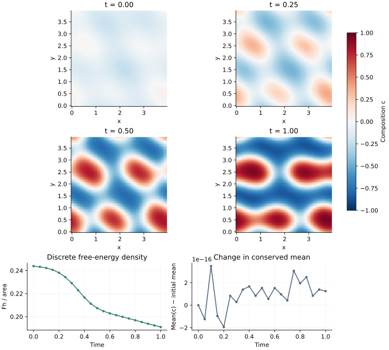

<!-- SPDX-FileCopyrightText: 2026 VTT Technical Research Centre of Finland Ltd -->
<!-- SPDX-License-Identifier: AGPL-3.0-or-later -->

::: {.article-body}
::: {.article-title}
[OpenPFC / A conserved nonlinear model]{.lesson-kicker}

# Let a conserved field separate into phases

[Separate the local free-energy derivative from the differential operators. Three short functions then state the physics.]{.lesson-deck}
:::

A diffuse interface balances a local preference for two phases against
a gradient penalty, following the free-energy construction of @cahn1958.
For a periodic square, take

$$
\begin{aligned}
F[c]&=\int_\Omega f(c,\nabla c)\,d\mathbf x,\\
f(c,\nabla c)&=\frac{(c^2-1)^2}{4}+\frac\gamma2|\nabla c|^2,\\
\mu&=c^3-c-\gamma\Delta c,\\
c_t&=M\Delta\mu.
\end{aligned}
$$ {#eq-physics}

Unlike [Allen–Cahn](../../polynomials/allen-cahn-fixed/index.qmd), this
kinetic law conserves the mean composition. For a smooth periodic
continuum solution, integration by parts gives
$dF/dt=-M\int|\nabla\mu|^2\,d\mathbf x\le0$.

## Put the linear and nonlinear pieces in their own places

For a Laplacian symbol $\ell=-|\mathbf k|^2$, write
$L=-M\ell(1+\gamma\ell)$ and
$\widehat{\mathcal N}=M\ell\,\widehat{c^3}$.

```{.cpp include="model.cpp" snippet="physics"}
```

The local callable evaluates only the cubic. `nonlinear_symbol`
applies its Laplacian in Fourier space. The field declaration tells
the system where the primary `psi` state lives. No model-specific
time loop or FFT bookkeeping belongs inside those three formulas.

## Use the native spectral ETD system

```{.cpp include="model.cpp" snippet="state" dedent=4}
```

The initial mixture is a deterministic sum of physical Fourier modes.
It therefore has the same values at a given global sample on every MPI
partition. This replaces the older example's rank-local random stream
and makes cross-rank comparisons meaningful.

```{.cpp include="model.cpp" snippet="evolve" dedent=4}
```

ETD1 advances

$$
\begin{aligned}
\hat c^{m+1}&=e^{L\Delta t}\hat c^m\\
&\quad+\Delta t\,\varphi_1(L\Delta t)\widehat{\mathcal N(c^m)}.
\end{aligned}
$$ {#eq-etd}

The native coefficient calculation uses the limiting value
$\varphi_1(0)=1$ and stable evaluation near zero; it does not discard
the nonlinear contribution whenever $L=0$. @cox2002 explains
exponential time differencing for stiff systems.

## Check conservation separately from dissipation

{#fig-phase}

Both symbols vanish at zero wave number, so the mean is conserved to
roundoff. The diagnostic energy uses the discrete Fourier Laplacian,
$\langle(c^2-1)^2/4+\gamma c(-\Delta_hc)/2\rangle$.
The mean-angle brackets denote the grid average, so this is energy per
unit area. It agrees with the discrete gradient-flow energy rather than
assuming that sampled first derivatives retain every Nyquist mode.

This first-order explicit nonlinear treatment is not unconditionally
energy stable. Its pointwise cubic is also not de-aliased. A decreasing
curve for the displayed run is an observation, not a general guarantee.
Refine both timestep and grid before interpreting an interface.

## Run a model with an answer you already know

```sh
openpfc run model.cpp input.json --launcher=none
```

Set `initial: "constant"`: every mode except the conserved mean vanishes.
Set `initial: "mode"`, `mean: 0` and `cubic: 0` to isolate the linear
growth rate $M|\mathbf k|^2(1-\gamma|\mathbf k|^2)$. The tests check
these exact limits and compare complete nonlinear small-grid fields
with an independent direct Fourier calculation on one and two ranks.
With `cubic: 0`, the recorded potential becomes
$-c^2/2+1/4$, matching that intentionally modified linear model.

Two companion inputs refine one numerical choice at a time while keeping
the physical end time at 1:

```sh
openpfc run model.cpp refine-grid.json --launcher=none
openpfc run model.cpp refine-time.json --launcher=none
```

Compare the degree-128 final field at every second node with the
degree-64 result, then compare the two degree-64 timesteps. The
[grid refinement input](refine-grid.json) and
[time refinement input](refine-time.json) save initial and final fields
to keep the comparisons small.

In the checked CPU run, the maximum differences were about
$2\times10^{-11}$ for grid refinement and $6.5\times10^{-4}$ for
timestep refinement. These are comparisons between discrete solutions,
not errors against an exact nonlinear PDE solution. For this configured
case, changing the timestep has a much larger effect than refining the grid.

The default $64^2$ grid, .001 timestep and deterministic initial field
replace the old $512^2$ random-field demo while preserving its PDE and
ETD1 method. The new box length is 4 and $\gamma=.04$, so an interface
scale $\sqrt{2\gamma}\approx.28$ spans about 4.5 grid intervals.
These choices give a small demonstration with resolved interfaces;
keeping the old length 20 and $\gamma=.01$ on only 64 points would not.
`results/fields_rank_*.csv` contains saved physical fields;
rank zero writes mean and energy to `results/diagnostics.csv`.
The complete [source](model.cpp) and [input](input.json) are available.

## References
::: {#refs}
:::
:::
