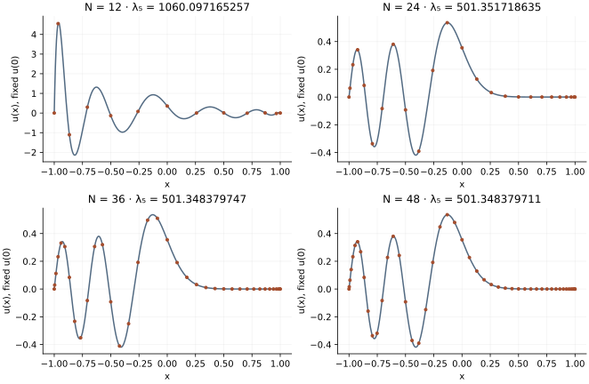

<!-- SPDX-FileCopyrightText: 2026 VTT Technical Research Centre of Finland Ltd -->
<!-- SPDX-License-Identifier: AGPL-3.0-or-later -->

::: {.article-body}
::: {.article-title}
[OpenPFC / Operators and their solutions]{.lesson-kicker}

# A zero weight is a constraint

[Solve the fifth positive Airy eigenmode without dividing by the zero coordinate at the centre of the grid.]{.lesson-deck}
:::

Program 22 of @trefethen2000 solves a generalized eigenproblem:

$$
\begin{gathered}
u''=\lambda xu, \\
u(-1)=u(1)=0.
\end{gathered}
$$

The weight $x$ changes sign and vanishes at the centre. This is not a
positive-definite mass matrix. Dividing every equation by $x$ would be
especially dangerous at the central Chebyshev point, whose floating-point
coordinate is merely close to zero.

## Eliminate the constraint, not a tiny denominator

The centre equation is $(D^2u)_c=0$. Write the other interior indices as O:

$$
\begin{gathered}
u_c=-A_{cc}^{-1}A_{cO}u_O, \\
(A_{OO}-A_{Oc}A_{cc}^{-1}A_{cO})u_O=\lambda\,\mathrm{diag}(x_O)u_O.
\end{gathered}
$$

The remaining weights are nonzero. We solve this reduced finite eigenproblem,
recover the central value, and normalize the fifth positive mode to
$\operatorname{Ai}(0)=1/[3^{2/3}\Gamma(2/3)]$.

```{.cpp include="model.cpp" snippet="constraint" dedent=6}
```

This removes the infinite generalized eigenvalue associated with the zero
weight; it does not discard a finite physical mode. Both the Schur reduction
and the dense QR are example-owned mathematics. They use the same Chebyshev
reference developed earlier, without claiming a public generalized-eigenvalue
API in OpenPFC.

{#fig-airy}

## Separate eigenvalue convergence from residual size

```sh
openpfc run model.cpp input.json --source-root .. --launcher=none
```

The defaults reproduce degrees 12,24,36,48. The coarse grid barely has five
positive finite eigenvalues, so its fifth need not be an accurate continuum
approximation. The CSV separates the selected eigenvalue and matrix residual
from nodal and interpolated field values. A small residual is possible even
on a poorly resolved grid.

The independent checks rebuild the full generalized equations, including
the central constraint, and compare the refined eigenvalue with an Airy
boundary determinant. The normalization at the centre fixes amplitude,
not the number of oscillations or the eigenvalue. Change the resolution
and predict which part of the shape should settle first.

The complete [C++ model](model.cpp) and [starting input](input.json)
are available with this lesson.
Keep [collocation.hpp](../collocation.hpp) in the theme directory.
This model also uses [eigensystem.hpp](../eigensystem.hpp) in that directory.

## References
::: {#refs}
:::
:::
