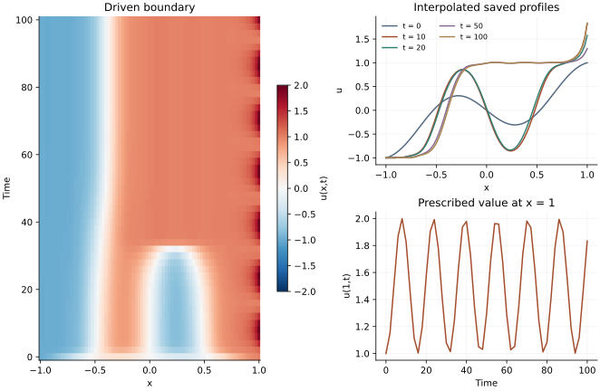

<!-- SPDX-FileCopyrightText: 2026 VTT Technical Research Centre of Finland Ltd -->
<!-- SPDX-License-Identifier: AGPL-3.0-or-later -->

::: {.article-body}
::: {.article-title}
[OpenPFC / Reaction, diffusion and boundaries]{.lesson-kicker}

# A changing wall must enter the next derivative

[The boundary belongs to the time-dependent state. Updating it at the wrong time changes the problem.]{.lesson-deck}
:::

Program 35 of @trefethen2000 evolves the same Allen–Cahn equation as
the [fixed-endpoint lesson](../allen-cahn-fixed/index.qmd), but drives
one endpoint:

$$
\begin{aligned}
u_t&=\epsilon u_{xx}+u-u^3,\\
u(-1,t)&=-1,\\
u(1,t)&=1+\sin^2(t/5).
\end{aligned}
$$ {#eq-driven}

The upper value lies between 1 and 2. It is prescribed externally;
it does not follow the local reaction law. Remember that the
Chebyshev samples run from $x_0=1$ to $x_N=-1$.

## Put the physical boundary in a callable

```{.cpp include="model.cpp" snippet="model" dedent=2}
```

The shared evolution helper uses the full $D^2$ matrix and the current
endpoint values in every interior derivative. In this mode it does not
subtract the fixed lift $x$ or zero the boundary rows.
OpenPFC's Euler stepper forms the provisional next vector, then the
two boundary entries are replaced:

```{.cpp include="../allen_cahn.hpp" snippet="boundary" dedent=4}
```

The overwritten endpoint updates have no influence on that step's
interior values: all right-hand sides were computed from the old
state. On the next step, the derivative sees the newly imposed
boundary. This is the original program's explicit method (II).

For a higher-order Runge–Kutta method, imposing a boundary only after
the final update would generally be insufficient. Each stage's
interior derivative must see the boundary at its own stage time.
This lesson deliberately uses the book's forward Euler method.

{#fig-driven}

## Keep the comparison controlled

The default degree, epsilon, initial profile, timestep prescription
and saved times match the fixed-boundary experiment. The shared helper
keeps the implementation comparable while the two `model.cpp` files
state the different boundary choice.

The default step is .01, with output every 2 time units through time
100. For refinements the [operator-based cap](../allen-cahn-fixed/index.qmd#know-which-restriction-makes-an-explicit-step-expensive)
also limits the step: the book's degree-dependent prescription alone
can become unstable. The scheduler rounds steps per output interval
and increases that count if needed to respect the cap. The CSV reports
the actual times. The interpolated curves evaluate
the degree-$N$ polynomial barycentrically, rather than fitting
monomial coefficients for display.

```sh
openpfc run model.cpp input.json --source-root .. --launcher=none
```

In `results/allen_cahn.csv`, verify every saved endpoint against its
prescribed value. Then compare `dt: .01` with `.005`: a correct wall
does not remove Euler's first-order interior error. The numerical
checks compare the full nodal evolution against independent
Lagrange-product second derivatives, including the time-dependent
boundary contributions.

The model runs on one process. Keep the [source](model.cpp),
[input](input.json), [evolution helper](../allen_cahn.hpp) and
[collocation helper](../collocation.hpp) together.

## References
::: {#refs}
:::
:::
