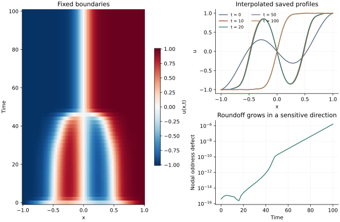

<!-- SPDX-FileCopyrightText: 2026 VTT Technical Research Centre of Finland Ltd -->
<!-- SPDX-License-Identifier: AGPL-3.0-or-later -->

::: {.article-body}
::: {.article-title}
[OpenPFC / Reaction, diffusion and boundaries]{.lesson-kicker}

# Lift the boundary before evolving the interior

[A simple function can carry the prescribed endpoint values, leaving a homogeneous quantity for the derivative operator.]{.lesson-deck}
:::

Allen–Cahn dynamics combine smoothing with a local preference for two
states:

$$
\begin{aligned}
u_t&=\epsilon u_{xx}+u-u^3,\\
u(-1,t)&=-1,\quad u(1,t)=1.
\end{aligned}
$$ {#eq-allen}

For $\epsilon=.01$, program 34 of @trefethen2000 begins with
$u(x,0)=.53x+.47\sin(-1.5\pi x)$ and follows its evolution to time 100.
Degree 20 is deliberately small enough to inspect the whole model.

## Let a line carry the endpoint values

The function $\ell(x)=x$ already satisfies the two endpoint conditions.
Writing $w=u-\ell$ gives $w(\pm1)=0$ and $u_{xx}=w_{xx}$.
The full Chebyshev matrix is squared first. Its endpoint rows are then
zeroed, so diffusion cannot change those two values.
At $u=\pm1$ the reaction $u-u^3$ also vanishes.

```{.cpp include="model.cpp" snippet="model" dedent=2}
```

The shared helper keeps the PDE visible and delegates the Euler update
to OpenPFC:

```{.cpp include="../allen_cahn.hpp" snippet="reaction" dedent=4}
```

Passing a vector to a native time stepper does not require a uniform
physical mesh. The callable owns the spatial interpretation; the
stepper only advances an ODE state. Here `collocation.hpp` supplies an
example-owned nonuniform polynomial derivative.

## Know which restriction makes an explicit step expensive

Forward Euler uses $u^{m+1}=u^m+\Delta t\,f(u^m)$.
The book chooses

$$
\Delta t=\min(.01,50N^{-4}/\epsilon).
$$ {#eq-step}

The $N^{-4}$ comes from the large Chebyshev diffusion eigenvalues;
compare [the grid's spectrum](../eigenmodes/index.qmd).
The original degree-20 run uses .01. The prescription alone becomes
unstable on some finer grids: at degree 40 its diffusive Euler step
lies outside the stability region. To make refinement useful, we also
calculate $B=\|(D^2)_{II}\|_\infty$ and cap the step by
$1.8/(\epsilon B+11)$:

```{.cpp include="../allen_cahn.hpp" snippet="stepcap" dedent=4}
```

Here 11 bounds $|1-3u^2|$ for $|u|\le2$; the factor 1.8 leaves a
margin below Euler's negative-real-axis limit. This diffusion-based
guard preserves the original degree-20 timestep and bounds tested
refinements; it is not a general nonlinear stability theorem.
An explicitly requested step above the cap is rejected. Output-time
adjustment cannot increase the step past the cap.

{#fig-allen}

The cubic term drives values toward either $-1$ or $1$; diffusion
smooths the transition between them. The interfacial scale is
proportional to $\sqrt\epsilon$. A smaller epsilon therefore asks for
more spatial resolution, even though it relaxes the diffusive step
restriction at a fixed degree.

## A symmetric picture can hide a sensitive direction

The exact initial profile is odd. In exact arithmetic the symmetric
discrete problem would keep that symmetry. Floating-point evaluation
introduces tiny asymmetric components, which this long evolution can
amplify. The third panel plots the actual nodal defect
$\max_j|u_j+u_{N-j}|$; its magnitude and sign can vary across platforms.
Do not interpret a minute late-time interface displacement as resolved
physical symmetry breaking.

This is visible when comparing two independent derivative constructions:
their default trajectories agree closely at early times, yet differ
by about $4\times10^{-7}$ at time 100 in the checked CPU run.
Restarting the independent calculation from each saved native field
separates that accumulated sensitivity from the accuracy of the update.
The high-order collocation operator also need not preserve a discrete
maximum principle; tiny excursions past $\pm1$ are possible.

## Run, refine and compare

```sh
openpfc run model.cpp input.json --source-root .. --launcher=none
```

`results/allen_cahn.csv` contains every collocation node and a
barycentrically interpolated curve at each saved time. The book fits
the same polynomial in a monomial basis for display; barycentric
evaluation avoids forming that ill-conditioned representation.

Change `epsilon`, then vary `n` and `dt` separately. Forward Euler has
first-order temporal accuracy. Preserving endpoints proves the boundary
bookkeeping, but does not prove that an interface is resolved.
Tests compare complete small-grid trajectories with independent
Lagrange-basis derivatives and check temporal convergence separately.

This is a serial reference with [source](model.cpp), [input](input.json),
[evolution helper](../allen_cahn.hpp) and
[collocation helper](../collocation.hpp). Continue with
a boundary that changes in time.

## References
::: {#refs}
:::
:::
