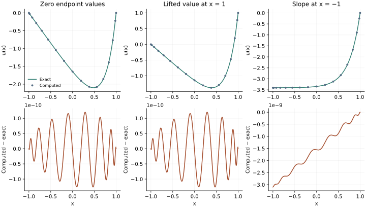

<!-- SPDX-FileCopyrightText: 2026 VTT Technical Research Centre of Finland Ltd -->
<!-- SPDX-License-Identifier: AGPL-3.0-or-later -->

::: {.article-body}
::: {.article-title}
[Polynomial methods / Learn by experiment]{.lesson-kicker}

# A boundary condition changes an equation

[Solve three Chebyshev Poisson problems with OpenPFC GMRES: homogeneous, lifted and mixed boundary data.]{.lesson-deck}
:::

All three experiments solve $u''=e^{4x}$ on $[-1,1]$. What changes is the
information supplied at the endpoints. Programs 13, 32 and 33 of
@trefethen2000 show how zero values, a nonzero value, and a specified
slope enter a collocation calculation.

## Differentiate before removing boundary values

Form $D^2$ on the complete grid, then select equations and unknowns.
Squaring an already truncated first-derivative matrix would discard
endpoint contributions and give a different second derivative.
For $u(-1)=u(1)=0$, retain only the interior block of $D^2$.

For $u(-1)=0$, $u(1)=1$, write $u=v+(x+1)/2$. The lift satisfies the
boundary values and its second derivative is zero. The interior system
for $v$ is therefore the same homogeneous-boundary problem.

For $u'(-1)=0$, $u(1)=0$, retain the value at $-1$ as an unknown and replace
the equation there with the corresponding row of $D$. The derivative row
is evaluated at $-1$, which is the *last* node in this storage order.

```{.cpp include="model.cpp" snippet="boundaries" dedent=4}
```

OpenPFC GMRES solves these example-owned collocation systems. They illustrate
boundary equations; they do not advertise a public Chebyshev boundary
operator or attach a nonperiodic boundary condition to a periodic FFT.
The [integration chapter](../integration/index.qmd) explains row scaling
and the native linear-solver contract.

## Three answers that can be checked independently

For zero boundary values,

$$u_0(x)=\frac{e^{4x}-x\sinh4-\cosh4}{16}.$$ {#eq-zero}

The lifted solution is $u_0(x)+(x+1)/2$. For the mixed conditions,

$$u_m(x)=\frac{e^{4x}-4e^{-4}(x-1)-e^4}{16}.$$ {#eq-mixed}

Differentiate these formulas and substitute the endpoints before looking
at a plot. This checks both the forcing and the boundary signs.

{#fig-boundaries}

## Experiment with the boundary, not only the resolution

```sh
openpfc run model.cpp input.json --source-root .. --launcher=none
```

`results/solutions.csv` labels each case and distinguishes grid nodes from
an interpolated curve. The default `n=16` repeats the book's degree. Try
8 and 24; compare the entire curve with the analytic solution. The tests
check all three curves, both endpoint values where prescribed, and the
Neumann equation using an independent Lagrange derivative at the endpoint.

As an exercise, lift arbitrary values $u(-1)=a$, $u(1)=b$ with
$\ell(x)=a(1-x)/2+b(1+x)/2$. Then change the slope condition to a nonzero
value and modify its right-hand side. A derivative row is an equation,
not a special flag whose meaning the linear solver can infer.

The complete [C++ model](model.cpp) and [starting input](input.json)
are available with this lesson. It also uses the shared [collocation.hpp](../collocation.hpp);
keep its relative location when saving the files.

## References
::: {#refs}
:::
:::
