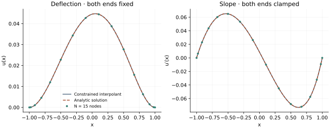

<!-- SPDX-FileCopyrightText: 2026 VTT Technical Research Centre of Finland Ltd -->
<!-- SPDX-License-Identifier: AGPL-3.0-or-later -->

::: {.article-body}
::: {.article-title}
[OpenPFC / Four derivatives, four endpoint conditions]{.lesson-kicker}

# Build the clamped ends into the trial function

[A zero value and a zero slope are different conditions. Choose a representation that satisfies both.]{.lesson-deck}
:::

Program 38 of @trefethen2000 solves a dimensionless clamped beam problem:

$$
\begin{aligned}
u^{(4)}(x)&=e^x,\qquad -1<x<1,\\
u(\pm1)&=u'(\pm1)=0.
\end{aligned}
$$ {#eq-beam}

The degree-15 grid is small enough to expose the whole construction.
Deleting the endpoint rows of an ordinary fourth-derivative matrix
would impose only two of the required conditions.

## Use the native Chebyshev building blocks

OpenPFC provides Lobatto nodes and a complete-domain FFT-based first
derivative. Apply that derivative to the nodal basis vectors to obtain
the matrix representation:

```{.cpp include="../clamped.hpp" snippet="native" dedent=2}
```

The earlier [differentiation lesson](../differentiation/index.qmd) develops
reference formulas so you can see the polynomial mathematics. Here the
native `chebyshev_derivative` supplies the same operation directly.
The example-owned helper composes it into a constrained fourth derivative;
it does not add a new public beam solver.

## Put both endpoint conditions in the representation

Write $u(x)=(1-x^2)v(x)$, where the degree-$N$ polynomial $v$ has
$v(\pm1)=0$. Then both $u$ and
$u'=-2xv+(1-x^2)v'$ vanish at the ends. Differentiating four times gives

$$
u^{(4)}=(1-x^2)v^{(4)}-8xv^{(3)}-12v''.
$$ {#eq-product}

At interior nodes, $v_j=u_j/(1-x_j^2)$. That identity gives the
weighted matrix from the book:

```{.cpp include="../clamped.hpp" snippet="clamped" dedent=2}
```

The complete derivative matrices are formed before selecting the
interior equations. There is no division by $1-x^2$ at the endpoints.
The grid has $N+1$ points; the represented $u$ can have degree $N+2$.

## Solve for the values, then evaluate the right interpolant

```{.cpp include="model.cpp" snippet="solve" dedent=4}
```

Native GMRES solves the small row-scaled linear system. The displayed
solution is $(1-x^2)$ times the interpolant of $v$, and its slope follows
the same product rule. Fitting an ordinary degree-$N$ polynomial through
the solved $u_j$ would generally lose the clamped slopes between nodes.
The book uses monomial fitting for this display; the example uses
barycentric evaluation of the same auxiliary polynomial.

{#fig-beam}

## An exact solution makes the check decisive

Every solution of $u^{(4)}=e^x$ is $e^x$ plus a cubic. Choose the cubic
so its values and slopes at both endpoints equal those of $e^x$.
Subtracting it gives the exact clamped solution. The numerical checks
solve those four coefficient equations independently and compare every
saved value and slope, including both endpoints.

```sh
openpfc run model.cpp input.json --source-root .. --launcher=none
```

`results/beam.csv` contains nodal and dense display values, slopes and
analytic references. Try degree 8, then 15. Once the smooth forcing is
resolved, roundoff and conditioning limit further improvement. This
complete-domain polynomial reference runs on one process.

Keep the [source](model.cpp), [input](input.json),
[clamped-operator helper](../clamped.hpp) and
[collocation helper](../collocation.hpp) together.

## References
::: {#refs}
:::
:::
