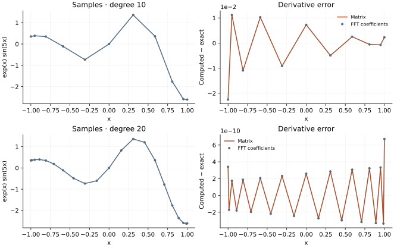

<!-- SPDX-FileCopyrightText: 2026 VTT Technical Research Centre of Finland Ltd -->
<!-- SPDX-License-Identifier: AGPL-3.0-or-later -->

::: {.article-body}
::: {.article-title}
[Polynomial methods / Learn by experiment]{.lesson-kicker}

# Differentiate a cosine-mapped grid

[Compare a Chebyshev collocation matrix with coefficients obtained through OpenPFC LocalFFT, including both endpoints.]{.lesson-deck}
:::

A nonperiodic interval can still benefit from a Fourier transform. Write
$x=\cos\theta$ and observe that a degree-$N$ polynomial in $x$ becomes a
cosine series in $\theta$. Programs 11 and 18 of @trefethen2000 differentiate
$f(x)=e^x\sin(5x)$ on this grid. We compare the collocation matrix with a
cosine-coefficient route using OpenPFC's public `LocalFFT`.

## A derivative matrix from interpolation

Let $x_j=\cos(j\pi/N)$ and let $c_0=c_N=2$, with $c_j=1$ otherwise.
For distinct rows and columns,

$$
\begin{gathered}
D_{ij}=\frac{c_i}{c_j}\frac{(-1)^{i+j}}{x_i-x_j}, \\
D_{ii}=-\sum_{j\ne i}D_{ij}.
\end{gathered}
$$ {#eq-cheb-matrix}

The diagonal enforces the derivative of a constant. Each row acts on every
sample; this is global polynomial collocation, not a local stencil.

```{.cpp include="../collocation.hpp" snippet="matrix"}
```

## Make an even extension

The sequence $f(x_0),\ldots,f(x_N),f(x_{N-1}),\ldots,f(x_1)$ has length
$2N$. Its unscaled real FFT yields cosine coefficients: divide interior
coefficients by $N$, and the constant and highest coefficients by $2N$.
If $p(x)=\sum_k a_kT_k(x)$, then

$$p'(\cos\theta)=\sum_{k=1}^N k a_k\frac{\sin(k\theta)}{\sin\theta}.$$ {#eq-cosine-derivative}

At $x=1$, $T_k'(1)=k^2$; at $x=-1$, $T_k'(-1)=(-1)^{k-1}k^2$.
These analytic limits avoid dividing by zero at the endpoints.

```{.cpp include="../collocation.hpp" snippet="cosine"}
```

OpenPFC supplies the local transform and its normalization contract. The
mapping, cosine coefficients, and endpoint formulas are example-owned.
Unlike the book's FFT differentiation routine, this transparent version
evaluates the coefficient sum directly at every node, so its total work is
$O(N^2)$ despite using an FFT for coefficient extraction. It demonstrates
the same polynomial derivative, without claiming an $O(N\log N)$ evaluator.

{#fig-differentiation}

## Check an answer, not only agreement

```{.cpp include="model.cpp" snippet="differentiate" dedent=4}
```

```sh
openpfc run model.cpp input.json --source-root .. --launcher=none
```

`input.json` selects `sizes`, initially `[10,20]`.
`results/derivatives.csv` includes the actual samples, both derivatives and
$e^x(\sin5x+5\cos5x)$. Compare endpoint errors separately from interior
errors. The tests check every value against this independent derivative,
then require the degree-20 error to be much smaller than degree 10. They
also check agreement between the two algorithms; agreement alone would
not establish accuracy.

The complete [C++ model](model.cpp) and [starting input](input.json)
are available with this lesson. It also uses the shared [collocation.hpp](../collocation.hpp);
keep its relative location when saving the files.

## References
::: {#refs}
:::
:::
