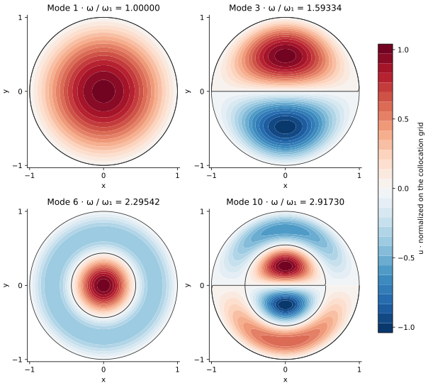

<!-- SPDX-FileCopyrightText: 2026 VTT Technical Research Centre of Finland Ltd -->
<!-- SPDX-License-Identifier: AGPL-3.0-or-later -->

::: {.article-body}
::: {.article-title}
[OpenPFC / Fourier modes meet polar geometry]{.lesson-kicker}

# Meet at the centre of a disk

[The centre is shared by every angle. A half-turn connects the two signs of the radial coordinate.]{.lesson-deck}
:::

Program 28 of @trefethen2000 finds vibration modes of a unit disk:

$$
-\Delta u=\lambda u,\qquad u(1,\theta)=0.
$$ {#eq-disk}

For the unit-speed wave equation, $\lambda=\omega^2$. The book displays
four shapes, with sorted indices 1, 3, 6 and 10, and reports their
frequencies relative to the fundamental.

In polar coordinates,

$$
\Delta u=u_{rr}+\frac{u_r}{r}+\frac{u_{\theta\theta}}{r^2}.
$$ {#eq-polar}

The coefficients look singular at the centre. Start with the geometry
before dividing by the radius.

## Give negative radius a geometric meaning

The points $(-r,\theta)$ and $(r,\theta+\pi)$ represent the same Cartesian
point. For an angular Fourier mode $e^{ik\theta}$ this gives

$$
R_k(-r)=(-1)^kR_k(r).
$$ {#eq-parity}

Use an odd degree $N$ for the signed Lobatto grid on $[-1,1]$.
There is no node at zero, and each positive radial unknown has a negative
partner. The default $N=25$ leaves twelve positive interior radii.
Both boundary radii have zero value.

Native OpenPFC derivatives supply the complete one-dimensional matrices:

```{.cpp include="../disk.hpp" snippet="derivatives" dedent=4}
```

The complete matrices are formed before selecting interior equations.
With $\partial_{\theta\theta}=-k^2$, fold the negative columns into
the positive ones using @eq-parity:

```{.cpp include="../disk.hpp" snippet="radial" dedent=4}
```

This is an example-owned polar composition. Native Chebyshev differentiation
and the local FFT are public OpenPFC building blocks; the helper does not
introduce a production polar-grid backend.

## Preserve the multiplicity of an angular mode

The book diagonalizes one $240\times240$ tensor matrix at $N=25$, $M=20$.
Fourier separation gives the same matrix spectrum through eleven small
radial blocks. For each nonzero frequency below Nyquist, cosine and sine
give two independent shapes with the same eigenvalue:

```{.cpp include="model.cpp" snippet="modes" dedent=4}
```

The zero mode and the angular Nyquist mode each have one real sampled
shape. Keeping those multiplicities gives all 240 eigenvalues. It also
chooses a reproducible orientation inside a repeated eigenspace; a rotated
linear combination of a sine/cosine pair describes an equally valid mode.

{#fig-disk .lightbox}

## Reconstruct the centre deliberately

The plotted radial polynomial uses the signed nodal values and their
Fourier parity:

```{.cpp include="model.cpp" snippet="display" dedent=6}
```

The original collocation grid has no pole unknown. For the display, the
axisymmetric mode takes its interpolated value at zero; nonzero angular
modes use the regular limit zero. The display grid adds no PDE resolution.
Normalization uses the largest absolute collocation value, so an
interpolated value between nodes can slightly exceed one.

Parity alone is not a complete regularity condition for every angular
mode. Check the selected low modes against their continuum forms:

$$
\begin{aligned}
u(r,\theta)&=J_k(\alpha r)
\begin{cases}\cos(k\theta),\\\sin(k\theta),\end{cases}\\
J_k(\alpha)&=0.
\end{aligned}
$$ {#eq-bessel}

The positive Bessel zeros and their notation are described in
@nistbesselzeros. Their squares give the eigenvalues; the zeros themselves
give frequency ratios. The independent numerical check evaluates Bessel
series and brackets their roots, then compares all saved nodal and display
values of the four selected shapes. It also checks every discrete radial
eigenvector and the full polar action, including the angular derivative.

## Run the original experiment

```sh
openpfc run model.cpp input.json --source-root .. --launcher=none
```

The [input](input.json) retains the book's $N=25$, $M=20$. The output includes
every eigenvalue in `results/spectrum.csv`, every radial eigenvector with
its angular labels in `results/radial.csv`, the four frequency ratios in
`results/selected.csv`, and all plotted fields in `results/fields.csv`.
The picture uses a two-dimensional field and nodal lines in place of the
book's wireframe projection.

Try $N=15$, then 25. Compare eigenvalues and shape errors before judging
the smoothness of a plot. Then increase $M$: predict which angular modes
become representable and which low modes should remain unchanged.
Continue with [Poisson's equation on the same disk](../poisson-disk/index.qmd)
to separate geometry from the regularity of the forcing.

This complete-domain reference uses one process, odd degrees 7 through 63
and even angular counts 8 through 64. Keep the [model](model.cpp),
[polar helper](../disk.hpp), [eigensolver](../eigensystem.hpp) and
[collocation helper](../collocation.hpp) together.

## References
::: {#refs}
:::
:::
