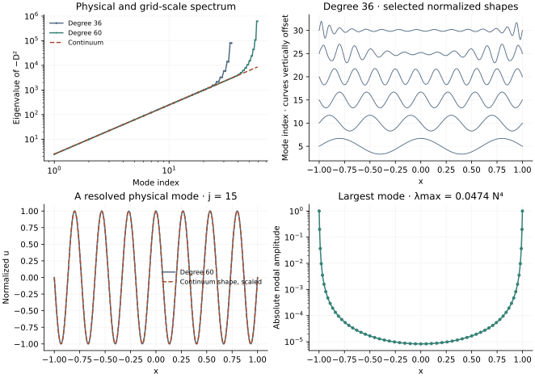

<!-- SPDX-FileCopyrightText: 2026 VTT Technical Research Centre of Finland Ltd -->
<!-- SPDX-License-Identifier: AGPL-3.0-or-later -->

::: {.article-body}
::: {.article-title}
[OpenPFC / Operators and their solutions]{.lesson-kicker}

# A grid has its own spectrum

[Distinguish physical Dirichlet eigenmodes from large grid-scale eigenvalues and the timestep restriction they create.]{.lesson-deck}
:::

A derivative matrix has more to teach than a single derivative. Programs
15 and 26 of @trefethen2000 examine the Dirichlet problem
$u''=\lambda u$ and the high-frequency end of its Chebyshev discretization.
We report the positive eigenvalues of $-D^2$ so physical frequencies and
stiffness can share one graph.

## Impose endpoint values before solving an eigenproblem

The full first-derivative matrix is squared before its known-zero boundary
values are removed. The interior matrix approximates $-u''$ on $[-1,1]$.
Its continuum eigenvalues are $(j\pi/2)^2$, with corresponding sine modes.

```{.cpp include="model.cpp" snippet="eigenproblem" dedent=4}
```

The collocation matrix is generally not symmetric in the ordinary Euclidean
inner product. The helper therefore uses an example-owned complex shifted
QR calculation, rather than applying a symmetric eigensolver to it. It
checks every returned eigenpair's scaled matrix residual. Such a residual
measures the finite matrix equation; it cannot establish continuum accuracy.

{#fig-spectrum}

The low modes become spectrally accurate when resolved. Modes near the
matrix dimension do not automatically approximate the corresponding
continuum sine accurately. Chebyshev endpoint spacing is $O(N^{-2})$;
the largest second-derivative eigenvalues grow as $O(N^4)$, making an
explicit diffusive timestep much more restrictive than on a uniform grid.

## Reproduce both experiments

```sh
openpfc run model.cpp input.json --source-root .. --launcher=none
openpfc run model.cpp trefethen-p26.json --source-root .. --launcher=none
```

The first uses degree 36 and modes 5,10,...,30. The second uses degree 60
and shows mode 15 and the largest mode. The original p26 source labels its
physical mode N/4 but selects index N/4-1; this preset uses actual mode N/4
and labels it accordingly. Full eigenvalues, imaginary roundoff and scaled
residuals are in `results/spectrum.csv`; nodal and interpolated shapes are
in `results/modes.csv`. `modes` must stay in 1..n-1.

The tests compare the lowest modes with their exact values and verify all
finite eigenpairs against an independently assembled operator. Connect the
largest eigenvalue with the [stability-region lesson](../../integration/stability/index.qmd):
a stable explicit step is a condition on every resolved discrete mode,
not only the physical mode used for an initial condition.

The complete [C++ model](model.cpp) and [starting input](input.json)
are available with this lesson.
Keep [collocation.hpp](../collocation.hpp) in the theme directory.
This model also uses [eigensystem.hpp](../eigensystem.hpp) in that directory.
Download the [program 26 preset](trefethen-p26.json) for the degree-60 experiment.

## References
::: {#refs}
:::
:::
