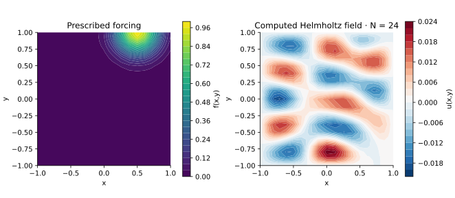

<!-- SPDX-FileCopyrightText: 2026 VTT Technical Research Centre of Finland Ltd -->
<!-- SPDX-License-Identifier: AGPL-3.0-or-later -->

::: {.article-body}
::: {.article-title}
[OpenPFC / Operators and their solutions]{.lesson-kicker}

# A wave number can make a solve delicate

[Keep the tensor discretization and add a Helmholtz shift that changes the spectrum and conditioning.]{.lesson-deck}
:::

Keep the square, zero endpoint values and polynomial grid, but solve

$$\Delta u+k^2u=e^{-10[(y-1)^2+(x-.5)^2]}.$$

Program 17 of @trefethen2000 chooses $k=9$. The source is concentrated
near the top boundary, while the solution can oscillate throughout the
interior. This is an elliptic boundary solve, not a time-marching wave.

```{.cpp include="model.cpp" snippet="source" dedent=4}
```

## A diagonal shift changes the solver's assumptions

The shared tensor action adds $k^2U_{ij}$ to the Laplacian action.
Even though $-\Delta$ with homogeneous Dirichlet values is positive definite,
$\Delta+k^2I$ can be indefinite or singular. We therefore use native GMRES,
not a method that assumes positive definiteness. Its diagonal inverse is
only a preconditioner; it does not decide the physical boundary condition.

```{.cpp include="../tensor.hpp" snippet="tensor" dedent=2}
```

Continuum resonances satisfy
$k^2=(\pi^2/4)(m^2+n^2)$ for positive integers m,n. Near one of them,
a small change in forcing or resolution can change the amplitude strongly.
At a resonance an arbitrary forcing need not admit a unique solution.

{#fig-helmholtz}

## Give the shifted problem its own oracle

```sh
openpfc run model.cpp input.json --source-root .. --launcher=none
```

The inputs are `n`, `wave` and `manufactured`. The manufactured mode uses
$u=(1-x^2)(1-y^2)$, with its matching $\Delta u+k^2u$ on the right-hand side.
All final nodes are in `results/solution.csv`. The checks compare that
field with its exact formula and the book forcing with an independent
small dense system. A separate reference inspects the default degree 24.

Try changing `wave` before changing `n`. Distinguish a genuine near-resonant
amplitude from a failure to resolve the spatial solution. More GMRES
iterations cannot fix either an inappropriate boundary condition or the
absence of a unique continuum solution. Compare next with
nonzero boundary data.

The complete [C++ model](model.cpp) and [starting input](input.json)
are available with this lesson.
Keep [collocation.hpp](../collocation.hpp) in the theme directory.
This model also uses [tensor.hpp](../tensor.hpp) in that directory.

## References
::: {#refs}
:::
:::
