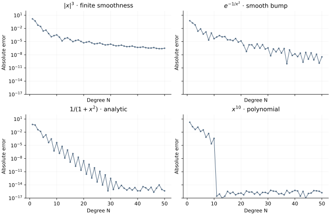

<!-- SPDX-FileCopyrightText: 2026 VTT Technical Research Centre of Finland Ltd -->
<!-- SPDX-License-Identifier: AGPL-3.0-or-later -->

::: {.article-body}
::: {.article-title}
[Polynomial methods / Learn by experiment]{.lesson-kicker}

# An integral is a boundary-value problem

[Recover four definite integrals by solving for an antiderivative with OpenPFC GMRES.]{.lesson-deck}
:::

An integral can be computed without introducing quadrature weights first.
Program 30 of @trefethen2000 solves the initial-value problem

$$
\begin{gathered}
v'(x)=f(x), \\
v(-1)=0, \\
I=v(1).
\end{gathered}
$$ {#eq-antiderivative}

We use the same Chebyshev collocation experiment for the four functions
from the [regularity lesson](../regularity/index.qmd), replacing the book's
explicit matrix inverse with OpenPFC's GMRES solver.

## Remove the known endpoint

The nodes run from $x_0=1$ to $x_N=-1$. The last value of $v$ is known,
so it is removed from the unknown vector. We impose $v'=f$ at the first
$N$ nodes and solve

$$D_{0:N-1,\,0:N-1}\,v_{0:N-1}=f_{0:N-1}.$$ {#eq-integration-system}

The desired integral is the first component, $v_0$. There is no sign flip:
the order of stored nodes does not change the direction of the integral.

```{.cpp include="model.cpp" snippet="integrate" dedent=4}
```

## Give the linear solver an operator

OpenPFC's solver accepts an action $w=Av$ and vector operations. This small
example stores a dense matrix; the same solver contract also admits an
operator that never forms a matrix. Each equation is scaled by its largest
coefficient before solving. The stopping norm therefore belongs to the
scaled equations, and the tests separately check the physical integral.

```{.cpp include="../collocation.hpp" snippet="solve"}
```

We use GMRES because this collocation matrix is not symmetric positive
definite. Choosing CG merely because the continuous problem is simple
would violate CG's algebraic assumptions. `VectorOperations` uses local
arithmetic here; these complete-domain reference models run on one process.

{#fig-integration}

## Separate solver error from approximation error

```sh
openpfc run model.cpp input.json --source-root .. --launcher=none
```

The exact integrals, in profile order, are
$1/2$, $2[e^{-1}-\sqrt\pi\operatorname{erfc}(1)]$, $\pi/2$ and $2/11$.
`results/integrals.csv` records the computed integral and its error for
every degree up to `n`, initially 50.

The derivative of a degree-$N$ antiderivative has degree at most $N-1$.
Thus $x^{10}$ needs $N\ge11$ for exact integration by this construction,
one degree later than its exact differentiation in the previous lesson.
The tests check those exact cases, the analytic integral, and the complete
low-degree systems against independent polynomial antiderivatives.
Tightening a Krylov tolerance cannot repair a poorly resolved source.
For the logarithmic plot, zero errors are placed at the $10^{-17}$ display
floor; the CSV retains zero when the rounded integral equals the reference.

The complete [C++ model](model.cpp) and [starting input](input.json)
are available with this lesson. It also uses the shared [collocation.hpp](../collocation.hpp);
keep its relative location when saving the files.

## References
::: {#refs}
:::
:::
