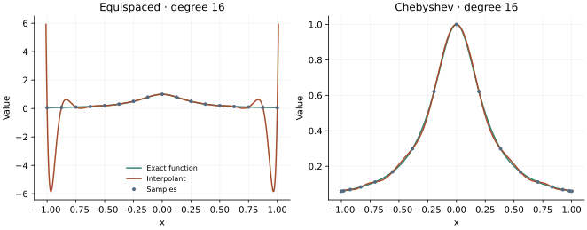

<!-- SPDX-FileCopyrightText: 2026 VTT Technical Research Centre of Finland Ltd -->
<!-- SPDX-License-Identifier: AGPL-3.0-or-later -->

::: {.article-body}
::: {.article-title}
[Polynomial methods / Learn by experiment]{.lesson-kicker}

# Where should the samples go?

[Compare equally spaced and Chebyshev nodes without changing the function or polynomial degree.]{.lesson-deck}
:::

A polynomial can pass through every sample and still be a poor approximation
between them. Program 9 of @trefethen2000 makes that distinction visible with
$f(x)=1/(1+16x^2)$ and degree $N=16$. We use the same experiment, replacing
monomial fitting with barycentric evaluation [@berrut2004].

## Change the nodes, keep the question

An equally spaced grid has $x_j=-1+2j/N$. A Chebyshev grid projects equally
spaced angles onto the interval:

$$
\begin{gathered}
x_j=\cos(j\pi/N), \\
j=0,\ldots,N.
\end{gathered}
$$ {#eq-nodes}

Both grids contain $N+1$ values. Both determine a unique polynomial of degree
at most $N$. The Chebyshev points cluster near the endpoints, where the
uniform-grid interpolant has its largest oscillations.

```{.cpp include="../collocation.hpp" snippet="nodes"}
```

## Evaluate a polynomial without fitting its monomials

For distinct nodes, define $w_j=1/\prod_{k\ne j}(x_j-x_k)$. The barycentric
formula is

$$p(x)=\frac{\sum_j w_jf_j/(x-x_j)}{\sum_j w_j/(x-x_j)}.$$ {#eq-barycentric}

At a node we return the corresponding sample directly; evaluating the
fraction there would divide by zero. Multiplying every weight by the same
nonzero constant leaves the interpolant unchanged. The example uses the
general product formula at these small degrees; specialised Chebyshev
weights and more careful weight construction are preferable at large sizes.

```{.cpp include="../collocation.hpp" snippet="barycentric"}
```

The interpolant is example-owned mathematics. This introductory chapter
supplies the evaluator used by the subsequent OpenPFC solver experiments;
it does not imply that OpenPFC provides a public polynomial-interpolation API.

```{.cpp include="model.cpp" snippet="interpolate" dedent=4}
```

{#fig-interpolation}

## Make the oscillations visible

```sh
openpfc run model.cpp input.json --source-root .. --launcher=none
```

The CSV `results/interpolation.csv` distinguishes `node` and `curve` records.
The curve follows the book's range $[-1.01,1.01]$: the outermost $0.01$ at
each end is extrapolation. Assess interpolation errors on $[-1,1]$ separately.
Change `n` from 16 to 24 and predict which grid will improve. Increasing the
degree on equally spaced points does not guarantee convergence; barycentric
evaluation cannot repair an ill-conditioned approximation problem.

The regression check compares the complete default curve with an independent
Lagrange-basis evaluation and checks every node. Continue with the
nodal polynomial to see the node geometry
in the complex plane.

The complete [C++ model](model.cpp) and [starting input](input.json)
are available with this lesson. It also uses the shared [collocation.hpp](../collocation.hpp);
keep its relative location when saving the files.

## References
::: {#refs}
:::
:::
