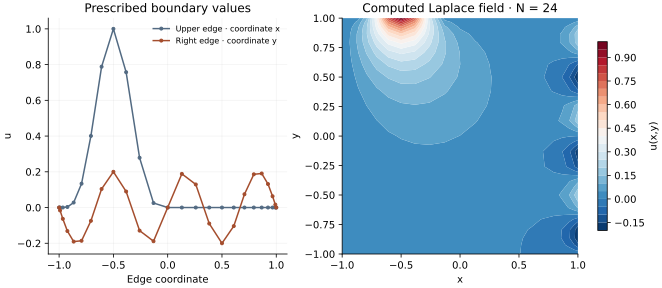

<!-- SPDX-FileCopyrightText: 2026 VTT Technical Research Centre of Finland Ltd -->
<!-- SPDX-License-Identifier: AGPL-3.0-or-later -->

::: {.article-body}
::: {.article-title}
[OpenPFC / Operators and their solutions]{.lesson-kicker}

# Let the boundary drive the interior

[Eliminate prescribed edge values into the right-hand side and solve a homogeneous interior Laplace equation.]{.lesson-deck}
:::

A zero interior forcing need not produce a zero field. Program 36 of
@trefethen2000 solves $\Delta u=0$ on the square with nonzero prescribed
edge data. The upper edge has $\sin^4(\pi x)$ for $x<0$; the right edge
has $.2\sin(3\pi y)$. Other edge values are zero.

```{.cpp include="model.cpp" snippet="source" dedent=4}
```

## Move known endpoint contributions to the other side

For each interior equation, split the tensor sum into unknown interior
values and known edge values. The latter enter the right-hand side with
a minus sign. This gives the same collocation solution as retaining all
nodes and replacing boundary rows by identity equations, as the book does.
The shared solver keeps the known values in the output grid and solves
only for interior unknowns with native GMRES.

This is prescribed-value elimination, not a periodic FFT trick. The
[one-dimensional boundary lesson](../boundary-values/index.qmd) derives
the same distinction for homogeneous and lifted endpoint data.

{#fig-laplace}

## Check a harmonic polynomial with all four edges active

```sh
openpfc run model.cpp input.json --source-root .. --launcher=none
```

Set `manufactured=true` to prescribe $u=x^2-y^2$ on every edge. Its Laplacian
is zero, giving an independent complete-field oracle for the elimination
signs and boundary indexing. The normal input reproduces the book's
piecewise edge functions. Every node appears in `results/solution.csv`.

The checks verify both the exact manufactured field and a low-degree
reference solve with the original edge values. The cutoff of the upper
edge data at x=0 also limits regularity; increasing degree cannot make
those prescribed data smoother. Assess convergence in the interior and
near the boundary separately rather than interpreting a visually smooth
plot as a uniform accuracy certificate.

The complete [C++ model](model.cpp) and [starting input](input.json)
are available with this lesson.
Keep [collocation.hpp](../collocation.hpp) in the theme directory.
This model also uses [tensor.hpp](../tensor.hpp) in that directory.

## References
::: {#refs}
:::
:::
