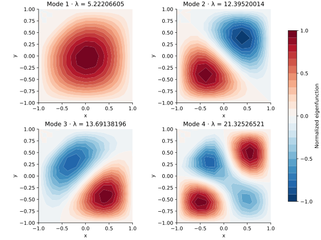

<!-- SPDX-FileCopyrightText: 2026 VTT Technical Research Centre of Finland Ltd -->
<!-- SPDX-License-Identifier: AGPL-3.0-or-later -->

::: {.article-body}
::: {.article-title}
[OpenPFC / Operators and their solutions]{.lesson-kicker}

# An asymmetric potential reshapes a membrane mode

[Build a tensor-product eigenproblem with a steep potential and inspect its four lowest modes.]{.lesson-deck}
:::

A two-dimensional eigenfunction has geometry as well as an eigenvalue.
Program 23 of @trefethen2000 adds a steep nonnegative potential to the
Dirichlet Laplacian on $[-1,1]^2$:

$$-\Delta u+e^{20(y-x-1)}u=\lambda u,\qquad u|_{\partial\Omega}=0.$$

The potential penalizes the region near the upper-left corner. The low
modes should respond to this asymmetry; their contours are more informative
than a table of numbers alone.

## Combine one-dimensional operators in two directions

With x-fastest interior storage, apply $-D^2$ along each row and column,
then add the sampled potential to the diagonal.

```{.cpp include="model.cpp" snippet="membrane" dedent=4}
```

This example assembles the dense tensor matrix because the default degree
16 has only 225 interior unknowns. Its complex QR diagonalization is a
bounded local reference, not a scalable OpenPFC eigenvalue solver. A large
problem would require a suitable iterative eigensolver and operator action.
The continuum operator is self-adjoint, but the raw Chebyshev collocation
matrix is not Euclidean symmetric; we preserve that distinction.

{#fig-membrane}

## Read contours with the right invariances

```sh
openpfc run model.cpp input.json --source-root .. --launcher=none
```

`results/spectrum.csv` records eigenvalues and scaled finite-matrix residuals;
`results/modes.csv` records every point, including zero boundaries. Increase
`n` from 12 to 16 before trusting a mode's details. The steep potential
can make matrix entries much larger than the low eigenvalues, so scaling
matters when interpreting backward residuals.

An eigenvector's sign is arbitrary. For clustered modes, even the basis
inside a nearly degenerate eigenspace can change. Compare eigenvalues and
subspaces rather than demanding one exact contour orientation. Independent
checks reconstruct the operator and compare the low spectrum and residuals;
they also verify all prescribed endpoint values. Continue with a forced
Poisson problem using the same tensor idea.

The complete [C++ model](model.cpp) and [starting input](input.json)
are available with this lesson.
Keep [collocation.hpp](../collocation.hpp) in the theme directory.
This model also uses [eigensystem.hpp](../eigensystem.hpp) in that directory.

## References
::: {#refs}
:::
:::
