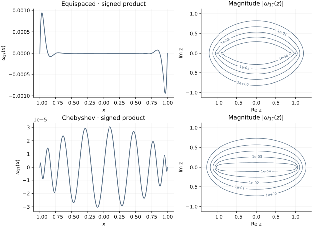

<!-- SPDX-FileCopyrightText: 2026 VTT Technical Research Centre of Finland Ltd -->
<!-- SPDX-License-Identifier: AGPL-3.0-or-later -->

::: {.article-body}
::: {.article-title}
[Polynomial methods / Learn by experiment]{.lesson-kicker}

# The geometry behind an interpolation error

[See how the product of distances to the nodes shapes polynomial approximation on the real and complex planes.]{.lesson-deck}
:::

Why did changing the nodes help the previous interpolant? Program 10 of
@trefethen2000 looks at the polynomial that vanishes at all those nodes:

$$\omega_{N+1}(z)=\prod_{j=0}^{N}(z-x_j).$$ {#eq-product}

This is a monic polynomial of degree $N+1$, not the degree-$N$ interpolant
of the previous chapter. The distinction is useful: one describes the node
geometry, while the other also depends on the sampled values.

## Multiply distances directly

For a real argument we draw the signed product; for a complex argument we
draw its magnitude. C++'s `std::complex<double>` makes the same expression
work for both. Forming monomial coefficients first is unnecessary.

```{.cpp include="model.cpp" snippet="product" dedent=4}
```

This chapter is a mathematical reference implemented with the C++ standard
library and the collection's small example-local node helper. The following
chapters connect these nodes to OpenPFC's FFT and linear solvers.

## Read the error formula carefully

For a sufficiently differentiable real function and a real interpolation
point, the classical remainder has the form

$$f(x)-p_N(x)=\frac{f^{(N+1)}(\xi_x)}{(N+1)!}\omega_{N+1}(x).$$ {#eq-remainder}

A small nodal product helps, but the derivative factor also matters. For
analytic functions, nearby complex singularities influence approximation.
Contours of $|\omega(z)|$ illustrate this geometry; they are not contours
of the actual interpolation error for an arbitrary function.

{#fig-nodal}

## Try another degree

```sh
openpfc run model.cpp input.json --source-root .. --launcher=none
```

`results/nodal.csv` holds the real curves. `results/potential.csv` holds the
complex-plane magnitudes on the book's rectangular grid. Change `n` to 8
or 24 and keep the contour levels fixed before comparing. Auto-scaling each
plot independently can conceal the very difference we want to see.

For Chebyshev extrema nodes there is an independent identity,

$$\omega_{N+1}(z)=2^{1-N}(z^2-1)U_{N-1}(z),$$

where $U_0=1$, $U_1=2z$, and $U_{k+1}=2zU_k-U_{k-1}$. The regression
check uses this recurrence to verify the complex-plane product, including
its scale. This is a numerical identity check, not a proof of the remainder
theorem or a guarantee about every function one might interpolate.

The complete [C++ model](model.cpp) and [starting input](input.json)
are available with this lesson. It also uses the shared [collocation.hpp](../collocation.hpp);
keep its relative location when saving the files.

## References
::: {#refs}
:::
:::
