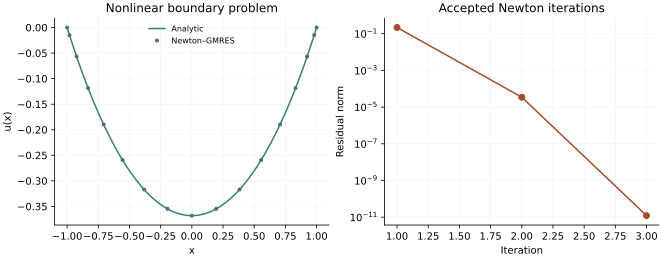

<!-- SPDX-FileCopyrightText: 2026 VTT Technical Research Centre of Finland Ltd -->
<!-- SPDX-License-Identifier: AGPL-3.0-or-later -->

::: {.article-body}
::: {.article-title}
[Polynomial methods / Learn by experiment]{.lesson-kicker}

# Let the field determine its own forcing

[Solve a nonlinear boundary-value problem using OpenPFC Newton–GMRES, then check it with a scalar root and an analytic solution.]{.lesson-deck}
:::

Replace the prescribed forcing by the unknown field itself:

$$
\begin{gathered}
u''=e^u, \\
u(-1)=u(1)=0.
\end{gathered}
$$ {#eq-nonlinear}

Program 14 of @trefethen2000 solves this problem by fixed-point iteration.
We keep its equation, Chebyshev grid and degree 16, and use OpenPFC's
Newton–GMRES solver instead. This is an explicit change of nonlinear
algorithm, with an independent solution available to judge the result.

## State the residual and its derivative

After removing the known endpoints, write $F(u)=D^2u-e^u$. Newton's
correction satisfies

$$
\begin{gathered}
J(u)\,\delta=-F(u), \\
J(u)v=D^2v-e^u v.
\end{gathered}
$$ {#eq-jacobian}

The final product is componentwise. The model provides residual,
linearization, Jacobian action and a diagonal inverse preconditioner.

```{.cpp include="model.cpp" snippet="model"}
```

The trial hooks are empty because evaluating this model has no persistent
trial state. A material model that caches history would need to implement
those hooks so rejected trials cannot alter its accepted state.

## Solve the actual equations

```{.cpp include="model.cpp" snippet="newton" dedent=4}
```

OpenPFC chooses an inexact linear tolerance and uses a line search to admit
a correction. A small change in the iterate is not our convergence test:
the nonlinear residual must satisfy the stated tolerances. The initial
interior field is zero, already consistent with the boundary data.

## Derive a reference without a second collocation solve

Try $u(x)=2\log[\cos(a)/\cos(ax)]$. Then
$u''=2a^2\sec^2(ax)$ and $e^u=\cos^2(a)\sec^2(ax)$, so the positive
parameter satisfies

$$
\begin{gathered}
\cos a=\sqrt2\,a, \\
0<a<1.
\end{gathered}
$$ {#eq-parameter}

OpenPFC's safeguarded scalar root finder supplies $a$. Its function value
and derivative are only a few characters:

```{.cpp include="model.cpp" snippet="exact" dedent=4}
```

The independent regression uses bisection for this scalar equation and
compares every recorded point, so agreement is not inferred from the
Newton residual alone.

{#fig-nonlinear}

## Look at convergence as well as the final curve

```sh
openpfc run model.cpp input.json --source-root .. --launcher=none
```

The attempt writes `results/nonlinear.csv` and `results/newton.csv`. The
second file records accepted residuals, step lengths and inner linear
iterations. Increase `n` to 24 and distinguish improved spatial accuracy
from a tighter nonlinear solve. An indefinitely tighter tolerance can
encounter cancellation in $D^2u$, whose entries grow strongly near the
endpoints. A reported solve failure should remain visible, not be hidden
by silently relaxing the tolerance.

The complete [C++ model](model.cpp) and [starting input](input.json)
are available with this lesson. It also uses the shared [collocation.hpp](../collocation.hpp);
keep its relative location when saving the files.

## References
::: {#refs}
:::
:::
