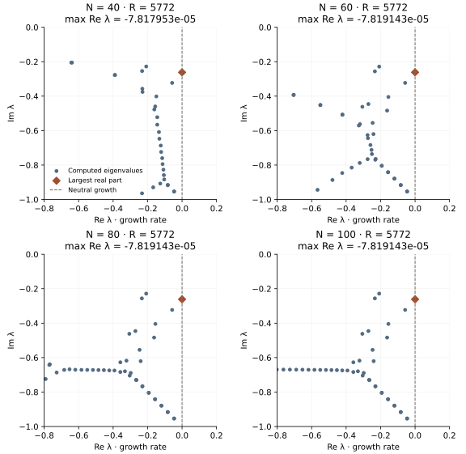

<!-- SPDX-FileCopyrightText: 2026 VTT Technical Research Centre of Finland Ltd -->
<!-- SPDX-License-Identifier: AGPL-3.0-or-later -->

::: {.article-body}
::: {.article-title}
[OpenPFC / Growth rates need a resolution check]{.lesson-kicker}

# A tiny real part decides whether a disturbance grows

[A complex eigenvalue gives a frequency and a growth rate. Near neutral stability, the small part of the answer matters most.]{.lesson-deck}
:::

Program 40 of @trefethen2000 studies a small disturbance to flow between
parallel walls. The base velocity is $U(y)=1-y^2$, with walls at $y=\pm1$.
Scale velocity by the centreline speed and length by the channel half-height;
their product divided by kinematic viscosity is the Reynolds number $R$.

Seek a wall-normal velocity disturbance proportional to
$v(y)e^{\lambda t+ix}$. This fixes the streamwise wave number to one.
The Orr–Sommerfeld equation becomes

$$
\begin{aligned}
\lambda(D^2-1)v
 &=\frac{D^4-2D^2+1}{R}v\\
 &\quad-iU(D^2-1)v-2iv,\\
v(\pm1)&=v'(\pm1)=0,
\end{aligned}
$$ {#eq-orr}

where $D=d/dy$. The real part of $\lambda$ determines exponential growth
or decay. The imaginary part determines the oscillation; with this wave
convention the phase speed is $-\operatorname{Im}\lambda$.

## Reuse the clamped fourth derivative

The [beam](../clamped-beam/index.qmd) and [plate](../clamped-plate/index.qmd)
chapters already built the two required operators from native OpenPFC
Chebyshev differentiation. Reuse the weighted, clamped $D_4$ and the
ordinary interior $D_2$ from the book. The generalized matrix problem is

$$
\begin{gathered}
Av=\lambda Bv, \\
B=D_2-I,
\end{gathered}
$$ {#eq-pencil}

$$
\begin{aligned}
A&=\frac{D_4-2D_2+I}{R}-2iI\\
 &\quad-i\operatorname{diag}(U)B.
\end{aligned}
$$ {#eq-matrices}

Multiplication by $U$ acts on each row of $B$. Moving it to the other
side would change the operator: differentiation and multiplication do
not commute.

```{.cpp include="model.cpp" snippet="operators" dedent=6}
```

## Solve a mass system before the ordinary eigenproblem

For these Dirichlet interior values, $B=D_2-I$ is invertible. Solve the
multiple-right-hand-side system $BC=A$, then find $Cv=\lambda v$:

```{.cpp include="model.cpp" snippet="solve" dedent=6}
```

The example-owned helper uses elimination with partial pivoting for the
real mass matrix and complex right-hand sides. It solves for $C$ directly;
it does not construct a separate inverse of $B$. The existing bounded
complex shifted-QR reference handles the resulting dense eigenproblem.
This is an educational reduction of this invertible pencil, rather than
a public OpenPFC generalized eigensolver. A general pencil can have a
singular $B$ and needs a method such as QZ instead.

The separate qualification compares every eigenvalue at all four original
resolutions with SciPy's generalized eigensolver, using independently
differentiated Lagrange products for the operators. SciPy is a qualification
tool, not a dependency of the C++ model or the ordinary example tests.
That QZ calculation scales each row of both $A$ and $B$ by the same
positive factor, the reciprocal of the largest absolute entry in that
row of $A$. Premultiplication by this invertible diagonal matrix preserves
the generalized eigenvalues and reduces the range of row magnitudes.
At degree 100, the unscaled calculation loses accuracy in the leading
root; equilibration brings it into agreement with the other checks.

## Look at all four resolutions

{#fig-orr .lightbox}

```sh
openpfc run model.cpp input.json --source-root .. --launcher=none
```

The default [input](input.json) uses $R=5772$ and degrees 40, 60, 80 and
100, matching the [original program](https://people.maths.ox.ac.uk/trefethen/p40.m).
`results/spectrum.csv` contains every eigenvalue and both residuals;
`results/vectors.csv` contains every complex nodal eigenvector, including
the zero endpoint values. `results/growth.csv` records the eigenvalue with
the largest real part at each resolution.
The default leading growth rate is approximately $-7.81914\times10^{-5}$
at the three finest degrees. It is negative for this fixed wave number;
the apparent proximity to the neutral line in the plot needs the
numerical resolution comparison, rather than a visual guess.

## Separate three different checks

The transformed residual checks $Cv-\lambda v$. The model also computes
the original-pencil residual

$$
\eta=\frac{\|Av-\lambda Bv\|_2}
{(\|A\|_F+|\lambda|\|B\|_F)\|v\|_2}.
$$ {#eq-residual}

This is a scaled backward-residual check, not an error bound for an
eigenvalue. The operator is nonnormal: its eigenvectors need not be
orthogonal, and small perturbations need not produce proportionally
small eigenvalue changes. Compare resolutions before trusting the sign
of a small growth rate.

The ordinary numerical test independently differentiates Lagrange
products, checks every generalized eigenvector, verifies the full
spectrum's trace and uses generalized inverse iteration to check the
leading mode. It also runs the [higher-Reynolds-number input](unstable.json):

```sh
openpfc run model.cpp unstable.json --source-root .. --launcher=none
```

First predict how reducing viscosity changes the competition between
diffusion and shear. Then compare the leading growth rates at $R=5772$
and $R=10000$, and repeat with another resolution. The fixed wave number
means this experiment does not search the critical Reynolds number over
all possible wavelengths. It is a linear disturbance calculation, not
a nonlinear channel-flow simulation.

This complete-domain reference runs on one process. Keep the [source](model.cpp),
[pencil helper](../pencil.hpp), [clamped helper](../clamped.hpp),
[eigensolver](../eigensystem.hpp) and [collocation helper](../collocation.hpp)
together. Inputs accept one through eight even degrees between 12 and
100 and Reynolds numbers between 100 and one million.

## References
::: {#refs}
:::
:::
