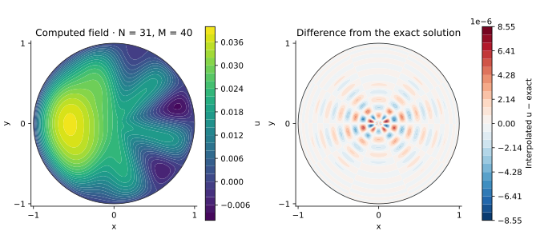

<!-- SPDX-FileCopyrightText: 2026 VTT Technical Research Centre of Finland Ltd -->
<!-- SPDX-License-Identifier: AGPL-3.0-or-later -->

::: {.article-body}
::: {.article-title}
[OpenPFC / Geometry, forcing and convergence]{.lesson-kicker}

# A small residual can leave a visible error

[Solve the collocation equations accurately. Then ask how accurately they represent the continuous problem.]{.lesson-deck}
:::

Program 29 of @trefethen2000 solves $\Delta u=f$ on the unit disk, with
$u=0$ at $r=1$. Its forcing is

$$
\begin{aligned}
f(r,\theta)&=-r^2\sin^4(\theta/2)\\
 &\quad+\sin(6\theta)\cos^2(\theta/2).
\end{aligned}
$$ {#eq-forcing}

Reuse the signed-radius operator from the
[disk-mode chapter](../disk-modes/index.qmd). The book's $N=31$, $M=40$
grid has fifteen positive interior radii and 600 unknowns. Angular Fourier
separation turns the full matrix solve into small radial solves.

## Keep the physical forcing visible

```{.cpp include="model.cpp" snippet="source" dedent=4}
```

The optional manufactured case supplies a smooth Cartesian polynomial.
Begin with the original forcing and transform each radial ring using
OpenPFC's native complete-domain FFT:

```{.cpp include="model.cpp" snippet="transform" dedent=4}
```

The samples are at $\theta_j=2\pi(j+1)/M$, matching the book. The transform
works on array indices; reconstruction therefore uses
$e^{ik(\theta-2\pi/M)}$. Keeping that phase convention preserves the
physical orientation of the field.

## Solve each real radial system with native GMRES

```{.cpp include="model.cpp" snippet="solve" dedent=4}
```

The radial operator is real. Its real and imaginary right-hand sides use
the same row-scaled native GMRES solve. The forward FFT is unscaled and
the backward FFT divides by $M$, so retaining those coefficients through
the radial solves gives the correct physical amplitude. Every represented
angular mode is retained; there is no smoothing or deliberate filtering.

The model then checks the original polar equations through the full
radial/half-turn action and a native angular second derivative.
A small residual establishes that these discrete equations were solved.
An exact solution lets us ask a different question about the approximation.

{#fig-poisson .lightbox}

The picture interpolates the computed modal coefficients onto a display
grid. Its smooth appearance adds no PDE unknowns; the error panel compares
that interpolated field with the exact solution at the display points.

## Derive an exact reference by separating the forcing

For a sine or cosine angular factor of order $k$,

$$
\Delta\bigl(r^p e^{ik\theta}\bigr)
=(p^2-k^2)r^{p-2}e^{ik\theta}.
$$ {#eq-power}

A term $c r^q$ in the forcing therefore has the zero-boundary particular
solution

$$
u_k(r)=c\,\frac{r^{q+2}-r^k}{(q+2)^2-k^2},
$$ {#eq-particular}

provided the denominator is nonzero. The subtracted $r^k$ is harmonic.
Expanding the original forcing gives six terms:

| Angular factor | Forcing amplitude | Solution amplitude |
|:--|:--|:--|
| $1$ | $-3r^2/8$ | $3(1-r^4)/128$ |
| $\cos\theta$ | $r^2/2$ | $(r^4-r)/30$ |
| $\cos2\theta$ | $-r^2/8$ | $(r^2-r^4)/96$ |
| $\sin6\theta$ | $1/2$ | $(r^6-r^2)/64$ |
| $\sin5\theta$ | $1/4$ | $(r^5-r^2)/84$ |
| $\sin7\theta$ | $1/4$ | $(r^7-r^2)/180$ |

Multiplying and summing the last column gives a continuous zero-boundary
solution, with centre value $3/128$. The numerical check reconstructs it
from the general power formula rather than copying the model's closed
expression.

## The forcing is not smooth at the centre

The term $\sin(6\theta)\cos^2(\theta/2)$ has different limits along
different rays as $r\to0$. There is no unique forcing value at that point.
The collocation grid omits the pole; the display evaluates the regular
axisymmetric limit of the solution there.

In particular, odd angular modes in this solution contain positive-radius
$r^2$ terms. Their signed odd extensions behave as $r|r|$ near zero and
are not analytic. These terms limit radial polynomial convergence.
Other terms are exactly representable radial polynomials, so the regularity
question concerns the representation as well as Cartesian smoothness.

At the default grid the largest nodal solution error is about
$6.9\times10^{-7}$ while the largest equation residual is about
$5.9\times10^{-13}$. The [radial refinement input](refine-radius.json)
raises $N$ to 63 at the same $M=40$ and reduces the nodal error to about
$1.3\times10^{-7}$. These are errors against the exact continuous solution;
a tiny discrete residual alone cannot show them.
The interpolated display reaches a larger error, about
$8.6\times10^{-6}$, between the two innermost collocation rings at
$r\approx0.094$.
The error panel therefore reveals reconstruction behaviour between the
solved nodes as well as the error at those nodes. With $N=63$, the same
display grid has a largest error of about $2.0\times10^{-6}$.

## Manufacture a smooth answer before changing the model

The [manufactured input](manufactured.json) uses

$$
\begin{aligned}
u&=(1-x^2-y^2)\\
 &\quad\times\bigl[1+x+\tfrac14(x^2-y^2)\bigr],\\
f&=-4-8x-3(x^2-y^2).
\end{aligned}
$$ {#eq-manufactured}

The field is a degree-four Cartesian polynomial with zero boundary values.
The degree-15 radial, 16-angle case reproduces it near roundoff; this
isolates the operator and normalization checks from the book forcing's
radial approximation error.

```sh
openpfc run model.cpp input.json --source-root .. --launcher=none
openpfc run model.cpp manufactured.json --source-root .. --launcher=none
openpfc run model.cpp refine-radius.json --source-root .. --launcher=none
```

Each preserved attempt writes `results/solution.csv` with the full nodal
field, dense display samples and exact reference, plus
`results/diagnostics.csv` with the equation residual and nodal error.
Try refining the angular count alone: once these seven Fourier modes are
resolved, that change cannot remove the radial error. Then replace the
forcing by a smooth Cartesian harmonic and derive its particular solution.

This complete-domain reference runs on one process. Keep the [model](model.cpp),
[input](input.json), [polar helper](../disk.hpp) and
[collocation helper](../collocation.hpp) together. Use odd $N$ from 7
through 63 and even $M$ from 8 through 64; the book forcing requires
$M\ge16$ to resolve its angular content.

## References
::: {#refs}
:::
:::
