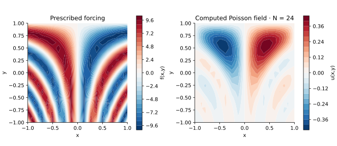

<!-- SPDX-FileCopyrightText: 2026 VTT Technical Research Centre of Finland Ltd -->
<!-- SPDX-License-Identifier: AGPL-3.0-or-later -->

::: {.article-body}
::: {.article-title}
[OpenPFC / Operators and their solutions]{.lesson-kicker}

# Solve a square without a giant Kronecker matrix

[Apply a Chebyshev tensor Laplacian through native GMRES, then check an exactly representable manufactured solution.]{.lesson-deck}
:::

Program 16 of @trefethen2000 solves

$$
\begin{gathered}
\Delta u=10\sin[8x(y-1)], \\
(x,y)\in[-1,1]^2, \\
u|_{\partial\Omega}=0.
\end{gathered}
$$

The textbook writes a Kronecker-sum matrix. We use the same degree-24
Chebyshev collocation equations and evaluate the tensor action directly
inside OpenPFC GMRES. The physical model stays visible in its own file:

```{.cpp include="model.cpp" snippet="source" dedent=4}
```

## Apply each direction separately

For interior values $U_{ij}$,

$$(\Delta_hU)_{ij}=\sum_k(D^2)_{ik}U_{kj}+\sum_k(D^2)_{jk}U_{ik}.$$

```{.cpp include="../tensor.hpp" snippet="tensor" dedent=2}
```

The action uses $O(N^3)$ arithmetic and $O(N^2)$ field storage. It avoids
forming the full $O(N^4)$ tensor matrix. Full-restart GMRES still stores
its Krylov basis, so this small reference does not claim a memory-optimal
large-scale solver. The reference Chebyshev matrix is example-owned;
GMRES and its true-residual admission are native OpenPFC capabilities.

{#fig-poisson}

## Manufacture a solution before changing the forcing

Set `manufactured=true` to use
$u=(1-x^2)(1-y^2)$ and $f=-4+2x^2+2y^2$. Both boundary values vanish and the
polynomial is exactly representable for degree at least two in each axis.
Any remaining error comes from arithmetic and the linear solve, not an
unresolved manufactured function.

```sh
openpfc run model.cpp input.json --source-root .. --launcher=none
```

The attempt writes all nodes and values to `results/solution.csv` and prints
the unpreconditioned equation residual. The checks verify the manufactured
field, compare the original low-degree forcing problem with an independent
Lagrange/dense solve, and separately inspect the book's default resolution.
A converged linear solver solves its discrete equations; the choice of
resolution still controls how well they represent the PDE.

The complete [C++ model](model.cpp) and [starting input](input.json)
are available with this lesson.
Keep [collocation.hpp](../collocation.hpp) in the theme directory.
This model also uses [tensor.hpp](../tensor.hpp) in that directory.

## References
::: {#refs}
:::
:::
