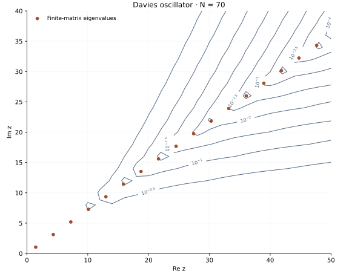

<!-- SPDX-FileCopyrightText: 2026 VTT Technical Research Centre of Finland Ltd -->
<!-- SPDX-License-Identifier: AGPL-3.0-or-later -->

::: {.article-body}
::: {.article-title}
[OpenPFC / How stable is a spectrum?]{.lesson-kicker}

# Eigenvalue dots do not tell the whole story

[An eigenvalue is one point. A small perturbation can make a whole region relevant.]{.lesson-deck}
:::

The [real harmonic oscillator](../../fourier/harmonic-oscillator/index.qmd)
has a familiar spectrum. Program 24 of @trefethen2000 changes the potential
to a complex one on the interval $(-6,6)$:

$$
\begin{aligned}
Au&=-u''+(1+3i)x^2u,\\
u(-6)&=u(6)=0.
\end{aligned}
$$ {#eq-davies}

The resulting matrix is nonnormal. Its eigenvalues alone do not describe
how it responds to perturbations. This chapter reproduces the book's
degree-70 grid, all 69 finite-matrix eigenvalues, and the 546 points of
its complex-plane sampling grid.

## Build the operator with native derivatives

Map the Lobatto coordinate $\xi\in[-1,1]$ to $x=L\xi$, with $L=6$.
The second derivative acquires a factor $1/L^2$. Apply native OpenPFC
Chebyshev differentiation twice to each interior nodal basis function:

```{.cpp include="model.cpp" snippet="oscillator" dedent=4}
```

The first derivative includes both endpoint values before taking the
second derivative. Restrict the resulting second derivative to interior
equations afterwards. Squaring an already restricted first derivative
would produce a different operator.

The eigenvalues are those of this finite interval and collocation matrix.
The infinite-line values $(2j+1)\sqrt{1+3i}$ provide a check for the first
few modes, rather than an exact reference for every high discrete mode.

## Ask how close a shifted matrix is to singular

At an eigenvalue, $zI-A$ is singular. Away from the eigenvalues, the
smallest singular value measures the smallest matrix perturbation that
would make it singular:

$$
\begin{aligned}
\Lambda_\varepsilon(A)
&=\{z:\sigma_{\min}(zI-A)\le\varepsilon\}\\
&=\bigcup_{\|E\|_2\le\varepsilon}\operatorname{spec}(A+E).
\end{aligned}
$$ {#eq-pseudospectrum}

For an invertible shift, this is also the reciprocal of the resolvent
norm: $\|(zI-A)^{-1}\|_2=1/\sigma_{\min}(zI-A)$.
The experiment uses the ordinary Euclidean norm of the nodal vectors,
as in the book. A weighted energy norm or a different basis would define
a different perturbation question.

```{.cpp include="model.cpp" snippet="pseudospectrum" dedent=4}
```

## Keep the small singular values

The example-owned reference uses one-sided complex Jacobi rotations.
For each pair of columns, compute their norms and inner product, then
apply a unitary rotation that reduces their overlap. Once all pairs are
orthogonal to floating-point tolerance, the column norms are the singular
values. The source helper also scales the input and imposes an iteration
limit.

```{.cpp include="../singular_values.hpp" snippet="jacobi" dedent=2}
```

Forming $(zI-A)^*(zI-A)$ would square the condition number. Its smallest
eigenvalue can lose the very information the plot is meant to show.
The column-rotation calculation works on the shifted matrix itself.
For the relative-accuracy analysis of one-sided Jacobi, see
@demmel1992jacobi.
It remains a bounded educational implementation, with input roundoff
and convergence limits; it is not a rank certificate or a new public
OpenPFC SVD API.

{#fig-pseudo .lightbox}

Contour lines interpolate the samples. A small region around an
eigenvalue can fall between sample points and remain undrawn; refining
`step` tests this drawing resolution.

## Reproduce the picture, then change the question

```sh
openpfc run model.cpp input.json --source-root .. --launcher=none
```

The [default input](input.json) uses $N=70$, $L=6$ and increments of two
on $\operatorname{Re}z=0,2,\ldots,50$ and
$\operatorname{Im}z=0,2,\ldots,40$, matching the
[original program](https://people.maths.ox.ac.uk/trefethen/p24.m).
`results/spectrum.csv` stores all eigenvalues and their residuals;
`results/pseudospectrum.csv` stores every sampled singular value.

Reduce `step` to 1 and then 0.5 to refine the contour drawing. That adds
shifted singular-value calculations; it does not improve the spatial
operator. Change `n` separately to test collocation resolution, and
change `length` separately to test the finite-interval truncation.
Predict which change should move eigenvalue dots and which should only
make a contour smoother. The denser plane sampling is substantially slower.

The ordinary numerical checks compare complete coarse complex-plane grids
at degrees 12 and 70 with inverse iteration through independently assembled
shifted solves. The even and odd reflection sectors separate nearly equal
singular-value pairs before that inverse iteration. This avoids both the
C++ Jacobi algorithm and explicit
normal equations. The native helper checks include complex triangular
matrices with singular values as small as $10^{-12}$.
Separate qualification compares every value of the original 546-point
degree-70 plot with SciPy's SVD. SciPy is not a runtime or routine-test
dependency.

This complete-domain reference runs on one process and accepts degrees
6 through 80, half-lengths 2 through 12, and complex-plane increments
0.5 through 10. Keep the [source](model.cpp),
[singular-value helper](../singular_values.hpp),
[eigensolver](../eigensystem.hpp) and [collocation helper](../collocation.hpp)
together. Continue to the [Orr–Sommerfeld example](../orr-sommerfeld/index.qmd)
to see why sensitivity and resolution matter for a small growth rate.

## References
::: {#refs}
:::
:::
