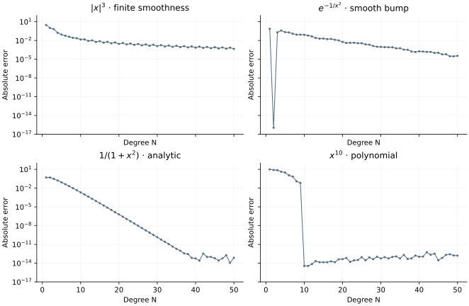

<!-- SPDX-FileCopyrightText: 2026 VTT Technical Research Centre of Finland Ltd -->
<!-- SPDX-License-Identifier: AGPL-3.0-or-later -->

::: {.article-body}
::: {.article-title}
[Polynomial methods / Learn by experiment]{.lesson-kicker}

# Smoothness still controls convergence

[Repeat the four regularity experiments on a nonperiodic Chebyshev grid and see when a polynomial becomes exact.]{.lesson-deck}
:::

The Fourier [smoothness experiment](../../differentiation/smoothness/index.qmd)
showed four convergence patterns. Program 12 of @trefethen2000 asks the
same question on a finite interval, using polynomials instead of periodic
trigonometric interpolants. We repeat all four functions and every degree
from 1 to 50.

## Four functions with four different promises

| Function | Exact derivative | What to investigate |
|---|---|---|
| $|x|^3$ | $3x|x|$ | Limited smoothness produces algebraic convergence. |
| $e^{-1/x^2}$, defined as zero at $x=0$ | $2e^{-1/x^2}/x^3$, also zero at 0 | Infinitely smooth does not mean analytic. |
| $1/(1+x^2)$ | $-2x/(1+x^2)^2$ | Complex singularities at $x=\pm i$ limit geometric convergence. |
| $x^{10}$ | $10x^9$ | Degree 10 can represent the function exactly in exact arithmetic. |

At each degree we differentiate the unique polynomial through the samples,
then measure the largest error at the nodes:

$$E_N=\max_{0\le j\le N}|(Df)_j-f'(x_j)|.$$ {#eq-nodal-error}

```{.cpp include="model.cpp" snippet="convergence" dedent=4}
```

This chapter uses the example-local Chebyshev matrix derived in the
[differentiation lesson](../differentiation/index.qmd). Its matrix and profile
formulas are mathematical reference code; the native OpenPFC FFT comparison
is developed there. No public Chebyshev-gradient API is assumed.

{#fig-regularity}

## Look for the mechanism

```sh
openpfc run model.cpp input.json --source-root .. --launcher=none
```

Set `n` to the maximum degree. `results/regularity.csv` has one record per
degree and profile; profile numbers follow the table from 0 to 3. The bump
and its derivative are assigned their limiting value at zero, avoiding an
undefined floating-point expression. Tiny underflowed tails are also zero.

Inspect consecutive odd and even degrees. The two node sets sample the
centre differently, so the curves need not decrease monotonically. For
the bump, degree 2 has an especially misleading success: its interpolant
is $x^2/e$, whose derivative happens to match the bump at all three nodes.
The bump is not a quadratic between those nodes. This explains the isolated
low-degree dip without claiming that three samples resolve the function.
For
$x^{10}$, verify the sharp improvement at degree 10. An increasing tail at
large degree can reflect cancellation and differentiation's amplification
of rounding errors, rather than a loss of smoothness.

The regression checks compare selected matrix actions with an independently
constructed Lagrange polynomial derivative and test degree-10 exactness.
The plotted error is measured at nodes; it does not directly certify a
continuous maximum over the entire interval. Next, turn differentiation
around and [calculate an integral](../integration/index.qmd).
The log plot places zero errors at its $10^{-17}$ display floor; the CSV
retains the computed values.

The complete [C++ model](model.cpp) and [starting input](input.json)
are available with this lesson. It also uses the shared [collocation.hpp](../collocation.hpp);
keep its relative location when saving the files.

## References
::: {#refs}
:::
:::
